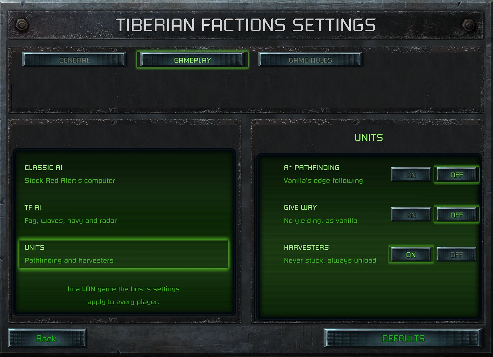

> [!NOTE]
> EA has not endorsed and does not support this product.

# Pathfinding

**Holds for:** C&C Remastered Collection, Steam build 21590013. EA has stopped patching the game and archived the
source in January 2025, so this should hold.

## When you need this

When units in your mod take silly routes, jam in narrow gaps, or try the same failing route forever. Or when your
mod changes maps or movement enough that the stock pathfinder's limits show. A mod that leaves movement alone still
inherits every stock behaviour below.

## The stock pathfinder: edge following, no A*

Red Alert has **no A\*** search. EA's `FootClass::Find_Path` (`FINDPATH.CPP`) heads straight for the destination,
and when it hits something impassable it **follows the obstacle's edge**, clockwise and counter-clockwise, then keeps
the shorter of the two (`Follow_Edge`, `MAX_PATH_EDGE_FOLLOW` 400 steps). It then removes loops and shortens the
result (`Unravel_Loop`, `Optimize_Moves`), in a move list of at most `MAX_MLIST_SIZE` (300) steps. Modders often
call it "crash and turn".

It's cheap, and fine in open country. Its failures are the familiar ones:

- **Detours round the wrong side.** It doesn't search; it walks the edge it hit. A unit can wander the long way
  round a lake or a ridge.
- **It nearly always returns *some* path.** When there's no real route, the edge-follower still produces one that
  heads toward the wall. So code waiting for a "no path" result rarely sees one: the unit just never arrives.

## Movement zones, and what they ignore

Reachability checks use **zones**: a flood fill that numbers each connected region of the map, once per movement
type (`MZONE_NORMAL`, `MZONE_CRUSHER`, `MZONE_DESTROYER`, `MZONE_WATER`; `MapClass::Zone_Span`). Two cells in different
zones can't reach each other.

- **Zones ignore buildings, by design.** The fill tests each cell with `Is_Clear_To_Move` with vehicles ignored, and
  that clears the occupancy bit for vehicles *and* buildings (`CELL.CPP`: "Drop the vehicle/building bit"). So a
  spot walled in by buildings still counts as reachable.
- **Building placement never rebuilds zones.** `Zone_Reset` is called for walls being built or destroyed, bridges,
  terrain such as trees, and scenario load, but never for buildings.

That gap is behind several of the stuck-unit bugs on this page and on [Harvesters](harvesters.md).

## Vehicles jam head-on

`UnitClass::Can_Enter_Cell` (`UNIT.CPP`) treats an allied vehicle facing exactly the opposite way, within about
1.25 cells (`0x1FF` leptons), as `MOVE_NO`: the one blocked state a unit never escalates past. So two columns of
vehicles meeting in a one-cell-wide gap jam nose to nose for good. Infantry have no such rule, and several share a
cell, so they slip past.

## Units that never give up

When a unit's path fails, it retries. Infantry abort their destination only if it's in a **different zone**
(`INFANTRY.CPP`'s give-up branch: "Only perform the abort of the target is in a different zone"). A destination
walled in by buildings is in the same zone, and so is the unit's own cell, so the unit asks for the same failing
path forever. Vehicles have a similar loop.

## What one mod ships

Each of these is a DLL change, and each can be switched off for EA's stock behaviour (see
[A player settings page](../structuring/player-settings-page.md)).

### A* first, the edge-follower as fallback

`Find_Path` tries an **A\*** search first, and runs EA's edge-follower only when A\* finds no route. The A\* comes from
**cfehunter's CFE Patch**, as carried in CFE Patch Redux. It retries with weaker threat-avoidance in stages before it
gives up. As DontCryJustDie pointed out, that A\* wasn't written with performance in mind, and most mods that use it
take it as it is. CFE also uses the search to keep infantry out of Tiberium: see
[Porting CFE Patch Redux](../engine/cfe-patch-ports.md). Three changes made it affordable:

- **A budget.** A search stops after `ASTAR_MAX_EXPANSIONS` (4096) nodes. Without it, a search for an unreachable
  destination floods the whole connected area, up to about 16,000 cells, and a capped miss falls to the
  edge-follower. Raise the cap if you need to, but don't remove it.
- **A binary heap** for the open list. CFE's version inserts each node into a sorted vector (`std::lower_bound`),
  which costs more the longer the list grows.
- **A fixed per-cell table** for visited cells, marked per search. CFE's version builds a hash map
  (`std::unordered_map`) for every search.

On maps past 128 × 128, long orders need coarse routing over map sectors as well: see
[Bigger maps](../maps-and-lobby/bigger-maps.md).

### Give-way and corridor claims at chokepoints

Three layers stop vehicle columns jamming in one-cell gaps. All three are vehicles only, and deterministic, so LAN
games stay in step:

- **Give way.** Before entering a narrow corridor on its *actual* path (not the straight line to its goal), a vehicle
  checks for an allied vehicle coming the other way. If one is already inside, it holds on open ground, or backs out
  to a free cell if it's caught inside. If both are still approaching, the lower object ID stands down. A distance
  tiebreak flapped every tick as the columns jostled.
- **Corridor claims.** The first column to commit, from 18 cells out, stamps the corridor's cells with its direction,
  and the opposing column reads the claim and holds. A claim expires 75 frames after its last stamp, and a unit
  re-stamps only when it enters a new cell, so a stalled unit's claim ages out. Re-stamping every tick kept one stuck
  unit's claim alive forever, and spread into gridlock across the map.
- **Deadlock breaker.** After 8 blocked cycles, a unit shoves an idle friendly infantryman out of its way, or
  scatters itself to a free neighbouring cell, and tries again. It counts only blocks by allied units, never bare
  terrain, or units would jiggle against cliffs.

When A\* fails and a fresh claim lies on the line to the destination, the search returns no path, so the unit waits
its turn instead of taking the edge-follower's long detour.

### Giving up on a hopeless path

A unit that keeps failing to path **from the same cell** gives up: infantry after 8 seconds, vehicles after a minute.
Any movement or successful path starts the count again, so a queue that advances a cell at a time never trips it.

- **Key it on the source cell, not the destination.** A stuck AI unit's destination keeps changing as it re-picks
  among unreachable targets, so a count keyed on source *and* destination never builds up.
- **Abort from the caller, never from inside the pathfinder.** `Assign_Destination` is virtual (`FOOT.H`, `UNIT.H`,
  `DRIVE.H`), and the overrides run radio protocols and reassign missions. Called from inside `Basic_Path`, it can tear
  down a harvester's dock contact while the movement code is still running. In a working mod, that crashed the game
  on two machines within minutes.
- **Guard recursion in give-way.** A retreat that assigns a new destination can start a nested move, which retreats
  again. Unguarded, that recursed about 1,500 frames deep and overflowed the stack.

## How it was verified

- **The stock pathfinder:** EA's `FINDPATH.CPP` (`Find_Path`, `Follow_Edge`, `Unravel_Loop`, `Optimize_Moves`,
  `MAX_MLIST_SIZE`, `MAX_PATH_EDGE_FOLLOW`), with no A\* anywhere in EA's source (searched with `grep -a`).
- **Zones:** EA's `MZoneType` (`DEFINES.H`), `Zone_Span` (`MAP.CPP`), `Is_Clear_To_Move` (`CELL.CPP`) and every
  `Zone_Reset` caller.
- **The head-on rule and the give-up gate:** EA's `UNIT.CPP` (`face == techface && Distance <= 0x1FF`, `MOVE_NO`)
  and `INFANTRY.CPP` (the zone-mismatch abort). No such rule in `INFANTRY.CPP`'s own `Can_Enter_Cell`.
- **The fixes:** a working mod's design notes and code (`Find_Path_AStar` marked as a CFE Patch Redux port, the
  budget, `Give_Way_Decision`, the corridor claims, `Try_Deadlock_Scatter`, the no-progress detector), each checked
  in play: a 1-wide pinch on a snow map for the claims, and a live match for the livelock. None of them exists in
  EA's source.
- **The A\* source:** CFE Patch Redux's README lists A\* pathing among its features, and credits the original CFE
  Patch to cfehunter. Its source shows the sorted-vector open list and the per-search hash map.

**Credit:** the A\* search is cfehunter's, from the CFE Patch, carried in CFE Patch Redux (ChthonVII and others).
DontCryJustDie pointed out its cost.

> [!TIP]
> **In Tiberian Factions**
>
> TF runs A\*, give-way and its harvester changes as three switches on its settings page, all on by default. Turned
> off, units path with EA's stock edge-follower exactly. The chokepoint layers came from two columns of tanks jamming
> for good in a one-cell gap on a snow map.
>
> 
>
> TF's UNITS switches: A* pathfinding, give-way and the harvester fixes, each with an off state that is stock Red Alert's.
