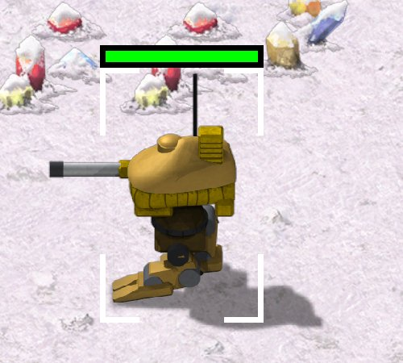

> [!NOTE]
> EA has not endorsed and does not support this product.

# How the launcher draws sprites

**Holds for:** C&C Remastered Collection, Steam build 21590013. EA has stopped patching the game and archived the
source in January 2025, so this should hold.

**HD mode only.** This page describes the HD renderer. See [HD-only mods](../getting-started/hd-only-mods.md).

## When you need this

Before you ship any new HD art for a unit, building, effect or beam. Each rule here cost at least one build that
drew wrong, and most of them fail silently. Art copied straight from EA's own ZIPs already follows them.

## The frame and its `.meta`

An HD frame is a TGA in a ZIP, with a `.meta` beside it. EA's Medium Tank, frame 0:

```json
{"size":[192,192],"crop":[59,57,134,152]}
```

`size` is a virtual canvas. `crop` is the box on that canvas, left, top, right and bottom, where the TGA sits, so
the TGA is exactly 75 × 95 pixels. The launcher places the **centre of the canvas** at the object's draw position.
The crop only says where on the canvas the pixels go.

**So compose every frame with its visual centre at the canvas centre.** Art placed low on the canvas draws low on
the map. Shots then hit the real, undrawn spot, and the selection box floats above the art. Fix it by placing the
art, not by changing the crop. EA's own HD vehicles centre their hulls on the canvas to within about 1.5 classic
pixels, with turrets and barrels sticking up past the centre.

**The ground line.** Because the canvas centre is the anchor, how far the art's lowest opaque pixels sit below the
canvas centre is the object's ground line. Measure it in full canvas space (add the `.meta` crop's offset) and
divide by the canvas's scale to get classic pixels. Two stances of one object, or a unit and the building it
deploys into, must share a ground line, or the sprite hops north or south when one replaces the other.

Selection boxes follow the same logic: the launcher centres a unit's box on the unit and a building's on its plot,
and takes only the size from the DLL. See [Building selection boxes](building-selection-boxes.md).

## Height is a shift north

The DLL draws an object off the ground by moving it up the screen. EA's draw code subtracts the object's height from
its screen y (`y -= Lepton_To_Pixel(Height)` in `AircraftClass::Draw_It`, `BulletClass::Draw_It` and
`TechnoClass`), and the position the DLL exports is that shifted point. Screen-up is map-north, so a raised object
draws exactly where an object on the ground that far north would.

- **Anything drawn at a raised object goes north by its height.** EA's bullet code marks the cells a flying shot
  covers at `Coord_Move(Coord, DIR_N, Height)`; put a trail puff or a flash at the same point.
- **Height and north-south movement look the same on screen.** A fall reads as a slanting fall only when the
  object also moves east or west. One moving north while it drops can hang still on screen.

## Rules

| Rule | What goes wrong otherwise |
|---|---|
| **Second draws use shape numbers 0 to 127 only.** A turret, radar dish or overlay is a second draw on the same object, and shapes from 128 up draw nothing. | The turret silently vanishes. A body drawn in the first draw can use shapes up to 255. |
| **Sprites can't be rotated.** In play, an export with `CNCObjectStruct::Rotation` set drew flat: as an effect, as a unit-typed export, and either one drawn fading. | Anything that must follow an angle can't be one sprite. Build it from round pieces laid along the line, or use the beam line below. |
| **Pixels below about half alpha are discarded.** | A soft, low-alpha shadow or glow draws as nothing. |
| **Every animation stage needs a tile.** Declare as many tiles as the animation has stages. | A stage with no tile draws as a white box. |
| **An effect with HD art only still needs `ImageData`.** An animation with no classic image gets a null `ImageData`. | It draws as a green placeholder. Give it another animation's `ImageData` (a donor), and its HD tile is then found by name. |
| **Write straight (unpremultiplied) alpha.** | Colour pasted through a mask onto a transparent canvas comes out darkened, and the launcher draws it darkened. |
| **A free animation is always its own object.** The export walks every map layer and starts a new root object for each one (`CurrentDrawCount = 0` before each `Draw_It`, EA's `DLLInterface.cpp`). | An animation placed on a unit never becomes part of that unit's draw, however close it sits. |
| **A draw scale scales each draw about its own anchor.** The `scale` argument of `Techno_Draw_Object` (`0x0100` is 1:1, `TECHNO.H`) reaches the launcher as `CNCObjectStruct::Scale`, and the launcher honours it: EA draws its atom blast animation at `0x300`. | A scaled unit's turret, a separate draw, slides off its hull, and its selection box and health bar keep the classic shape's size. Size a unit with its classic shape instead (see [HD tilesets and ZIPs](hd-tilesets-and-zips.md#size-comes-from-the-classic-shape)). |
| **A delayed animation is drawn while it waits.** `AnimClass`'s `timedelay` holds back `Start()` until the delay runs out, but the check that would keep it off screen meanwhile (`if (Delay) return(false);` in `AnimClass::Render`) is compiled out (`#ifdef VIC`). | It shows, unstarted, for the whole delay. Leave the delay at 0 for art that must not show early. |

## Shadows are baked in

The game draws a separate shadow only for things in the air: a bullet with `Height > 0` whose type has `Shadow`
set (`BULLET.CPP`), and aircraft in flight. On the ground, a shadow is part of the object's own art. A classic
shape carries shadow pixels, which `TechnoClass::Techno_Draw_Object` darkens through a shadow table (`TECHNO.CPP`,
which switches to the air table when `Height > 0`). An HD frame carries its shadow baked in. Every ground shadow is part of the
sprite, EA's included. EA's Medium Tank frame above carries its shadow as pure black at alpha 191.

So bake the shadow into each frame as an offset copy of the object's silhouette, pure black at around alpha 191,
under the sprite. Keep it above the alpha cutoff after any resize. A shadow anchored to the bottom of a diagonal
hull's bounding box collapses into a detached blob at the diagonal facings. An offset of the whole silhouette hugs
the hull at every facing.

## Worked example: a beam the launcher can't draw

Tiberian Sun's Disruptor fires a sonic wave: a shimmering band from the tank to its target. TS draws it by
displacing screen pixels along the line (OpenTS's `wave.cpp`), and ships no art for it. The Remastered launcher has
no per-pixel effect a mod can use for that, so the band has to be built from sprites. It took one mod weeks of
builds, and it's a good map of the limits above:

| Tried | Result |
|---|---|
| One long band sprite, rotated to the target | Rotation is ignored (above), so the band only lined up at one angle. |
| A thin bar, rotated | Drew unrotated in play. |
| A chain of round discs along the line | **Works.** Round pieces don't need rotating. Discs 32 leptons apart read as a band; at 64 they showed as beads. |
| The discs owned by the firing player | The launcher tints an owned effect in its house colour, which turned the band gold. The discs carry no owner. |
| `Cloak` on the discs, for a shimmer | Ignored, on an effect and on discs exported as units alike. |
| `SHAPE_PREDATOR` (the stealth shimmer) | Draws nothing, and warps nothing. |
| `FlashingFlags` | A strobe, not a shimmer. |
| A lit window sliding down the band, like TS's pulse | Works as a mechanism, but TS's pulse is smaller than one disc, so it can't read like TS. |
| TS's brightness ladder as a pale overlay | TS multiplies the colours beneath. An overlay can only add, so it never looks the same. |
| The chronal vortex | The only true screen warp the launcher offers. It ignores the exported width and height and always draws Red Alert's whole chronosphere whirlpool. |
| `SHAPE_FADING` plus a small, repeating change of scale (12%, every 6 stages) | **Shipped.** The only motion that read like TS's shimmer. |

Two things this shows for any effect along a line:

- **A chain of overlapping sprites can't give a hard edge, or keep a texture.** Discs overlapping several deep fade
  out at the band's edge whatever the disc's own edge does, and they smear any mottling in the art. If you need a
  hard edge, the beam line (below) is the only primitive that follows an angle.
- **Make the effect the weapon.** Once the band was a chain of discs, its damage could ride the discs too: each
  cell's disc damages what stands in it, so the band hurts what it visibly crosses.

## Beams

A beam weapon such as the Obelisk's is drawn by the launcher as lines, not as a sprite. Each object exports at most
3 lines (`MAX_OBJECT_LINES` in `DLLInterface.h`), and each line has an animation `Frame`. `MAX_OBJECT_LINES` sizes
an array inside `CNCObjectStruct`, the packed struct the launcher reads, so a mod can't raise it.

**Only Tiberian Dawn's DLL exports lines.** In EA's TD source, `CC_Draw_Line` hands each line to
`DLL_Draw_Line_Intercept`, which adds it to the object being drawn, with `TechnoClass::LineFrame` as its frame, and
drops any past the third. EA's Red Alert DLL has none of this: it sets `NumLines` to 0 and never adds one, and Red
Alert's `TechnoClass` has no `LineFrame`. A Red Alert mod that wants a beam ports TD's `CC_Draw_Line`, the
intercept and the two `LineFrame` / `LineMaxFrames` fields.

**Use frames 0 to 4 only.** From frame 5 up, the launcher draws a giant square at each end of the line, in the
line's colour. TD's Obelisk never hits this: its `LineMaxFrames` is 5. Lines can go at any angle, unlike sprites.

## How it was verified

- **The `.meta` format and the baked shadow:** read from the base game's own `MTNK.ZIP`.
- **Shadows only in the air, and three lines per object:** EA's released source (`BULLET.CPP`, `TECHNO.CPP`,
  `DLLInterface.h`). The Obelisk's 5 line frames are
  in EA's TD source.
- **Lines in each game:** EA's TD `CONQUER.CPP` (`CC_Draw_Line`), `TECHNO.CPP` (`LineFrame`, `LineMaxFrames`) and
  TD's `DLLInterface.cpp` (the intercept); in EA's Red Alert source the only `NumLines` writes set it to 0, and no
  `LineFrame` exists. A working mod's Red Alert DLL ports the TD path and draws TD's Obelisk beam with it.
- **Free and delayed animations:** EA's export loop (`DLLInterface.cpp`, the layer loop around `Draw_It`) and
  `ANIM.CPP` (the `#ifdef VIC` check in `Render`, `Start()` deferred in `AI`); `VIC` is defined nowhere in the
  released source. A working mod saw delayed animations drawn before they started, and stopped using the delay.
- **Height as a shift north:** EA's `AIRCRAFT.CPP`, `BULLET.CPP` and `TECHNO.CPP` (the `Lepton_To_Pixel(Height)`
  subtractions, and `BulletClass`'s `Coord_Move(Coord, DIR_N, Height)`), and the export, which sends the drawn
  position. A working mod draws its missile trails north by the missile's height, and its drop pods fall in from
  the side because a fall from the south didn't read as one.
- **The draw scale:** the `scale` default in EA's `TECHNO.H`, the `Scale` field the export fills
  (`DLLInterface.cpp`) and the atom blast's `0x300` in `ADATA.CPP`. The sheared turret and the unscaled box are
  observed: a working mod scaled a unit this way and dropped it for a classic shape of the right size.
- **The ground line:** a working mod's walker and its deployed building drew a hop until their art's lowest pixels
  matched, measured as above.
- **Each rule:** found in a shipped mod's art, where a build drew wrong and the fix was confirmed in game. The
  canvas-centre anchor was also tested against the competing idea that the crop's centre is the anchor. A tall
  sprite placed by its content centre sank into its own platform, and placing it by the canvas centre fixed it.
- **The beam example:** the attempts and their results recorded in a working mod's notes and history, OpenTS's
  `wave.cpp` (TS's per-pixel displacement), and the vortex fields (`VortexActive`, `VortexX/Y`, `VortexWidth/Height`)
  in EA's `DLLInterface.h`. Each result was seen in play.
- **Observed only, not read from code:** the 128-shape limit on second draws, the ignored rotation, the alpha
  cutoff, the white box, the green placeholder and the squares at frame 5. Each was seen in play and worked around.
  The cause behind each one is inside the launcher.
- **The ignored rotation:** the DLL logged the `Rotation` it exported, and every form drew flat. An earlier test that
  seemed to show a rotated sprite cut to its unrotated frame hadn't recorded which way the art itself faced.

> [!TIP]
> **In Tiberian Factions**
>
> TF's Tiberian Sun walkers taught most of these rules. The Titan ships exactly 128 shapes: 8 facings × 12 walk
> frames, plus 32 turret frames. The railgun's beam drew giant white squares until its frame count dropped to 5.
> Every TF vehicle is centred on its canvas after packing, and given a baked shadow fitted to EA's Mammoth tanks.
>
> 
>
> TF's Titan, a Tiberian Sun walker, selected: the box brackets the hull, the turret is a second draw, and the shadow is baked into the art.
