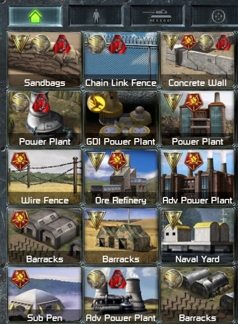

> [!NOTE]
> EA has not endorsed and does not support this product.

# Sidebar cameos

**Holds for:** C&C Remastered Collection, Steam build 21590013. EA has stopped patching the game and archived the
source in January 2025, so this should hold.

**HD mode only.** This page describes the HD renderer. See [HD-only mods](../getting-started/hd-only-mods.md).

## When you need this

When your mod adds something buildable, or wants a cameo that changes with the player: a faction's own icon on a
shared type, or a badge showing who can build it. A mod that only changes stock types keeps their stock cameos.

## Where a cameo comes from

1. **The DLL names the sidebar entry.** EA's sidebar export copies each entry's INI name into its `AssetName`
   (`DLLInterface.cpp`, the sidebar state). The field is 16 bytes, so 15 characters.
2. **The launcher finds the buildables entry** named `RA_` plus that name, the same entry the object itself uses
   (see [HD tilesets and ZIPs](hd-tilesets-and-zips.md)).
3. **Its `<BuildIcon>` names the cameo.** EA's Medium Tank, `RA_2TNK`, names `BuildIcon_RA_MediumTank`.

The base game's cameos are all regions of the UI atlas, `MT_COMMANDBAR_COMMON`: about 150 `BUILDICON_*` regions,
341 × 256 pixels each, and no texture archive holds a separate cameo file. See
[The UI atlas](../front-end/the-ui-atlas.md).

**TD's cameos are in the same atlas.** 54 of those regions are `BUILDICON_TD_*`, and TD's own buildables file
(`CNCBUILDABLES.XML`) names 51 of them, from `BuildIcon_TD_Minigunner` to `BuildIcon_TD_TempleOfNod`. A Red Alert
mod that ports a TD unit or building can point its entry's `<BuildIcon>` at TD's and ship no cameo.

## A new cameo

Ship a loose file named after its `<BuildIcon>` in your mod's `Data/ART/TEXTURES/SRGB/`:

- **As a TGA:** 341 × 256, like the stock regions.
- **As a DDS, to save memory:** DXT needs sides that are multiples of 4, so 344 × 256; the sidebar stretches it to
  fit. DXT1 with mips is about 59 KB, against about 350 KB for a 32-bit uncompressed TGA. Cameos are drawn small and
  carry no team colour, so DXT's colour rounding doesn't show (see
  [Sprite memory and DDS](sprite-memory-and-dds.md)).

**Make it fully opaque.** Noise shows through a cameo's transparent pixels, so composite a portrait with
transparency onto solid black first. (Observed.)

The cameo's name and description on the sidebar come from the buildables entry's text IDs, not from the
picture: see [New text strings](../launcher-data/new-text-strings.md).

### Replacing a stock cameo

A loose **TGA** named after a stock region (`BuildIcon_TD_A10.tga`, say) replaces that region's art. A loose
**DDS** of the same name doesn't: the atlas's art still shows. So a replacement for a stock cameo has to be a TGA.
(Observed.) Or don't replace it: give your type a new name, and point its entry at a new icon.

## Cameos that change at runtime

The launcher draws whatever cameo the entry's name leads to, and the DLL chooses that name on every sidebar export.
So the DLL can show different cameos for the same type:

1. Register each variant as its own buildables entry: `RA_<name>_1`, `RA_<name>_2` and so on, each with its own
   `<BuildIcon>`.
2. In the sidebar export, append the variant's suffix to `AssetName` for the player it's for. Keep the whole name
   within 15 characters.

The variant can be chosen per player: by their faction, or by which of their factions can build the entry. The
cameo widget (`UI_SIDEBAR_CONSTRUCTIONENTRY.BUI`) has no overlay that could add a per-entry badge. Its quads
(`IconFraming_Quad`, `Unavailable_Quad`, `FakeLoc_Quad`) draw fixed art: `FakeLoc_Quad` shows
`BuildIcon_RA_FakeText_<language>` on decoy buildings, one picture for every entry. Nor can the entry's other data
carry one: besides the name and the type fields, EA's `CNCSidebarEntryStruct` (`DLLInterface.h`) holds `Cost`,
`PowerProvided`, `BuildTime`, `Progress`, the placement list and six flags (`Completed`, `Constructing`,
`ConstructionOnHold`, `Busy`, `BuildableViaCapture`, `Fake`), each with a fixed meaning. So a badge has to be baked
into each variant's picture.

**`Busy` draws nothing.** EA sets it on every entry whose factory is in use, or whose object list is full, and the
cameo looks the same either way. To show that an entry can't be built for now, swap its `AssetName` to a variant
with a locked picture, as above. (Observed.)

## How it was verified

- **The lookup:** EA's sidebar export (`AssetName` from `IniName`) and the 16-byte field in `DLLInterface.h`; the
  stock `RABUILDABLES.XML`; and Tiberian Factions' badge variants, which each draw their own cameo.
- **Stock cameos:** the base game's `MT_COMMANDBAR_COMMON.MTD`, read for this page (`BUILDICON_*` regions,
  341 × 256), and the texture MEGs, which hold no separate cameo files.
- **TD's cameos:** the `BUILDICON_TD_*` regions in the `.MTD` and the `<BuildIcon>` names in `CNCBUILDABLES.XML`,
  both read for this page; TF's TD ports name them and ship none but the one it repaints.
- **The cameo widget:** its quads read from the stock `UI_SIDEBAR_CONSTRUCTIONENTRY.BUI`, the eight
  `BuildIcon_RA_FakeText_*` names in `ClientG.exe`, and EA's `Fake` field in the sidebar entry struct.
- **New cameos:** TF ships 552 loose DDS cameos (344 × 256, DXT1, 9 mip levels, read for this page),
  drawn in its sidebar and encyclopedia.
- **Sides in multiples of 4:** all 51,748 DXT1 and DXT5 textures in the base game's five texture MEGs have both
  sides a multiple of 4 (headers read for this page).
- **The entry's fields:** EA's `DLLInterface.h`; the launcher's cameo click tests four of the flags (see
  [Launcher key commands and superweapon clicks](../clientg-ram/launcher-key-commands-and-clicks.md)).
- **`Busy`:** EA's sidebar export sets it from the factory and the object heap (`isbusy`, `DLLInterface.cpp`). TF
  found that setting `Busy` changes nothing on the cameo, and swaps in locked variants by name
  instead (its sidebar export).
- **Observed only:** that a loose DDS doesn't override a stock region, when a TGA does, and that `Busy` draws
  nothing.

> [!TIP]
> **In Tiberian Factions**
>
> TF's sidebar marks which of a player's factions can build each entry. Once a player builds a category from two or
> more factions (by holding two factions' construction yards, say), the DLL appends one base-32 digit to the cameo's
> name (the entry's factions among the player's), and each variant carries its owners' emblems baked in. A player
> setting turns the badges off. TF's one stock-name cameo, `BuildIcon_TD_A10`, stays a TGA for the override rule
> above.
>
> 
>
> A player building from all five factions: each cameo carries the emblems of the factions that can build it, three
> on the Sandbags and one on the Allies' Naval Yard.
