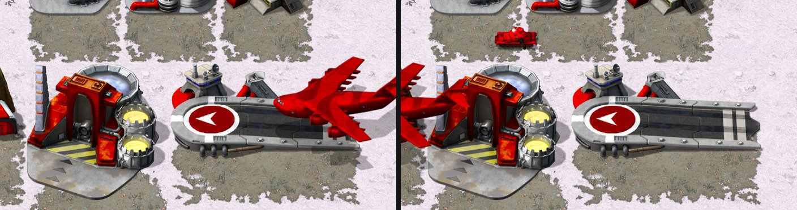

> [!NOTE]
> EA has not endorsed and does not support this product.

# Air delivery, fleets and support powers

**Holds for:** C&C Remastered Collection, Steam build 21590013. EA has stopped patching the game and archived the
source in January 2025, so this should hold.

## When you need this

When a new faction needs Tiberian Dawn's airstrip delivery, its own navy or air force, or support powers of its own.
A mod that keeps Red Alert's sides and their production doesn't need this page.

## Cargo-plane delivery

**In Tiberian Dawn,** a vehicle built at the Nod airstrip isn't driven out. The airstrip's `Exit_Object` calls
`Create_Special_Reinforcement` with the cargo plane (`AIRCRAFT_CARGO`) and an unload mission. The plane flies in from
the map edge, sets the vehicle down beside the strip, and leaves (TD's `BUILDING.CPP` and `REINF.CPP`).

**Red Alert has no cargo plane type:** its aircraft list has no `AIRCRAFT_CARGO`. Porting the delivery means:

1. **An aircraft type** added to Red Alert's enum and constructor list, with a `rules.ini` section. Without one, its
   speed defaults to nothing and it sits frozen at the map edge.
2. **A classic image,** so `ImageData` isn't null, or `AircraftClass::Draw_It` returns before drawing and the plane is
   invisible. Borrow another aircraft's image; the launcher still finds the plane's own HD tiles by name. See
   [Adding a unit](../units/adding-a-unit.md).
3. **Its own size.** Red Alert's `AircraftTypeClass::Dimensions()` gives the Badger 56x56 and every other aircraft
   21x20. A large plane leaves ghost trails on the map unless it gets a branch of its own.
4. **The airstrip's exit** calling the reinforcement with the cargo plane, as TD's does.
5. **A landing run.** Red Alert's `AircraftClass::Mission_Unload` hands every fixed-wing aircraft straight to
   `Mission_Hunt`. TD's has a fixed-wing branch: pick an airstrip, fly to it, set the cargo down, leave. Port it
   for the cargo plane alone, so Red Alert's own planes keep hunting. TD's `Enter_Idle_Mode` is what starts it: an
   airborne loaner with cargo and no team gets `MISSION_UNLOAD`. Red Alert's has no such branch, so without one
   the plane falls back to its idle mission instead of unloading. TD's run sets the cargo down when the plane is
   within `0x80` leptons of the strip (`FLY_TO_AIRSTRIP`). Tiberian Factions' plane, flown at Red Alert's speeds,
   overshot that window, turned back and circled, until the window was widened to `0x200`.
6. **Several deliveries in a row:** a second plane can arrive while the first is still in radio contact with the
   strip. Placement has to retry instead of giving up, planes should come in from a fixed edge with a fallback when
   the strip is busy, and the approach should fly straight in rather than circle.

## A faction's own fleet and air force

**Give a new faction its own types; never open Red Alert's to it.** Opening a stock building to another owner (the
Allied naval yard, the Soviet sub pen or airfield) brings its whole roster and its superweapon grants with it.
Clone what you need as new types owned by the new faction instead. Shared transports are the exception that works:
a transport with no roster behind it can be owned by every side.

## Support powers

Grant each support power from a host building, the way Red Alert grants its own superweapons in `HouseClass`: enable
it while the house has the building active, and remove it when the building goes. The power that fires decides what
it delivers, so a captured building of another era gives its own era's version.

**The launcher's side of a new power.** `DLLExportClass::Convert_Special_Weapon_Type` (`DLLInterface.cpp`) tells the
launcher two things about each superweapon: its type (`DllSuperweaponTypeEnum`), which sets how the cameo click and
targeting behave, and its asset name (`SW_Nuke`, `SW_GPS`; at most 15 characters, copied with `strncpy(..., 16)`).
A new `SpecialWeaponType` falls to `SW_UNKNOWN` there, so add a case:

- **The type:** for a power aimed at a cell, `SW_ION_CANNON` (one of TD's values in the shared enum) gives the plain
  targeting cursor in Red Alert too. A power that works like a stock one can borrow that one's type instead
  (`SW_NUKE`, `SW_PARA_INFANTRY`, `SW_SPY_MISSION`).
- **The asset name** picks the sidebar entry: `RA_` plus the name in capitals, as `SW_Nuke` is `RA_SW_NUKE` in
  `RABUILDABLES.XML`. Give each power its own name and entry, with its own cameo (see
  [Sidebar cameos](../art/sidebar-cameos.md)). The launcher still shows a cost line on it (see
  [What the launcher owns](../engine/what-the-launcher-owns.md)).

## Traps

- **An aircraft with no `rules.ini` section** gets a speed of zero and never moves.
- **A null `ImageData`** makes an aircraft invisible, as for any unit.
- **An empty cargo plane doesn't leave by itself.** `AircraftClass::Edge_Of_World_AI` deletes an aircraft off the
  map's edge only while it's on `MISSION_RETREAT`. Both games' source carry, commented out, the clause that would
  also delete an empty cargo plane: `/*|| (*this == AIRCRAFT_CARGO && !Is_Something_Attached())*/`. Restore it for
  your plane, or give the plane `MISSION_RETREAT` once it's empty.
- **`IsLegalTarget=no` doesn't stop a forced attack on a landed aircraft.** With Ctrl held, Red Alert's
  `TechnoClass::What_Action` skips the legal-target test, and an aircraft at height 0 can be attacked with any
  weapon, anti-aircraft or not. TD makes the same exception for a landed aircraft but leaves out its cargo plane by
  type (`*aircraft != AIRCRAFT_CARGO`). A ported cargo plane parked on its strip needs that test too.
- **Opening a stock building to a new owner** leaks its roster and superweapons.
- **A carrier that sets its load down** (Tiberian Sun's Carryall) has to place it at its own exact coordinate.
  Snapping to the cell's centre slid the load most of a cell in one frame. Lift the landed carrier off the map
  (`Mark(MARK_UP)`) while the load is placed, and put it back after (`MARK_DOWN`). Otherwise the carrier occupies
  the cell, the load's `UnitClass::Can_Enter_Cell` refuses it, and a search for a free cell nearby puts it a cell
  away.
- **A short-range aircraft weapon never attacks.** An attacking aircraft that isn't fixed-wing (fixed-wing ones hunt
  instead) picks where to fire from with `AircraftClass::Good_Fire_Location`, whose ring search starts a cell inside
  the weapon's range and stops a cell from the target (`for (r = range-0x0100; r > 0x0100; ...)`). For a weapon of
  two cells' range or less it finds nothing, and the aircraft returns to base. Give such a weapon (a bomb dropped
  from overhead) a firing spot of its own, such as the target's cell.

## How it was verified

- **TD's delivery and what Red Alert lacks:** EA's TD `BUILDING.CPP` (the airstrip calling
  `Create_Special_Reinforcement` with `AIRCRAFT_CARGO`) and `REINF.CPP` (`SOURCE_AIR`), and Red Alert's `DEFINES.H`, with
  no cargo plane in its aircraft list. The box and the landing run: Red Alert's `AADATA.CPP` (`Dimensions`, 56x56
  for `AIRCRAFT_BADGER`, else 21x20) and `AIRCRAFT.CPP` (`Mission_Unload`'s fixed-wing `Mission_Hunt`;
  `Enter_Idle_Mode` with no cargo branch), against TD's `AIRCRAFT.CPP` (`PICK_AIRSTRIP`, `FLY_TO_AIRSTRIP`,
  `BUG_OUT`; the airborne `Is_Something_Attached` and `IsALoaner` test giving `MISSION_UNLOAD`). Tiberian Factions'
  cargo plane has its own `Dimensions` branch and TD's unload states, gated to its type, and its notes record the
  frozen mission before the idle branch was added.
- **Superweapon types and names:** EA's `DLLInterface.cpp` (`Convert_Special_Weapon_Type`: the `SW_*` names, the
  16-byte `strncpy`, `SW_UNKNOWN` for anything else) and `DLLInterface.h` (`DllSuperweaponTypeEnum`, with
  `SW_ION_CANNON` among TD's values), the stock `RA_SW_*` entries in `RABUILDABLES.XML`, and TF's four
  new targeted powers routed as `SW_ION_CANNON`, and others as `SW_NUKE`, `SW_PARA_INFANTRY` and `SW_SPY_MISSION`,
  each with its own `RA_SW_*` entry.
- **The landing window, the edge and the forced attack:** TD's `AIRCRAFT.CPP` (`navdist < 0x0080` in
  `FLY_TO_AIRSTRIP`), the commented-out cargo clause in both games' `Edge_Of_World_AI`, Red Alert's `What_Action`
  (`ctrldown ||` before `IsLegalTarget`, the `Height == 0` test) and TD's (`AIRCRAFT_CARGO` left out, `Altitude
  == 0`) in each `TECHNO.CPP`. TF's cargo plane drops at `0x200`, restores the edge clause for its
  type, and adds the cargo-plane test to its `What_Action` after its parked plane could be force-attacked.
- **The short-range trap:** EA's `AIRCRAFT.CPP` (`Mission_Attack` handing fixed-wing aircraft to `Mission_Hunt`,
  `Good_Fire_Location`'s loop, and `PICK_ATTACK_LOCATION` falling to `RETURN_TO_BASE` when it returns nothing), the
  same in Vanilla Conquer, and TF's Orca Bomber, whose 1.5-cell bombs needed the target cell as the
  firing spot.
- **The set-down:** EA's `UNIT.CPP` (`Can_Enter_Cell` returning a blocked result for a cell another object
  occupies) and `FOOT.CPP` (`FootClass::Mark`, whose `MARK_UP` takes a grounded object out of its cell with
  `Map.Pick_Up`), and TF's Carryall, whose set-down lifts the carrier with `MARK_UP`, places the load at
  the carrier's coordinate, and falls back to `Nearby_Location` only when `Can_Enter_Cell` still refuses. The
  one-frame slide and the push into the next cell were seen in play.
- **TF:** cargo-plane delivery at its Nod airstrip, its GDI and Nod navies and airfield, and its Nod
  paratroops and recon flight, shipped and played under Proton on Linux and on the Steam Deck. The roster leak was hit
  in its first navy and A-10 builds and reverted.

> [!TIP]
> **In Tiberian Factions**
>
> TF's Nod airstrip delivers vehicles by TD's cargo plane. GDI has its own naval yard (a gunboat, a destroyer) and an
> airfield with TD's A-10, and Nod a sub pen with two submarines. Every side shares Red Alert's transport. Nod gets TD
> paratroops and a recon flight as support powers of its own.
>
> 
>
> TD's cargo plane coming in over the Nod airstrip (left); a moment later it's leaving, and the Light Tank it carried is on the ground (right).
