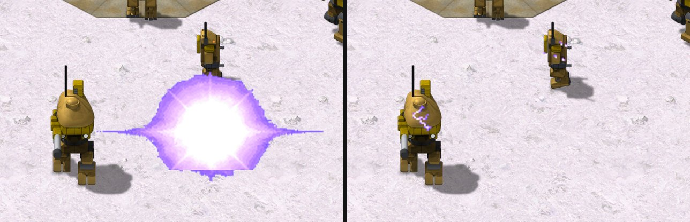

> [!NOTE]
> EA has not endorsed and does not support this product.

# EMP and stun

**Holds for:** C&C Remastered Collection, Steam build 21590013. EA has stopped patching the game and archived the
source in January 2025, so this should hold.

## When you need this

When your mod wants a weapon that disables rather than destroys: Tiberian Sun's E.M. Pulse Cannon, a mobile EMP, or
any timed stun. Red Alert has none. EA's source has a `TechnoClass::Stun()`, but that's not a paralysis: it clears an
object's target and destination, breaks its radio contact and unselects it, as it leaves play. A mod without
disabling weapons doesn't need this page.

## How Tiberian Sun does it

From OpenTS's `empulse.cpp` (`EMPulseClass::Create`) and TS's `RULES.INI`:

- **The weapon's damage is the duration.** `[EMPulseWeapon]` has `Damage=1200`, commented "Damage is duration for EM
  Pulse". The warhead's `Spread=11` is the radius in cells.
- **Inside the circle:** grounded aircraft crash (by distance, below); underground units lose power and stop;
  buildings lose power for the duration; vehicles and aircraft with a locomotor are stunned. Plain infantry are
  untouched (only cyborgs are stunned), and Visceroids are immune.
- **Aircraft are a separate pass, by distance.** Before the cell walk, every aircraft that's on the map, out of
  limbo and not in the air (`IsDown && !IsInLimbo && !In_Air()`) crashes if its centre is within `Spread` cells'
  worth of leptons of the pulse's centre (`Spread * CELL_LEPTON`). That's a distance test, not the cell circle, and
  it has no building check.
- **Who's spared:** the object that fired the pulse; a building whose centre cell is outside the circle, even if
  part of it is inside; and anything else in a cell that holds a building, since the cell walk affects only the
  building there. Core defenders (`IsCoreDefender`, Firestorm's Core Defender), building or unit, are neither
  stunned nor powered off. Limpet mines in the circle are destroyed rather than stunned.
- **The stun counts down** on each object (`StunDuration`). While it runs the object can't move, fire or deploy. A
  stunned factory still produces, since TS's production tests read a flag the pulse leaves set. At zero, a
  building's power comes back.
- **The sparks** are TS's `EMPulseSparkles` animation (`EMP_FX01`), attached to every stunned vehicle, aircraft,
  cyborg and digger. A building gets them only when `Is_Mobile_Deployer()` is true, that is the deployed form of a
  mobile unit (the sensor array, tick tank, artillery, mobile stealth, Juggernaut and ICBM launcher), placed a
  quarter-cell along each map axis from its centre and half a height level up. Each spark anim starts after a random
  delay of 0 to 25 frames, and `[EMP_FX01]` `LoopCount=-1` in `ART.INI` keeps it looping.
- **No lingering field.** The pulse marks its cells, but nothing reads the mark: a unit driving in afterwards is
  unaffected. Only each object's own timer matters.

## The method in Red Alert's DLL

1. **A stun timer** on `TechnoClass`, counted down in its AI.
2. **The pulse:** a function that, given a centre cell, radius and duration, walks the cells in a circle
   (`dx*dx + dy*dy <= r*r`) and applies TS's rules above. Call it from the warhead's impact instead of doing damage.
3. **Gates while stunned**, each one a place that must check the timer:
   - the order events that move or re-task it ignored (`EventClass`'s `MEGAMISSION`, `IDLE`, `SCATTER` and
     `PRIMARY`), and movement finishes the current cell, then holds;
   - `Can_Fire` refuses;
   - the player can't move it;
   - deploying and taking off refused;
   - radar drops as if on low power, and gap and stealth generators stop.
4. **What TS keeps running:** a stunned power plant still produces power, a stunned construction yard still builds,
   and factories keep producing. Follow TS here, or a pulse on a base is far stronger than intended.
5. **Diggers:** a stunned unit underground is rerouted to the nearest cell it can surface on, and destroyed only if
   there's none (see [Subterranean units](subterranean-units.md)).

## Showing hidden enemies without decloaking them

TS's Mobile Sensor Array shows cloaked and buried enemies to its owner alone. One way to do it in Red Alert's
launcher: for each hidden enemy in range, export a **copy** of its draw entries to the sensor's owner, enemy-owned
(their colour and radar dot), see-through and unselectable. The real object stays hidden from everyone else. Make
cloaked ones attackable through the copy (the cell carries the attack action), and buried ones only visible, as in TS.

## Traps

- **TS's radius is for TS's cells.** `Spread=11` covered a whole Red Alert base. Size the radius to what the pulse's
  effect art covers on screen, so what the player sees stunned is what gets stunned.
- **Every gate is a separate place.** A stun that only stops movement leaves units firing, deploying or taking off.
  List every action and check each one.
- **The targeting cursor is the launcher's.** While a player aims a superweapon, the DLL is told nothing, so an
  out-of-range cursor can't be shown from the DLL (see [What the launcher owns](../engine/what-the-launcher-owns.md)).

## How it was verified

- **What stock Red Alert lacks:** `grep -a` over EA's Red Alert source finds no EMP and no timed stun. Its
  `TechnoClass::Stun()` (`TECHNO.CPP`) only clears targets, radio and selection.
- **TS's model:** OpenTS's `empulse.cpp` (the circle test, the aircraft crash, the underground layer, buildings'
  `Power_Off` keyed on their centre cell, limpet mines destroyed, the firer exempt, the cell-with-a-building branch
  that skips everything else in it, the cyborg-only infantry rule, `StunDuration`, and `IsAffectedByEMP`, which is
  only ever cleared), and TS's `RULES.INI` (`[EMPulseWeapon]` `Damage=1200`, `[EMPuls]` `Spread=11`,
  `[EMPulseSpecial]`, `[AudioVisual]` `EMPulseSparkles=EMP_FX01`).
- **The aircraft pass, core defenders and sparks:** OpenTS's `empulse.cpp` (the aircraft loop ahead of the cell
  walk, with its `Spread * CELL_LEPTON` distance test; the two `IsCoreDefender` branches; the sparks on every stunned
  foot object and on buildings only behind `Is_Mobile_Deployer()`, offset `CELL_LEPTON_W / 4`, `CELL_LEPTON_H / 4`
  and `LEVEL_LEPTON_H / 2`, each created with `Random_Pick(0, 25)` as the `AnimClass` start delay), `builtype.cpp`
  (`Is_Mobile_Deployer`'s list) and `anim.cpp` (a `LoopCount` of -1 stored as 255, the count that never runs
  down); TS's `FIRESTRM.INI` (`IsCoreDefender=yes` on `[DEFENDER]` and `[DDEFD]`, both "Core Defender") and
  `ART.INI` (`[EMP_FX01]` `LoopCount=-1`); and the working mod's pulse, which uses the same quarter-cell offset and
  0 to 25 delay for its sparks. The aircraft pass is OpenTS's reading of TS, not tested in TS itself.
- **What keeps running:** in OpenTS the pulse calls a building's `Power_Off`, which leaves `IsOn` set, and
  `Power_Output` and `Who_Can_Build_Me` (the factory and construction yard test) read `IsOn`, never the stun timer.
- **The stun gates:** EA's `EVENT.CPP` (the `MEGAMISSION`, `IDLE`, `SCATTER` and `PRIMARY` orders), and the working
  mod's code, which gates exactly those four.
- **A working mod:** the E.M. Pulse Cannon, a Mobile EMP and the Mobile Sensor Array in its release, played under
  Proton on Linux and on the Steam Deck.
- **Unproven:** whether a TS pulse spares an aircraft parked on a helipad. The cell walk skips everything else in a
  building's cell, but the aircraft pass runs first with no building test, so a parked aircraft survives only if
  `In_Air()` is true on the pad.

> [!TIP]
> **In Tiberian Factions**
>
> TS GDI's E.M. Pulse Cannon stuns for 30 seconds within 3 cells, and the Mobile EMP for 10 seconds within 3 cells.
> TF picked 3 because it's what the pulse's ring covers on screen; TS's 11 swallowed a Red Alert base. The Mobile
> Sensor Array shows cloaked and buried enemies to its owner with an EVA warning and a radar ping.
>
> 
>
> TS GDI's E.M. Pulse Cannon fired between a Titan and a Wolverine (left); a moment later both walkers are stunned, sparking purple (right). The EMP hits its owner's own units too.
