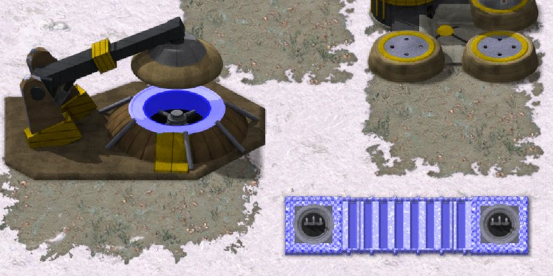

> [!NOTE]
> EA has not endorsed and does not support this product.

# Firestorm Defense

**Holds for:** C&C Remastered Collection, Steam build 21590013. EA has stopped patching the game and archived the
source in January 2025, so this should hold.

## When you need this

When your mod wants a toggled defensive field, like Tiberian Sun's Firestorm Defense, or a superweapon that drains
while it's on. Red Alert has neither: EA's source has no firestorm and no charge-drain superweapon. A mod without
them doesn't need this page.

## How Tiberian Sun does it

From TS's `RULES.INI` and OpenTS (`super.cpp`, `house.cpp`, `building.cpp`, `bullet.cpp`):

- **A charge-drain superweapon** (`UseChargeDrain=true`). While on, the field drains the charge. Turned on, the
  drain time is the charge × `ChargeToDrainRatio` (.333, so a full charge buys about a minute). Turned off early,
  each frame of drain left comes back as three frames of charge (1 ÷ .333), and the weapon stays usable while it
  charges on, so a part charge buys a shorter field. It can be raised in any state except charging from zero. A
  drain that runs out, low power, or losing the last generator drops the field and starts the charge from zero.
  OpenTS's `SuperClass` keeps four states for it, `SUSPENDED`, `CHARGING`, `READY` and `FIRESTORM_ON`, and
  `Can_Place` accepts a click in every one but `CHARGING`.
- **Computer houses toggle it without a drain,** and never raise it of their own accord: the AI's superweapon logic
  (`HouseClass::AI_Super_Weapons`) has no Firestorm case, so for a computer house only a map trigger's
  `ACTIVATE_FIRESTORM` action turns the field on.
- **A section costs $250.** TS's own `RULES.INI` says `Cost=50` for `[GAFSDF]`, but TS's executable, as OpenTS
  reconstructs it, charges 250 whatever the rules say.
- **Every wall section the house owns goes live**, anywhere on the map. A live section blocks everyone, its owner
  included, and kills anything standing on it or moving in.
- **What "moving in" means:** when a section goes live, or its state is refreshed, anything mobile in the 5 × 5
  cells around it that's moving into its cell dies, to the `C4Warhead` (`HE` in TS's rules) at full strength.
- **Aircraft over a live section die,** at any height, and so do jumpjets.
- **A death by the field** throws 7 to 9 bursts of `FirestormSparkSys` (`[CombatDamage]`
  `DefaultFirestormExplosionSystem`) in random directions, in place of a vehicle's or aircraft's normal explosion.
  `FSGRND` plays at the wall, or `FSAIR` at the victim when it's more than 100 leptons up.
- **`IgnoresFirestorm=yes` passes the field** untouched: TS sets it on its two Hunter Seekers.
- **Shots are eaten:** a projectile entering a live cell is deleted unless the wall's owner fired it (one with no
  firer is eaten too), and instant weapons stop at the first live cell of another house's wall.
- **A live section takes no damage.** Each hit drains the field instead (damage × 0.1). An eaten shot never hits, so
  it doesn't drain the field.
- **Line fill:** placing a section within 5 cells, in a straight line, of another of the house's sections fills
  the gap. The 5 is the section's `GuardRange=5`, the search runs only north, east, south and west, and the filling
  sections are free.
- **What it looks like:** a live section draws its neighbour frame plus 32. `GAFSDF_A` plays on live sections that
  aren't a straight run, and every 8 frames each such section with no column showing has a 1 in 16 chance to throw up
  `FSIDLE`, played once at 50% translucency. So the field reads as flickering columns, not a steady wall.
- **EVA:** `00-I162` "Firestorm defense ready" (the superweapon's `RechargeVoice`), and `00-I170` "Firestorm defense
  offline" when the field drops.
- **Sections as buildings:** placing or removing one refreshes its four neighbours' frames, and the player's power
  toggle (the `POWERON` and `POWEROFF` events) skips sections.

## The method in Red Alert's DLL

1. **The superweapon:** add a drain state to `SuperClass`: start a drain sized from the charge, stop it early and
   bank the remainder, and drop it on low power or when the last generator goes.
2. **The toggle:** a superweapon cameo in Red Alert normally needs a target. TS's Firestorm toggles on one click.
   That takes a launcher patch on the cameo click, which then arrives as a build request your DLL turns into the
   toggle. See [Patching the launcher's code from your DLL](../clientg-ram/patching-the-launchers-code.md).
3. **The field, every frame:** kill what stands on live sections (own units too), and aircraft over them. Make live
   sections block movement, and passable again while the field is down.
4. **Shots:** in `BulletClass::AI`, delete a projectile in a hostile live cell. Cut instant shots at the first live cell
   of another house's wall on their path at launch.
5. **Sections as buildings:** 1×1, not selectable. Their frame comes from their neighbours (north, east, south, west
   as 1, 2, 4, 8), plus 32 while live, as in TS. Make them sellable only while the field is down.

## Line fill, for every wall

The same fill works for any wall. When a wall is placed in a straight line within a few cells of another of the
house's walls of the same type, and every cell between is clear, fill the gap, charging for each piece. The launcher
owns the placement ghost, so the line appears only when the second end is placed.

## Traps

- **Flying aircraft take half damage.** Red Alert's `AircraftClass::Take_Damage` halves it ("Flying aircraft take
  half damage"), so double the field's damage to airborne targets to kill them.
- **Sections chain only from your own sections,** and the placement ghost's distance map is the real gate, so
  limit it there too. EA's `DLLExportClass::Calculate_Placement_Distances` (`DLLInterface.cpp`) builds that map: the
  distance from the player's base buildings and bibs, or for a wall type from any cell the player owns, out to the
  type's `Adjacent` + 1.
- **Wall seams.** Keep wall-section classic stubs even, or each piece lands half a classic pixel (about 2.7 HD
  pixels) off its neighbour (see [Gates](gates.md)).
- **One click counts once.** The launcher can deliver a click more than once, so ignore repeats within a fraction
  of a second.

## How it was verified

- **What stock Red Alert lacks:** `grep -a` over EA's Red Alert source finds no firestorm or charge drain.
- **TS's model:** TS's `RULES.INI` (`UseChargeDrain=true`, `ChargeToDrainRatio=.333`, `[GAFSDF]` `Cost=50`,
  `IgnoresFirestorm=yes` on `[GHUNTER]` and `[NHUNTER]`, the section and generator entries) and OpenTS's `super.cpp`
  (`Discharged`: the leftover drain divided by the ratio; `Can_Place`: anything but `CHARGING`), `techtype.cpp`
  (`GAFSDF`'s cost forced to 250), `house.cpp`, `building.cpp`, `bullet.cpp` and `map.cpp`.
- **TS's edge cases:** OpenTS's `super.h` (the four `ChargeDrainState` values), `super.cpp` (`Discharged`'s
  no-drain branch for computer houses), `house.cpp` (`AI_Super_Weapons` with no Firestorm case), `taction.cpp`
  (`ACTIVATE_FIRESTORM`), `building.cpp` (`Update_FS_Wall_State`: the +32, the 5 × 5 `C4Warhead` loop and
  `GAFSDF_A`; the `FSIDLE` spawn on `(Frame & 7) == 0`, a 1-in-16 roll and `SHAPE_TRANSLUCENT50`; the neighbour
  refresh in `Unlimbo` and `Limbo`; `Crossing_Firestorm`'s 100-lepton test), `jumpjet.cpp` and `fly.cpp` (the kill
  on a live section), `aircraft.cpp` and `unit.cpp` (7 + a random 0 to 2 spark systems), `bullet.cpp` (the eaten
  shot deleted with no damage), `event.cpp` (`POWERON` and `POWEROFF` skipping sections), `map.cpp`
  (`Place_Firestorm_Wall`: four directions, `ThreatRange >> 8` cells, sections created without a charge),
  `techtype.cpp` (`ThreatRange` read from `GuardRange`) and `vox.cpp` (`00-I162`, `00-I170`); TS's `RULES.INI`
  (`[GAFSDF]` `GuardRange=5`, `[FirestormSpecial]` `RechargeVoice=00-I162`, `[AudioVisual]`'s four Firestorm anims,
  `[CombatDamage]` `C4Warhead=HE` and `DefaultFirestormExplosionSystem=FirestormSparkSys`). The working mod
  reproduces the +32 frame, the `FSIDLE` rule and both EVA lines. The AI rule, the 5 × 5 kill, jumpjets, the
  neighbour refresh and the power toggle are OpenTS's reading of TS, not tested in TS itself.
- **The placement map:** EA's `DLLInterface.cpp` (`Calculate_Placement_Distances`), the same in Vanilla Conquer,
  and the working mod's copy, which it limits for wall sections.
- **The same rules in Red Alert:** the working mod's charge-drain `SuperClass` refunds three frames of charge per
  frame of drain left and keeps a part-charged weapon usable, charges $250 a section, and spares its Hunter Seeker.
- **A working mod:** the generator, sections, field, toggle and line fill in its release, played under Proton on
  Linux and on the Steam Deck.
- **Unproven:** the enemy-side checks in a LAN game.

> [!TIP]
> **In Tiberian Factions**
>
> TS GDI's Firestorm Generator raises the field with one click on its cameo, and drops it with another, banking
> what's left. Sections cost $250, as in TS. Line fill works for every wall in the mod, from sandbags to
> Firestorm sections.
>
> 
>
> TS GDI's Firestorm Generator with the field up: its core glows blue, and so does the wall line beside it, posts and bars alike.
