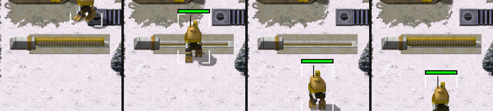

> [!NOTE]
> EA has not endorsed and does not support this product.

# Gates

**Holds for:** C&C Remastered Collection, Steam build 21590013. EA has stopped patching the game and archived the
source in January 2025, so this should hold.

## When you need this

When your mod wants a gate: a section of wall that opens for your own units and stays shut to the enemy. Red Alert
has walls but no gates. EA's released Red Alert source has no gate type, no gate flag and no gate logic. Tiberian
Sun has them (`Gate=yes` in its `RULES.INI`), and OpenTS's reconstruction shows how they work. A mod with walls only
doesn't need this page.

## How Tiberian Sun does it

From OpenTS (`building.cpp`, `map.cpp`) and TS's `RULES.INI` (`[GAGATE_A]`):

- **A gate is a building** with `Gate=yes`, a door that opens over `DeployTime` (.044 minutes) and stays open for
  `GateCloseDelay` (.2 minutes) once nothing stands in it.
- **Allies open it; nobody else can.** When a moving unit wants to enter a gate's cell, `MapClass::Try_Open_Gate`
  asks the gate: an ally's request opens it (`Open_Gate`) and the unit waits until it's fully up. Anyone else gets
  in only if it happens to be standing open (`Is_Gate_Open`).
- **An open gate holds while something's in it.** Its opening mission rewinds the close timer while an occupier
  blocks it, and closes once the timer runs out.

## The method in Red Alert's DLL

1. **Make the gate a building type** in a wall line, one per orientation (east-west and north-south), since a
   building's footprint doesn't rotate. A 3×1 and a 1×3 footprint suit a three-cell gate.
2. **Use the building's door.** Every Red Alert object that can act inherits a door, `DoorClass` (`DOOR.H`), with
   `Open_Door(rate, stages)`, `Close_Door` and `Is_Door_Open`. The war factory's door uses it. Drive the gate's animation stages from it: shut, then the opening frames,
   then open.
3. **Open on request.** Give the building an `Open_Gate()` that resets a hold timer, opens the door if it's shut,
   and returns true only once it's fully open, so the asking unit waits. A gate being built or sold never opens.
4. **Close when clear.** Each frame, while the door is open, rewind the hold timer if anything stands in the gate's
   footprint. When the timer runs out, close the door.
5. **Ask before every step.** Where a vehicle or infantryman is about to enter its next cell, call a check like
   TS's `Try_Open_Gate`: for an ally's gate, ask it to open and hold the step until it's up; for anyone else's, pass
   only while it stands open. A cell without a gate answers yes.
6. **Let allies path through.** In the passability check (`Can_Enter_Cell`), treat a gate as open ground to its
   owner and allies, so the pathfinder plans routes through it. To anyone else it's an obstacle unless it stands
   open.
7. **Make a click on it a move.** In `What_Action`, a click on an allied gate is a move order onto it, not a
   select.

## Zones: why a gate links both sides

Red Alert's movement zones (`MapClass::Zone_Span`) flood-fill passable ground, using `Is_Clear_To_Move` with
vehicles ignored. That drops the cell's "vehicle or building" bit, so **buildings never split zones**, but wall
overlays do. A gate standing in a gap in a wall line therefore puts both sides in one zone, as it should for the
gate's owner.

**Trap: placing a gate onto existing walls.** A gate built over its owner's wall segments has to remove those wall
overlays, and then **rebuild the zones** (`Zone_Reset`). Otherwise the cells under the gate still count as wall in the
zone map. Infantry refuse a destination outside their own zone, so they walk up and down the wall and never use the
gate. Vehicles barely consult zones, so they drive through, and the bug only shows with infantry.

## Joining walls

- **Wall ends join the gate.** A wall beside a gate's end, along the gate's axis, should draw its end piece into the
  gate. Give each cell a check like "is there a gate here running east-west (or north-south)?", and have the wall's
  connection logic count it as a neighbour.
- **Draw order:** a gate should sort just north of its own northern row, so a unit anywhere in the gate draws over
  it, while a building north of it still draws first.
- **Even classic stub widths.** The launcher places a sprite half its classic stub width from its centre, so an odd
  width lands half a classic pixel (about 2.7 HD pixels, at 128 HD pixels to 24 classic) off its neighbours and
  leaves a seam where a wall meets the gate. Keep wall, tower and gate stubs even.

## Power, and energy gates

A gate that's a force field (a laser or Tesla barrier rather than a door) can follow a different rule: while its
house is short of power it opens and stays open, to everyone. Energy gates can also switch faster than sliding
doors.

## Traps

- **The zone rebuild** after placing a gate on walls (above).
- **Two orientations, two types.** A building can't turn, so each orientation is its own type with its own art.
- **A gate's end piece in front of its pad.** A north-south gate's north end has to show a wall end on its pad but
  behind the gate's standing parts. Red Alert's draw order draws walls first, so that can't be layered at run time.
  Bake it into the gate's art instead, using a mask of what stands in front.
- **The AI.** Nothing makes the AI build gates. Its units pass its own gates by the same movement rules, but placing
  gates in a wall line is AI work nobody has written.

## How it was verified

- **What stock Red Alert lacks:** `grep -a` over EA's Red Alert source finds no gate type, flag or logic. The zone
  fill and the "vehicle or building" bit are in EA's `MAP.CPP` (`Zone_Span`) and `CELL.CPP` (`Is_Clear_To_Move`).
- **TS's model:** OpenTS's `Try_Open_Gate`, `Open_Gate`, `Is_Gate_Open` and the gate's opening mission, and TS's
  `RULES.INI` (`Gate=yes`, `DeployTime=.044`, `GateCloseDelay=.2`).
- **Tiberian Factions:** six gate types in its release (TS GDI, TS Nod, Allied, Soviet Tesla, TD GDI, TD Nod laser),
  with the open-on-request, hold-while-occupied and ally rules above, and the zone-rebuild fix, played under Proton
  on Linux and on the Steam Deck, LAN included.
- **Unproven:** an enemy unit caught in a gate as it starts to close, and two players' units passing one gate in LAN.

> [!TIP]
> **In Tiberian Factions**
>
> TF has a gate for each faction: TS GDI's and TS Nod's sliding gates, an Allied gate, a Soviet Tesla gate whose arcs
> crackle while shut and wind down with the Tesla Coil's charge-up sound, a TD GDI gate, and a silent Nod laser gate.
> The Tesla and laser gates drop open when their house is short of power. Each places and builds with its own game's
> sounds, and stands open for TS's 0.2 minutes once clear.
>
> 
>
> TS GDI's East-West gate beside a concrete wall, left to right: shut as a Titan approaches, slid open as it walks through, still open once it's clear, and shut again.
