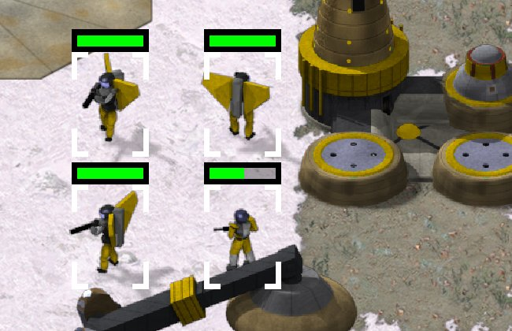

> [!NOTE]
> EA has not endorsed and does not support this product.

# Jumpjets, deployers, mines and bouncing discs

**Holds for:** C&C Remastered Collection, Steam build 21590013. EA has stopped patching the game and archived the
source in January 2025, so this should hold.

## When you need this

When your mod brings any of these Tiberian Sun behaviours into Red Alert: infantry that fly, units that deploy into
buildings and pack up, a drone that settles into a mine, or a projectile that bounces. Each is smaller than the
behaviours with pages of their own, so they share this one.

## Jumpjet infantry

Tiberian Sun's jumpjet infantry fly low over the battlefield (`JumpJet=yes` in TS's `RULES.INI`, flown by OpenTS's
`jumpjet.cpp`). Red Alert's engine assumes that only aircraft fly, in several places, and each one has to let a
flying soldier through:

- **Missions stop in the air.** EA's `MissionClass::AI` returns early for any infantry, unit or vessel with
  `Height > 0`, so a flying soldier runs no mission at all. Exempt jumpjets.
- **Targets get dropped.** Target upkeep drops a non-aircraft's target that's out of range in another zone, which
  a flying unit often is. Exempt it.
- **Move clicks get pulled back** into the unit's own zone. A flyer can cross zones, so don't.
- **Anti-air only sees aircraft.** Defences that track aircraft need to count an airborne jumpjet as airborne.
- **Ground weapons can't hit a flyer.** Only anti-air weapons should get an attack cursor over a jumpjet in the air.
- **A flyer can reveal cloaked units below it,** as TS's jumpjets do. A working mod has it on a development branch
  (built, not in a release).

The flight itself can follow OpenTS's jumpjet: ease off near the destination, bob on a slow sine while hovering,
and land on the nearest free spot. One launcher detail matters: the launcher places a selection box and health bar
from the first shape an object draws plus its exported centre. Draw the flying body before its shadow, and lift the
exported centre by the height.

## Units that deploy into buildings

A unit that deploys into a building and back (a mobile war factory, a mobile sensor, an artillery piece that sets
down to fire) is Red Alert's MCV pattern, extended:

- **Deploy where the build-up starts.** Place the building so the unit stands where the build-up's first frame
  draws it, or it jumps on deploy.
- **Pack up by the deploy key.** The launcher's deploy command only works for the stock MCV, so a new deployer needs
  the deploy key routed to your DLL. See [What the launcher owns](../engine/what-the-launcher-owns.md).
- **Share a ground line.** The unit and the building it becomes must sit on the same ground line, or the art hops
  on deploy (see [How the launcher draws sprites](../art/how-the-launcher-draws-sprites.md)).
- **Deploy to fire.** For a unit that has to deploy before firing, an AI attack wave on attack-move never stops to
  deploy. Switch a unit with a target in reach to an attack, deploy, fire, and move on afterwards.

## A mine laid by a drone

TS's Limpet Drone settles into a mine on its own cell. Red Alert already has mines (`STRUCT_AVMINE`, `STRUCT_APMINE`):
buildings that units drive over. Make the deployed mine another such building, and let every unit's passability
check treat it as open ground, whoever owns it. An EMP destroys it (see [EMP and stun](emp-and-stun.md)).

## A bouncing disc

TS's Disc Thrower throws a disc that bounces (`Bouncy=yes`; OpenTS's `bounce.cpp`). In Red Alert's bullets:

- **Launch from the hand.** The fire coordinate carries the thrower's hand height as a shift to the north, so move
  the start south by that much and launch from that height.
- **Solve the throw.** Launch speed from the range and gravity, capped. Use the lobbed solution only when the aim
  point is higher than it is far.
- **Cliffs catch only a disc that has bounced.** A first throw clears cliffs; only a disc that has already bounced
  is set off by flying low over one.
- **Use the true distance for ballistics.** EA's `Distance()` (`COORD.CPP`) is an approximation (the larger
  difference plus half the smaller), up to about 6% long on a diagonal. A ballistic arc flown on it lands long:
  about 290 leptons long for one long-range shot.

## How it was verified

- **Jumpjets:** EA's `MissionClass::AI` (`MISSION.CPP`, the `Height > 0` early return), TS's `RULES.INI`
  (`JumpJet=yes`) and OpenTS's `jumpjet.cpp`.
- **Mines:** EA's mine buildings (`STRUCT_AVMINE`, `STRUCT_APMINE`), and a working mod's drone that settles into one.
- **The disc:** TS's `RULES.INI` (`Bouncy=yes`), OpenTS's `bounce.cpp`, and EA's `Distance()` in `COORD.CPP`.
- **A working mod:** jumpjet infantry, the mobile war factory and sensor, a deploy-to-fire walker, the limpet
  drone and the disc thrower in its release, played under Proton on Linux and on the Steam Deck.

> [!TIP]
> **In Tiberian Factions**
>
> TS GDI's Jumpjet Infantry, Mobile War Factory, Mobile Sensor Array, Juggernaut, Limpet Drone and Disc Thrower all
> came through these routes. The Juggernaut sets down to fire, the Limpet Drone settles into a mine any unit can drive
> over, and the Disc Thrower's disc bounces as TS's does.
>
> 
>
> TF's Jumpjet Infantry, selected, beside a TS GDI base: wings spread in flight, each with the selection box and health bar the launcher places.
