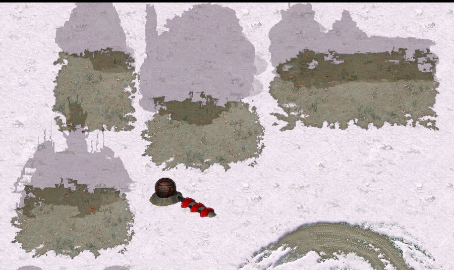

> [!NOTE]
> EA has not endorsed and does not support this product.

# A stealth generator

**Holds for:** C&C Remastered Collection, Steam build 21590013. EA has stopped patching the game and archived the
source in January 2025, so this should hold.

## When you need this

When your mod wants a building that hides its side's base, like Tiberian Sun's Nod Stealth Generator. Red Alert
cloaks only units of a cloaking type (the submarine, and units given `Cloakable=yes`). Its gap generator shrouds
the map, but nothing cloaks buildings. A mod without area cloaking doesn't need this page.

## The method: drive the cloak system you already have

Red Alert's `TechnoClass` has a full cloak machine: `Cloak` runs through uncloaked, cloaking, cloaked and uncloaking,
`Do_Cloak`, `Do_Uncloak` and `Do_Shimmer` move it, and `Cloaking_AI` re-cloaks an object a while after it's ready.
A generator only has to decide **who may cloak**. The machine does the rest.

1. **Each frame,** gather the house's powered, active generators.
2. **Cover:** for each friendly building, unit, infantryman and aircraft within range, set its `IsCloakable` true.
   Skip the generator itself (it stays visible), and units that cloak natively.
3. **Don't force the cloak.** Let `Cloaking_AI` cloak each object when it's ready. Calling `Do_Cloak` every frame
   fights the machine (see Traps).
4. **Restore:** an object that has left coverage, or whose generators are gone, gets `IsCloakable` false and is
   uncloaked.
5. **Detectors:** for each object you cloaked, if an enemy detector (`IsScanner`) is within reveal range, shimmer it
   (`Do_Shimmer`). It re-cloaks by itself when the detector leaves.
6. **Armed buildings ambush:** when a cloaked armed building has a legal target in range, uncloak it so it can fire.
   It re-cloaks after the threat has gone.

Hidden objects stay hidden from the AI too, since `Is_Cloaked` hides them from every non-ally, players and AI alike.
And when an object starts to cloak, `Do_Cloak` calls `Detach_All(false)`, so everything already targeting it loses
it. That reaches friends too: `FootClass::Detach` also clears any unit's destination (`NavCom`) on the object.
Radio contact survives, since only `Detach_All(true)` breaks it.

## What the engine gives you

- **The detector flag is `IsScanner`,** set by `Sensors=` in a type's `rules.ini` section. Every infantry type
  and every vessel type has it on from its constructor, so infantry and ships detect with no work. A vehicle
  detector needs `Sensors=yes`.
- **The re-cloak delay is read from `SubmergeDelay`.** `Rule.CloakDelay` comes from `[General]` `SubmergeDelay`
  (in minutes; the stock `rules.ini` says .02, and calls it the submarine's surface time), and it applies to every
  cloaker: after uncloaking, `Cloaking_AI` won't cloak an object again until it runs out. Tune that key to change
  how long revealed buildings stay visible.
- **Some reveals are built in.** A cloaked object shimmers when it takes damage (`TechnoClass::Take_Damage`), when
  a vehicle's move is blocked by it (`MOVE_CLOAK` in `DRIVE.CPP` shimmers the cell, so units walking into a hidden
  base seem to detect it), and while it carries a captured flag.
- **`Visual_Character` tells the viewers apart.** For a settled cloak, `TechnoClass::Visual_Character` returns
  `VISUAL_SHADOWY` when the player being drawn for owns the object, and `VISUAL_HIDDEN` for everyone else. It picks
  how `Techno_Draw_Object` draws each shape, so it's the test to use for anything tied to a cloaked object that
  only some players should see, such as its bib. The object export also carries the raw `Cloak` state.
- **Both transitions need the flag.** `Do_Cloak` acts only on an object that's `IsCloakable` and uncloaked or
  uncloaking; `Do_Uncloak` only on one that's `IsCloakable` and cloaked or cloaking. Clear `IsCloakable` before the
  uncloak has finished and the object stays as it is.

## The engine gaps you have to fill

- **Buildings never copy `IsCloakable`.** EA's unit, infantry and vessel constructors copy their type's cloak flag
  (`IsCloakable = Class->IsCloakable;`), but the building constructor doesn't. Add that line, or no building can
  enter the cloak machine.
- **Detection only runs one way.** EA's `FootClass::Per_Cell_Process` shimmers a cloaked object when *it* moves next
  to an enemy scanner. Nothing reveals a stationary cloaked building, or an idle unit a scanner walks up to. So the
  generator needs the reverse scan (step 5).
- **Bibs are stamped into cells,** not drawn with the building, so cloaking a building leaves its bib showing.
  Hide the bib at draw time while its building is hidden. Don't remove the bib smudge: it also blocks building
  placement, so removing it would let an enemy build into the cloaked base.

## Traps

- **Forcing `Do_Cloak` every frame** fought `Cloaking_AI` and the uncloak-to-fire sequence. Units flickered, fired
  without doing damage, and the cloak state went inconsistent, so reveal and restore stopped working. Only set
  `IsCloakable`, and let the machine cloak.
- **A whole base stayed cloaked after the generator died.** The restore pass ran for one frame, but `Do_Uncloak` only
  *starts* a transition over several frames. The objects never reached "uncloaked", their flag was never reset, and
  `Cloaking_AI` cloaked them again. Keep restoring until a full pass finds nothing left, and clear `IsCloakable` only
  once an object is uncloaked, since `Do_Uncloak` does nothing without it.
- **A helipad never cloaked.** It's always in radio contact with its parked helicopter, and a "don't cloak while in
  radio contact" rule held it visible. Block cloaking only while the partner is actually moving. Aircraft need their
  own cover pass too. The rule is still needed for a partner on its way in: a building that starts to cloak clears
  the destination of a harvester or aircraft heading to it (above), stranding it.
- **Footprints with holes.** Finding which building owns a bib has to walk the building's real footprint, holes and
  all, or some bibs float uncovered.

## How it was verified

- **The cloak machine and its gaps:** EA's `TECHNO.CPP` (the cloak states, `Do_Cloak` and `Do_Uncloak` with their
  guards and `Detach_All`, `Cloaking_AI`, the `CloakDelay` wait, the shimmer in `Take_Damage`), the `IsCloakable`
  copy in `UNIT.CPP`, `INFANTRY.CPP` and `VESSEL.CPP` but not `BUILDING.CPP`, and the one-way scanner shimmer in
  `FOOT.CPP`; Vanilla Conquer's copies match.
- **Viewers and destinations:** EA's `TECHNO.CPP` (`Visual_Character`'s `CLOAKED` branch on `Is_Owned_By_Player`,
  and `Techno_Draw_Object` switching on it; `Do_Cloak` calling `Detach_All(false)`; `TechnoClass::Detach` sending
  `RADIO_OVER_OUT` only when `all` is set), `FOOT.CPP` (`FootClass::Detach` clearing a matching `NavCom`),
  `TRACKER.CPP` (`Detach_This_From_All` walking every house's objects) and `DLLInterface.cpp` (the export copying
  `Cloak`); the same in Vanilla Conquer; and the working mod, which hides a cloaked building's bib when
  `Visual_Character` is `VISUAL_HIDDEN`, and holds a building's cloak while its radio partner has a `NavCom`.
- **Detectors and the delay:** EA's `TECHNO.CPP` (`Sensors=` read into `IsScanner`), `IDATA.CPP` and `VDATA.CPP`
  (`IsScanner = true` for every infantry and vessel type), `RULES.CPP` (`CloakDelay` read from `SubmergeDelay`) and
  `DRIVE.CPP` (`MOVE_CLOAK` shimmering the cell); the stock `rules.ini`'s `SubmergeDelay=.02`. The working mod gives
  its Radar Jammer `Sensors=yes`, and saw units walking into a hidden base shimmer it.
- **A working mod:** the generator in its release, played under Proton on Linux and on the Steam Deck. The traps
  above were each hit and fixed there.
- **Unproven:** in play, a cloaked armed building (an Obelisk) charged and failed to fire, which is why the ambush
  step exists. But EA's `BuildingClass::Mission_Attack` does handle the "cloaked" fire result by uncloaking, so the
  reason it didn't fire wasn't traced.

> [!TIP]
> **In Tiberian Factions**
>
> Nod's Stealth Generator, behind the Temple of Nod, hides friendly buildings and units within 10 cells. Infantry,
> ships and the Radar Jammer detect it within 3 cells, and its armed defences ambush. The generator stays visible as
> a weak point, so its power cost was halved to 100 in exchange. The Nod AI builds one once it has the Temple.
> On a development branch, Tiberian Sun's own Nod Stealth Generator takes its place (built, not in a release).
>
> 
>
> A Nod base under its Stealth Generator, as its owner sees it: the Temple, Hand of Nod, refinery and airstrip are faint outlines over their bibs, and the generator stays solid.
