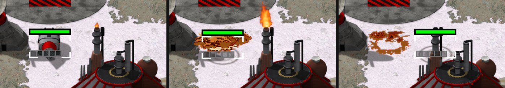

> [!NOTE]
> EA has not endorsed and does not support this product.

# Subterranean units

**Holds for:** C&C Remastered Collection, Steam build 21590013. EA has stopped patching the game and archived the
source in January 2025, so this should hold.

**HD mode only** for the dive art. See [HD-only mods](../getting-started/hd-only-mods.md).

## When you need this

When your mod wants units that travel underground, like Tiberian Sun's Subterranean APC and Devil's Tongue. Red
Alert has no such movement: EA's released source has no tunnel locomotion or underground layer. A mod without
digging units doesn't need this page.

## How Tiberian Sun does it

OpenTS's `tunnel.cpp` reconstructs TS's `TunnelLocomotionClass`, and its `unit.cpp` the drive-or-dig decision:

- **Dig unless a short surface route exists.** TS digs on a move order unless the destination is in the same zone,
  within 12 cells, and reachable by a short trial walk. It never digs to an adjacent cell. The numbers, from
  `UnitClass::Is_Route_Broken`: the larger of the X and Y distances (the Chebyshev distance) under 12, both ends
  inside the playable map, and a trial walk (`Test_Cell_Walk`) of 15 cells or fewer.
- **Underground travel is a straight line** through any terrain, water included, at a fixed 19 leptons a tick,
  whatever the unit's own speed.
- **Surfacing:** on arrival, a blocked cell is swapped for a nearby legal one. With no legal cell anywhere, the unit
  is destroyed. A stop order underground heads for the nearest place it can surface, unless the unit is already
  within a cell's diagonal of its destination, where it carries on. The search tries the unit's own zone first,
  then any zone.

## The method in Red Alert's DLL

1. **A state machine on the unit:** idle, turning, digging in, tunnelling, emerging, aborting. Decide to dig when
   the move is assigned: to another zone, or past a distance threshold, but never to an adjacent cell.
2. **Stay a live object, not in limbo.** A unit in limbo has no position in the world, which breaks anything that
   has to find it underground (detection, an EMP). Keep a real `Coord`, tick it along a straight line with no
   pathfinding and no zones, and take it out of cell occupancy and target scans.
3. **Hide it from everyone but allies.** Fold "is tunnelling" into the cloak check (`Is_Cloaked`) for every
   non-ally question, export it to the launcher as cloaked, with its visibility flags cleared for non-allies.
4. **Protect it while under:** no damage unless forced, no firing, no scattering, no unloading.
5. **Let orders aim at anything:** a click on water or a cliff is a legal order, resolved to the nearest cell it can
   surface on.
6. **Surface only on legal ground:** not water, rock, an occupied cell or a building. Red Alert's
   `MapClass::Nearby_Location` does TS's two-step search: pass the unit's zone first, then `-1`, which
   `CellClass::Is_Clear_To_Move` reads as any zone.

The owner sees an earth marker. A useful trick: make the marker the unit's own underground frame. The launcher
draws an owner's cloaked object see-through (see [A stealth generator](stealth-generator.md)), so with the hull's
frame the owner would see a ghost of the tank; with the marker frame they see a faint patch of disturbed earth, and
enemies see nothing.

## Detection, and the EMP

- **Detected means seen, not attackable,** as in TS. A sensor can show buried enemies to its owner as see-through
  copies that can't be targeted.
- **An EMP surfaces a digger:** it's stunned and rerouted to the nearest cell it can surface on, and destroyed only
  if there's none. See [EMP and stun](emp-and-stun.md).

## The dive is made in the engine

Tiberian Sun has no "dive" animation: its art registry has only the dirt mound (`DIG`) and a dirt explosion
(`DIRTEXPL`). The units tilt at run time (`IsTilter`): nose down as they dig in, and nose up as they surface, so a
unit comes up front first, the opposite tilt to its dive. Only an aborted dig runs the dive backwards. To reproduce
it with sprites, render the unit pitched at a few angles for 8 facings: for example 0, -8, -16, -24, -32 and -40
degrees (nose down) for the dive, and +40, +32, +24, +16, +8 and back to 0 (nose up) for surfacing. Snap the
facing at dig start, and play the dirt mound over the top. That's about 112 shapes, which fits under the 128-shape
limit on a second draw (see [How the launcher draws sprites](../art/how-the-launcher-draws-sprites.md)).

The order that reads right: tilt first, at ground level and with no dirt; start the dirt mound partway into the
tilt; hide the hull the moment the last step completes, while the mound is still solid. Surfacing mirrors it.

## Traps

- **Not limbo** (above): limbo breaks the EMP and detection.
- **Nothing shared with the cloak system:** use your own underground state, folded into the cloak *check*, not
  the cloak *machine*, which would try to shimmer or reveal it.
- **Decode TS's dirt art without the team-colour remap.** In TS's animation palette, indices 16 to 31 are real dirt
  tones, not house colour.

## How it was verified

- **What stock Red Alert lacks:** `grep -a` over EA's Red Alert source finds no tunnel locomotion.
- **TS's model:** OpenTS's `tunnel.cpp` (`Process_Tunneling`'s fixed 19-lepton step, `Stop_Moving`'s
  cell-diagonal test and its same-zone-then-any `Nearby_Location` calls) and `unit.cpp` (`Is_Route_Broken`: no dig
  to an adjacent cell), and TS's `RULES.INI` (`[SAPC]`, `[SUBTANK]`, `[General]`'s `TunnelSpeed`, `DigSound`,
  `Dig=DIG`).
- **The dig test's numbers:** OpenTS's `UnitClass::Is_Route_Broken` (`unit.cpp`: same `MZONE_NORMAL` zone, a
  distance of 1 never broken, `dist >= 12` or an end outside `In_Local_Radar` broken, otherwise broken when
  `Test_Cell_Walk` returns more than 15). This is OpenTS's reading of TS, not measured in TS itself; the working mod
  uses its own, shorter threshold.
- **No dive art:** TS's `RULES.INI` `[Animations]` list, all 282 entries, names `DIG` (320) and `DIRTEXPL` (501)
  and nothing that dives, and Firestorm's `FIRESTRM.INI` adds 38 more with none either. Both units carry
  `IsTilter=yes`.
- **The tilt's direction:** OpenTS's `TunnelLocomotionClass::Draw_Matrix` (`tunnel.cpp`) pitches by
  `DigTimer.Progress()` × 90° while digging in, from −90° back to 0 while emerging, and from 90° back to 0 while
  aborting; the working mod's emerge ladder runs nose up, +40 to 0, in its frame packer and its unit code.
- **The surfacing search in Red Alert:** EA's `MapClass::Nearby_Location` (`MAP.CPP`) and `Is_Clear_To_Move`
  (`CELL.CPP`, where a zone of `-1` matches any), and the working mod's code, which calls it with the unit's zone
  and then `-1`, and steps 19 leptons a tick underground.
- **What the owner sees:** EA's `TechnoClass::Visual_Character` returns `VISUAL_SHADOWY` to a cloaked object's
  owner, and `Techno_Draw_Object` draws that with `SHAPE_PREDATOR`; the working mod exports a digger as `CLOAKED`
  and returns the marker frame while it tunnels; in its screenshots (below, and on the stealth generator page)
  the owner's cloaked objects show faint.
- **A working mod:** both TS digging units in its release, with the behaviour above, played under Proton on Linux
  and on the Steam Deck.
- **Unproven:** saving and loading with a unit underground.

> [!TIP]
> **In Tiberian Factions**
>
> TF's Subterranean APC and Devil's Tongue are crate finds, since they're Nod units in TS. They dig on longer trips,
> a Mobile Sensor Array shows them to its owner, and an E.M. pulse brings them up. The Devil's Tongue fires TS's own
> fire stream, with TS's damage formula worked out for Red Alert's smaller cells.
>
> 
>
> A Subterranean APC on a long move, left to right: on the surface, sinking into its dirt mound, then underground, its selection box still tracking it beyond the ring of dirt it left. Taken from TF's development build with TS Nod, where the APC is built at the Nod War Factory rather than found in crates.
