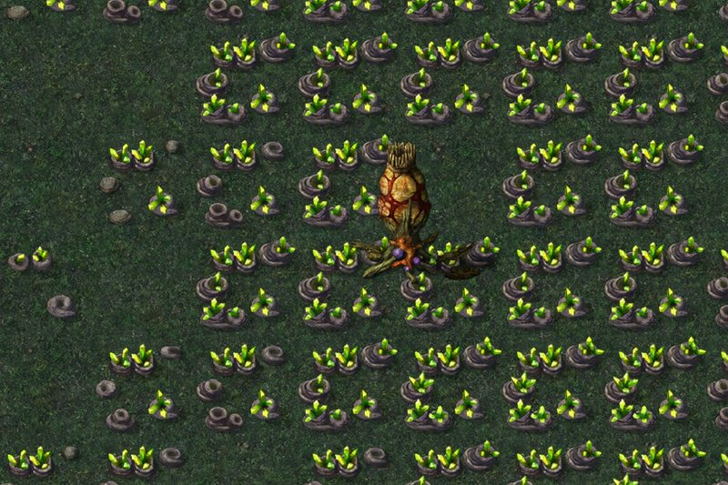

> [!NOTE]
> EA has not endorsed and does not support this product.

# The Tiberium ecosystem

**Holds for:** C&C Remastered Collection, Steam build 21590013. EA has stopped patching the game and archived the
source in January 2025, so this should hold.

## When you need this

When your mod wants Tiberian Dawn's Tiberium in Red Alert: a resource that grows, hurts infantry and turns trees
into blossom trees, beside Red Alert's harmless ore and gems. Red Alert has ore and gems, which grow and spread, but
nothing that hurts or mutates. A mod that only reskins ore doesn't need this page.

## A new resource is its own overlay

Red Alert's ore and gems (`GOLD01`–`GOLD04`, `GEM01`–`GEM04`) all have the land type `LAND_TIBERIUM` (`ODATA.CPP`). Tiberian
Dawn's infantry damage tests that land type (`Land_Type() == LAND_TIBERIUM`), so copied as it is it would make Red
Alert's ore deadly too. Make Tiberium **its own overlay**, and key every Tiberium rule on that overlay, never on the
land type.

**The launcher's resource range.** The DLL marks a cell's overlay as a resource only within the stock ore and gem
range (`IsResource` is set for `OVERLAY_GOLD1` to `OVERLAY_GEMS4` in `DLLInterface.cpp`), and the launcher's minimap
keys its resource pips off that range. A new overlay outside it gets no pips. Two fixes are needed together:

- add the new overlay to the `IsResource` test;
- export it to the launcher as a stock resource overlay for the overlay model and the radar, but with its own asset
  name, so the map still draws Tiberium.

**It blocks building, as ore does.** Outside the map editor, `CellClass::Is_Clear_To_Build` refuses any cell with an
overlay ("In normal game mode, all overlays are not buildable"), so ore, gems and a new resource all block
placement. A field left to spread can close off every legal cell near a construction yard.

**Keep the fields apart.** Make sure Tiberium and ore never convert each other where their fields meet, in the
spread code. Stock spreading always plants ore, whatever the source cell holds (see
[A new resource on the official skirmish maps](../maps-and-lobby/official-maps-with-tiberium.md)).

## Blossom trees

- **A blossom tree can be a building** owned by the neutral house, drawn with TD's blossom-tree art. On each growth
  tick it spreads a neighbouring Tiberium cell, or failing that seeds an empty one.
- **Trees can turn.** An ordinary tree with Tiberium in most of its neighbours becomes a blossom tree.
- **Make it invulnerable,** as TD's are. A damaged blossom tree asks for damage frames its art doesn't have, and
  those draw as white squares.

## Damage to infantry

TD damages infantry by 2 each time one reaches a cell's centre over Tiberium (`InfantryClass::Per_Cell_Process` in
TD's `INFANTRY.CPP`), and exempts the chem warrior. A port can follow that, or damage on a timer instead. If you use
a timer, tune its interval to TD's survival times: the interval sets how fast infantry die.

## Visceroids

TD turns some infantry killed by Tiberium into Visceroids, hostile to everyone.

- **Use a house nobody allies.** Every house allies the neutral house, so a Visceroid it owned would never be
  attacked. Red Alert has a spare house, `HOUSE_JP` (in `DEFINES.H`), that a skirmish doesn't create. Create it on the
  first spawn, ally it with itself, and make it everyone's enemy.
- **Place it with a scan.** The dying soldier still occupies its cell, so place the Visceroid in the nearest free
  spot rather than the exact cell.
- **Give it a hunt mission,** or it idles where it spawns.

## How it was verified

- **The shared land type and the resource range:** EA's `ODATA.CPP` (ore and gems are `LAND_TIBERIUM`) and
  `DLLInterface.cpp` (`IsResource` only for `OVERLAY_GOLD1` to `OVERLAY_GEMS4`).
- **Placement:** EA's `CELL.CPP` (`Is_Clear_To_Build` returning false for any overlay unless `Debug_Map`), the same
  in Vanilla Conquer, and a working mod's long test matches, where spreading Tiberium left no legal cell near the
  yard.
- **TD's behaviour:** EA's TD `INFANTRY.CPP` (2 damage on reaching a cell's centre, not for `INFANTRY_E5`), and
  `HOUSE_JP` in Red Alert's `DEFINES.H`.
- **A working mod:** Tiberium as its own overlay, blossom trees, infantry damage and Visceroids, shipped and played
  on official maps where Tiberium and ore fields meet, under Proton on Linux and on the Steam Deck.

> [!TIP]
> **In Tiberian Factions**
>
> TF puts Tiberium on Red Alert maps as overlay `TIB01`, beside the ore. Infantry standing in it take 2 damage every
> 50 frames, so a minigunner survives about 28 tiles, as in TD, and every infantry type is hurt. The pathfinder steers
> infantry round it. Tiberian Sun's Ghost Stalker is immune and heals in it. About 1 in 100 infantry killed by
> Tiberium rise as a Visceroid.
>
> 
>
> A TD blossom tree standing in a Tiberium field on Keep off the Grass, one of the official Red Alert maps TF converts, where it replaced an ore mine.
