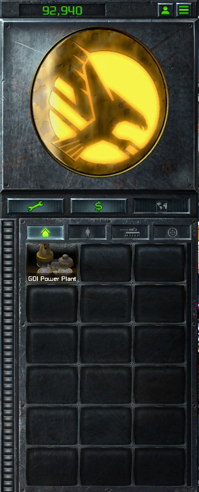

> [!NOTE]
> EA has not endorsed and does not support this product.

# Re-pointing launcher UI art in memory

## When you need this

Only when your mod needs more crests than the launcher's two sides give it: a faction added **alongside** Allied
and Soviet, riding one of their sides, or sub-factions (countries) that each get a logo of their own.

The launcher picks side-specific HUD art, such as the radar crest and the waypoint markers, by Red Alert side, and
it knows only two. A mod with just Allies and Soviets doesn't need this page: to change their look, repaint their
regions in the atlas, which is data. The same goes for a mod that replaces a side outright. If every Allied country
becomes GDI, repaint the Allied crest.

You need it once a third faction plays on an Allied or Soviet country *beside* the original side. Say GDI rides an
Allied country. The launcher then draws the Allied crest for GDI and for the Allies alike, and no data file can tell
the two apart. Re-pointing the record in memory is the only way to give GDI its own crest without taking the
Allies' away.

Sub-factions hit the same wall. England, France and Germany all draw the one Allied crest, so giving each country
its own logo also means re-pointing, by the local player's country.

**Unique sidebars are the same method at a larger scale.** First check whether you need it at all. If TD's
sidebar will do, that's data: each faction in `FACTIONS.XML` names both TD's HUD scene and Red Alert's, and
swapping them gives that faction TD's whole sidebar (see [Adding a faction](../engine/adding-a-faction.md)). Only a
sidebar of your own, or Red Alert's restyled per faction, needs re-pointing. See
[Re-skinning the whole sidebar](#re-skinning-the-whole-sidebar) below.

> [!WARNING]
> **Fragile: this patches the running launcher's memory.**
>
> - **Verified against:** `ClientG.exe` version 1.153 (745903), 34,797,928 bytes, SHA-256
>   `d405ed389548be51c67740bb6309de10a5f02bdfc86324a10c9ad3b663c08897` (Steam build 21590013), with the stock UI
>   atlas `MT_COMMANDBAR_COMMON.TGA` at 6871x6716.
> - **What it depends on:** the layout of ClientG's cached region record (four floats, in the order given below),
>   ClientG computing those floats from the size of the atlas it loaded, the records living in private read-write
>   heap, and which record each side draws. None of this is a public interface.
> - **How it fails if the client changes:** the scan finds no record that matches all 16 bytes, writes nothing, and
>   the stock art draws. The failure is silent and harmless as long as you only ever write on a full match.
>   **Unproven:** what happens if a new client kept the same 16 bytes but used them for something else.
> - **Scanning rules, each one learned from a stall or a crash:**
>   - Never scan ClientG's memory on the game thread. A scan reads hundreds of MB across processes, and 75 of
>     them on the game thread stalled match loads for up to a minute.
>   - Scan a few times, on a worker thread, at widening gaps, and stop once the records are patched. Cache the
>     process id.
>   - Skip every thread's stack. A copy of the mod's DLL also runs inside ClientG, so a scan finds its own locals
>     on the stack and writes over whatever frame is there a moment later.
>   - Never write on a partial match. Compare the whole thing you mean to replace. Tiberian Factions 5.0.0
>     crashed on skirmish load because a sister patch wrote over a freed heap buffer that still held a copy of its
>     needle, and corrupted the heap block after it.
> - **Keep it cosmetic.** This changes only what one player's launcher draws. The simulation never sees it, so it
>   can't desync a LAN game.

**Holds for:** the client in the box above. EA has stopped patching the game and archived the source in January
2025, so the build should stay put, but check the hash before trusting any offset here.

The launcher (`ClientG.exe`) draws its HUD from one big texture atlas, and which part of the atlas a widget shows
can't be changed in data. In memory it can. ClientG keeps a small record for every atlas region it draws, and the
widget samples from that record every frame. Rewrite the record's 16 bytes and the widget shows a different region
on the next frame, with no new art and no pixel writes.

## The data side, and where it stops

The HUD art is `MT_COMMANDBAR_COMMON.TGA` in `TEXTURES_SRGB.MEG`, with a `.MTD` that maps each region name to
`x, y, w, h`. A mod can ship a repainted copy of the `.TGA`, but region geometry belongs to the launcher: a loose
`.MTD` with altered coordinates is ignored. Which region a widget draws is decided by the client too. The radar
crest, for one, picks its logo by Red Alert side.

## The record

```c
float v0, u0, wn, hn;   // y/H, x/W, w/W, h/H of the region, W x H being the atlas size
```

- It lives in ordinary writable heap: private, committed, `PAGE_READWRITE`.
- Each drawn region has a master copy, plus a copy made for each match from the master.
- A region that is never drawn has no record. That makes the record a live inventory: scan for every region's
  record and the hits are the regions on screen.
- Compute each float as a **double divide, then a cast to float**, or it won't match ClientG's bytes.
- Use the size of the atlas the client actually loaded. If your mod ships an atlas of another size, divide by
  that size.

Example: the Allied radar crest, region `x=5698, y=1706, w=794, h=713`, is the record
`{1706/6716, 5698/6871, 794/6871, 713/6716}`.

## The method

1. **Find the process.** `CreateToolhelp32Snapshot` for `ClientG.exe`, then `OpenProcess` with `PROCESS_VM_READ`,
   `PROCESS_VM_WRITE`, `PROCESS_VM_OPERATION` and `PROCESS_QUERY_INFORMATION`. The game's DLL runs in a different
   process (the instance server), so all of this is cross-process. In a LAN game only the host runs that process,
   so a patch made this way reaches only the host's own launcher. Under Proton these calls don't trip Linux's
   `ptrace_scope` at its default of 1: wineserver carries out every `ReadProcessMemory` and `WriteProcessMemory`
   (with `process_vm_readv`, or ptrace), and each Wine process names wineserver as its allowed tracer when it
   starts.
2. **List the thread stacks to skip.** For each thread, read the TEB's `StackBase` with
   `NtQueryInformationThread`, and skip down to the stack's reservation base. Under WoW64 the 32-bit TEB sits at
   `+0x2000` from the 64-bit one.
3. **Walk the heap.** `VirtualQueryEx` over every `MEM_PRIVATE`, `PAGE_READWRITE` region outside those stacks.
   Search on 4-byte alignment for a whole 16-byte record: any slot's stock rect, or any rect you might already have
   written.
4. **Write the rect you want** with `WriteProcessMemory`, and remember the address.
5. **Re-check the known addresses cheaply.** Every few frames, read just those 16 bytes back and re-point them if
   the client has rewritten them. That costs nothing next to a scan.

## What decides the timing

- **The pixels never come back to RAM.** After launch the atlas pixels live only on the GPU. A 1.7 GB read of
  every readable ClientG mapping found the crest pixels in no encoding, while the atlas metadata (region names) was
  resident. Editing pixels in memory is not an option.
- **The atlas file is read once per launch.** A change to the loose `.TGA` shows only after exiting to the desktop
  and relaunching, so the file can't be used to signal anything mid-session.
- **The per-match record appears late.** It's created on the first radar draw, a few frames into the match. A patch
  at frame 0 finds nothing on a fresh launch. Scanning at frames 0, 6, 12, 24, 48, 96, 192 and 384 catches it,
  after which the copies are cloned from a master that's already patched.

## Traps

- **Patch every slot the launcher might draw.** Which slot a side draws is the launcher's choice, and it isn't
  always the obvious one. Point all candidate slots at the art you want, and whichever is drawn will be right.
- **Two slots aimed at one target can't be told apart on the way back.** If two slots both now hold the same rect,
  restoring them needs to know which was which. Add a per-slot nudge to `u0` (`slot * 1e-6`, about 0.007 px), so
  every written record stays unique and restores to its own stock rect.
- **It can't add widgets.** Re-pointing only changes which pixels an existing widget samples. Adding widgets is a
  different job: a new `.BUI` scene and a code patch that binds it. See
  [What the launcher owns](../engine/what-the-launcher-owns.md).

## Re-skinning the whole sidebar

The crest is one region. Every other piece of Red Alert's sidebar is a region too, with the same kind of cached
record: build-bar plates, power bar, top button, tab icons, tooltip frame, small buttons. So one faction can get a
whole sidebar of its own by re-pointing every region Red Alert's scene draws, at art for that faction.

- **Find what's drawn.** Only drawn regions have a record, so scan for the record of every candidate region in
  the `.MTD`. The hits are the pieces to re-point.
- **Match sizes.** A region drawn into a different-shaped slot is squashed. Where the art doesn't match, sample a
  window of the target region with the slot's own proportions. A square button cut from a wide button bar keeps
  its icon and bevels.
- **Leave out pieces that cover others.** An opaque replacement for a frame or bezel can hide what's drawn
  beneath it, the crest included.
- **Restore by slot.** With dozens of slots, two of them will often share a target rect. Use the per-slot `u0`
  nudge (see Traps), or the way back can't tell them apart.

The art you point at has to be in the atlas. A loose, repainted atlas can carry it: see [The UI atlas](../front-end/the-ui-atlas.md). Re-pointing changes how Red Alert's sidebar looks, not what's on it.

## A quick test loop

Under Proton on Linux, ClientG's memory is readable and writable at `/proc/<pid>/mem` by the same user. A script
that lists the records for a region pattern and re-points them lets you test an idea in seconds, with no DLL build:
write the record, take a screenshot.

This works even with Linux's `ptrace_scope` at its default of 1 because of the Steam Linux Runtime, not Wine: the
game runs in the runtime container's user namespace, which belongs to your user, and Linux lets a namespace's owner
read the processes inside it. A same-user process outside such a container, such as the Steam client, refuses the
same read. Without the container, the loop is untested.

## How it was verified

Every finding here was made with that loop against the running client, before any DLL code was written.
Tiberian Factions' patch was then checked for each side in skirmish, under Proton on Linux and on the Steam Deck, and
across a LAN game with a joiner.
`ptrace_scope`: Wine's `server/ptrace.c` (`read_process_memory` and `write_process_memory` try
`process_vm_readv`/`process_vm_writev`, then `PTRACE_ATTACH` with `/proc/<pid>/mem`) and `dlls/ntdll/unix/server.c`
(`prctl(PR_SET_PTRACER, server_pid)` in `server_init_process`, commented "work around Ubuntu's ptrace breakage");
TF's patch works on a Linux desktop with `kernel.yama.ptrace_scope` set to 1. The quick test loop: at
`ptrace_scope` 1, a same-user read of ClientG's `/proc/<pid>/mem` returned its `MZ` header, while the same read of
the Steam client failed; `/proc/<pid>/ns/user` put ClientG and wineserver in a user namespace of their own (the
container's, mapped to the same user) and the shell and the Steam client in the initial one.

> [!TIP]
> **In Tiberian Factions**
>
> TF's radar crest follows the picked faction: TD's eagle for GDI, the scorpion for Nod, a Tiberian Sun crest for
> TS GDI. Both TD logos are already in the stock atlas as regions Red Alert never draws, so re-pointing the crest
> records costs no new art. The same patch re-points the small Allied and Soviet logos the waypoint and rally
> markers use. For a while TF also re-skinned Red Alert's whole sidebar for GDI and Nod this way: 54 region pairs,
> each Red Alert piece pointed at its TD counterpart, checked for all four factions. It retired that the day
> GDI and Nod switched to TD's own HUD scene in `FACTIONS.XML`, which did the same job as data. To reach LAN joiners too, TF relies on ClientG loading the mod's DLL briefly at its own start-up on
> every machine. A hook installed during that load lets each player's launcher run the patch for itself. See
> [Patching the launcher's code from your DLL](patching-the-launchers-code.md).
>
> 
>
> A TS GDI player's sidebar in a Red Alert match: the faction's own crest in the radar slot, before a radar is built.
