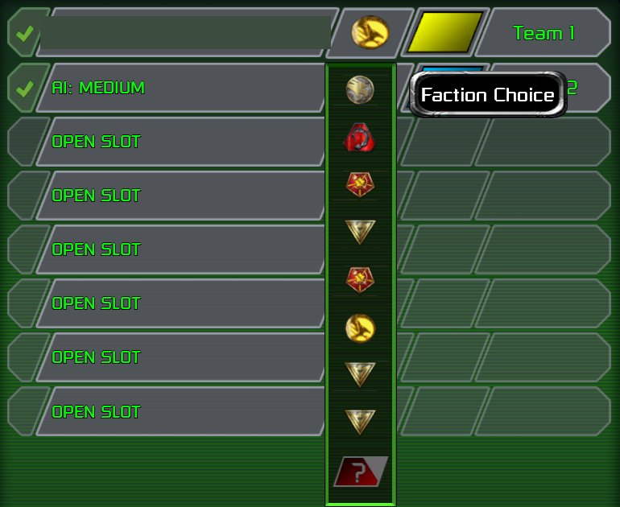

> [!NOTE]
> EA has not endorsed and does not support this product.

# Adding a faction

**Holds for:** C&C Remastered Collection, Steam build 21590013. EA has stopped patching the game and archived the
source in January 2025, so this should hold.

## When you need this

When a Red Alert mod wants a new playable side in skirmish and multiplayer: its own tech tree, starting units, EVA
and lobby name, beside Allied and Soviet. It takes a custom DLL. A mod that only changes the existing sides' units,
or gives a country a stat bonus, doesn't need this page.

## Why you can't just add a house

Red Alert's sides are a compiled enum, `HousesType` (`DEFINES.H`): the eight countries (Spain, Greece, USSR,
England, Ukraine, Germany, France, Turkey), then `HOUSE_GOOD`, `HOUSE_BAD`, `HOUSE_NEUTRAL`, `HOUSE_JP`, and the
eight multiplayer houses. Side membership is a pair of bit masks: `HOUSEF_ALLIES` (the six Allied countries plus
`HOUSE_GOOD`) and `HOUSEF_SOVIET` (USSR, Ukraine and `HOUSE_BAD`). Side behaviour is tested against country
houses all through the game code, in 15 of Red Alert's source files. Then there's the launcher. Its lobby picker
lists exactly the eight countries, and the only identity it ever receives is a country house (see
[What the launcher owns](what-the-launcher-owns.md)).

No data file adds a side, and a new `HousesType` value would mean changing every one of those places, then
finding the launcher has no row, name or art for it. Instead, **a new faction rides one of the eight country
rows.**

## How a pick becomes a house

In skirmish and multiplayer, each player plays a multiplayer house (`HOUSE_MULTI1` plus their slot). The country
they picked in the lobby arrives in `CNC_Set_Multiplayer_Data` (`CNCPlayerInfoStruct::House`), and
`HouseClass::Init_Data` stores it as the house's `ActLike`. All side-specific code asks `ActLike`. So there are two
ways to turn a country row into a new faction:

1. **Remap the pick to an existing non-country house.** Red Alert already has `HOUSE_GOOD` and `HOUSE_BAD`. In
   `CNC_Set_Multiplayer_Data`, before the player list is used, rewrite the picked country: Spain becomes
   `HOUSE_GOOD`, say. Every `ActLike` test then sees GDI. Nothing in the enum changes.
2. **Decouple a country from its side.** Take one country out of `HOUSEF_ALLIES` (or `HOUSEF_SOVIET`) and give it
   a mask of its own, with one predicate (`Is_<faction>(house)`) that every faction branch asks. The row the
   player clicks *is* the house they play, so no remap is needed.

Either way, the faction's tech tree, starting units, AI and sounds are DLL work keyed on `ActLike` or the
predicate. That work is your mod's own design, and it's beyond this page.

## The launcher's data for the row

The lobby row itself is the launcher's, and it's data in `CONFIG.MEG` (see
[Overriding the launcher's data](../launcher-data/overriding-launcher-data.md)):

- **The name** is three strings per country in `MASTERTEXTFILE_<lang>.LOC`: `TEXT_FACTION_NAME_FACTION_<n>`
  (the lobby name), `TEXT_FACTION_BONUS_<COUNTRY>` (the overlay shown on hover and select) and
  `TEXT_FACTION_REDALERT_<COUNTRY>` (the in-match name). Relabel all three.
- **The entries:** `FACTIONS.XML` holds eleven `ObjectTypeClass` entries. `Faction1` is TD's GDI and `Faction2`
  TD's Nod. `Faction3` to `Faction10` are the eight countries in `HousesType` order: Spain, Greece, USSR, England,
  Ukraine, Germany, France, Turkey. The eleventh, `Faction_Funpark`, is the Jurassic bonus campaign's.
- **The emblem** is `EncyclopediaComponent` > `DefaultIcons` > `SmallIconName` in each entry, pointing at a
  preloaded player-slot icon (`UI_Multiplayer_PlayerSlot_Faction_<nn>`). GDI uses `_00` and Nod `_01`, the
  countries `_03` to `_10` in the same order, and `Faction_Funpark` reuses `_00`. There is no `_02`. Repaint those
  icons in the UI atlas.
- **The colours:** each entry's `TeamColorSettings` holds one entry per player colour (team 0 sky blue, team 1 red,
  and on, then one for outposts), each with its own `UIColor`, `ParticleColor` and `RadarIconColor`. So a
  faction's UI tint is set per team, not once for the faction.
- **The HUD scene:** each faction entry in `FACTIONS.XML` names both TD's scene (`Art/GUI/Tactical_UI.bui`, in
  `TopLevelGUIList`) and Red Alert's (`Art/GUI/RA_Tactical_UI.bui`, in `TopLevelGUIListAlt`). Red Alert reads
  the alternate list, so swapping the two in a faction's entry gives that faction TD's whole sidebar.

## What the launcher still keys by side

A faction riding a country is Allied or Soviet to the launcher: Spain, Greece and Germany are all Allied. So these
need the DLL or a launcher patch:

- **Side-keyed HUD art** (radar crest, waypoint and rally markers):
  [Re-pointing launcher UI art in memory](../clientg-ram/repointing-atlas-regions.md).
- **TD's HUD scene picks its logo by Red Alert side,** so a TD-scene faction on the Allied side shows TD's GDI
  eagle until it's re-pointed.
- **EVA voice lines the launcher plays itself** ("Mission accomplished", "Low power" and others) follow the side,
  not the faction.
- **Sounds and EVA the DLL sends** follow whatever name the DLL chooses, so pick them by `ActLike`:
  [TD sounds from the base game](../using-what-the-player-owns/td-sounds-from-the-base-game.md).

## Traps

- **`PlayerPtr` is every house in turn.** In the Remastered DLL, `HouseClass::AI` calls
  `Logic_Switch_Player_Context(this)` first, so inside it `this == PlayerPtr` is always true. Test `IsHuman`, or
  the DLL's current local player index, instead.
- **Eight rows, fixed.** The picker lists the eight countries in the launcher's own order. Reordering
  `FACTIONS.XML` changes nothing, a commented-out entry leaves a blank row that still selects its country, and
  changing an entry's `CampaignType` crashes the launcher at boot (observed). So eight rows is the ceiling, Allied
  and Soviet included, and any rows you don't use stay as duplicates.
- **A decoupled country must never unlock its old side.** If a building grants the new faction's tree, give it the
  faction's own mask, never the country's bit, or the country's old side tree comes with it.
- **The launcher's preloaded icons only.** Pointing `SmallIconName` at any other atlas region crashes the launcher
  at boot (observed).

## How it was verified

- **EA's source:** the `HousesType` enum and both side masks, `CNC_Set_Multiplayer_Data` handing the picked house
  over, `HouseClass::Init_Data` setting `ActLike`, and `HouseClass::AI` switching the player context.
- **The game's files:** the stock `FACTIONS.XML` (the countries' entries, preloaded icons and both scene lists),
  and the three name strings per country in `MASTERTEXTFILE_EN-US.LOC`. The eleven entries, their icon numbers
  and their `TeamColorSettings` (ten player colours and an outpost neutral) were read from the stock file; the
  countries' order matches `HousesType` in EA's `DEFINES.H`, and Tiberian Factions' same-size `FACTIONS.XML` edit
  finds each entry's icon at that path.
- **TF** uses both routes: Spain and Greece remapped to `HOUSE_GOOD` and `HOUSE_BAD`, Germany
  decoupled into a side of its own. All of it played in skirmish and LAN, under Proton on Linux and on the Steam
  Deck.
- Observed only: the picker's fixed order and the two boot crashes.

> [!TIP]
> **In Tiberian Factions**
>
> TF plays five factions on the eight rows: Spain is TD's GDI and Greece TD's Nod (both remapped), Germany is
> Tiberian Sun's GDI (decoupled), England stays Allied and the USSR Soviet. The remaining three rows are labelled
> as duplicates of Allied and Soviet for now, and they're where TF's next factions go: more are on the way. GDI,
> Nod and TS GDI load TD's sidebar scene.
>
> 
>
> The lobby picker's eight rows: GDI's silver coin, Nod's scorpion, Soviet and Allied, then a Soviet duplicate, TS GDI's gold coin and two Allied duplicates, plus random. The player's name is blanked.
