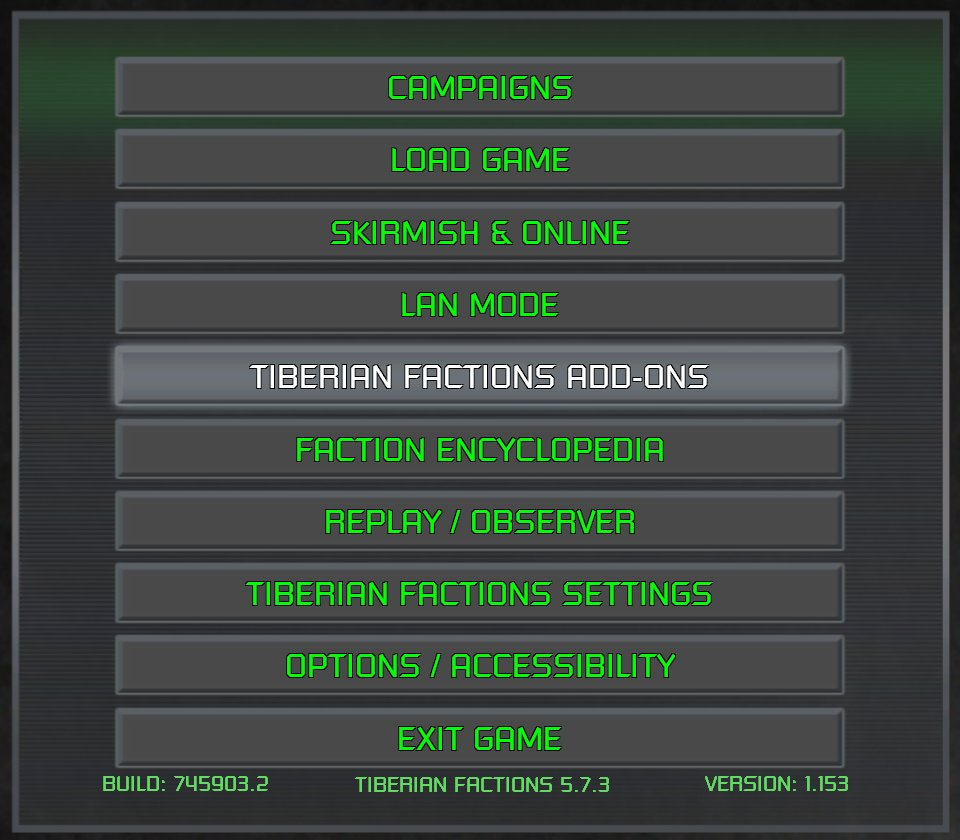

> [!NOTE]
> EA has not endorsed and does not support this product.

# BUI screens

**Holds for:** C&C Remastered Collection, Steam build 21590013. EA has stopped patching the game and archived the
source in January 2025, so this should hold.

**HD mode only.** This page describes the HD renderer. See [HD-only mods](../getting-started/hd-only-mods.md).

## When you need this

When your mod changes how a launcher screen is laid out: moving, resizing, hiding or recolouring buttons and
panels on the main menu, lobbies, dialogs, loading screen or in-match HUD, or swapping a screen for TD's. Changing
only the *pictures* on a screen is [the UI atlas](the-ui-atlas.md) or a loose texture. Adding a screen or a button
that does something new also needs [a launcher patch](new-screens-and-buttons.md).

## Where screens live, and which one opens

Every screen is a `.BUI` file under `DATA\ART\GUI\` in `CONFIG.MEG` (207 of them): `RA_MAIN_MENU.BUI`,
`RA_TACTICAL_UI.BUI` for Red Alert's in-match HUD, `TACTICAL_UI.BUI` for TD's, and so on.

**Which screen opens is data.** Each faction in `FACTIONS.XML` lists screens by key in `GUIFileNames`, as
`RA/<name>` (for example `DialogBox` → `RA/RA_DialogBox_Allied`), and names its HUD scenes. Pointing a key at
TD's screen name swaps in TD's whole screen. For the HUD, see [Adding a faction](../engine/adding-a-faction.md).

**Ship a `.BUI` loose**, at its path under your mod's `Data/` (`Data/ART/GUI/RA_MAIN_MENU.BUI`). A loose screen may
be any size. Inside a replacement `CONFIG.MEG` it must keep the stock file's exact size: see
[Overriding the launcher's data](../launcher-data/overriding-launcher-data.md).

## The format

```
offset  size  field
0x00    2     magic 'CH' (ChunkFile)                       keep
0x02    2     version 02 01 (2.1)                          keep
0x04    1     flags: low nibble 1 = zlib                   keep
0x08    4     a hash                                       not checked: leave it as it was
0x10    4     compressed length = file length - 0x24       set it after an edit
0x24    ...   the zlib stream: the scene graph
```

The hash at `0x08` is never checked. A shipped, edited main menu keeps the stock file's hash over a different
payload, and loads. The uncompressed size is stored nowhere.

**The scene graph is a tree of nodes:** `[u32 id][u32 spec]`. If `spec`'s top bit is set, the node is a container,
and the low 31 bits are its number of **child nodes** (a count, not a byte size). Otherwise it's a leaf of `spec`
bytes. Every stock screen parses this way exactly, end to end. Red Alert's HUD is 6,497 nodes.

**Widgets** carry ASCII names (`Button_Exit`, `Side_Bar_Group`), texture references and text keys. The tags mapped
so far:

- `02 10`: the widget's rect, four floats `x, y, w, h` as fractions of the screen (0 to 1). Changing it moves or
  resizes the whole widget, label included.
- `03 10`: its tint, four floats RGBA. Alpha 0 hides it.
- **A widget's rect and tint come before its name**, not after. The tags following a name belong to the *next*
  widget. Editing the tint after a name changes the wrong widget.
- Texture-set names are strings inside a widget's header leaf, and can be swapped for any set the launcher knows.

Text styles live in `FONTLIBRARY.BFD`, a flat list of named styles, and new ones can be appended. Some text widgets
are recoloured by the launcher itself, so for those a tint won't stick: use a coloured style instead.

## What you can do

- **Reshape existing widgets:** move, resize, hide, retint, retexture, restyle text. This works on every screen,
  in the menus and in the match HUD.
- **Reorder or remove buttons** by moving and hiding them.
- **Clone a widget.** Copy a complete widget subtree, give it new names, a fresh unique ID (each widget's first
  micro-chunk, `01 04 <u32>`, is a per-instance ID) and a new rect, insert it as a sibling, and add one to its
  parent's child count. The screen then draws it. Drawn is not the same as working: the launcher binds behaviour to
  widgets it looks up by name in its own code, so a clone of a button draws but does nothing until a patch binds
  it. See [New screens and buttons](new-screens-and-buttons.md).
- **Add text styles** in `FONTLIBRARY.BFD`, and attach effects (sheens, glows) by name.

What a `.BUI` can't do alone is make the launcher *use* a widget it has no code for. In Red Alert's HUD scene, for
example, every Allied country's crest is the `_Allies` widget, and an added `_GDI` widget is never asked for. That's
why per-faction crests come from [re-pointing records in memory](../clientg-ram/repointing-atlas-regions.md).

## Editing safely

1. Start from the **stock** file, extracted from `CONFIG.MEG`, every time. Check the values you expect before you
   change them.
2. Decompress from `0x24`, edit the tree, and recompress.
3. **Loose:** write the header with the new compressed length, and you're done.
4. **Inside a replacement `CONFIG.MEG`:** recompress at zlib level 9 (the stock files compress at about level 6,
   so re-saving at 6 tends to *grow* them), check the stream still fits in the stock file's size, then pad with
   zero bytes back to the exact stock size.
5. Keep the tree balanced. A broken child count or a too-deep tree makes the launcher refuse the file as corrupt.

## Traps

- **A combo box's list only takes clicks inside the group that holds the combo.** Stretch a drop-down list past
  its group and its lower rows draw, but close the list when clicked. Grow the group too, and scale its other
  widgets so nothing moves on screen (observed).
- **A widget moved off screen widens the screen's fit**, stretching the whole menu, and its clicks, on ultrawide
  displays. Shrink a widget you want gone, in place, instead (observed).
- **Shared sets and styles restyle more than one screen.** The stock main menu's buttons use the texture set
  `TacticalSidebarSellRepairButton`, which repainting showed is also the in-match sidebar's (observed). The text
  style `24 Point Regular Outline Red` appears in 19 stock Red Alert screens. Give your screen its own sets and
  styles rather than repainting shared ones.
- **Animations only play when the launcher starts them by name.** A keyframe animation you add won't run. Effects
  such as sheens loop by themselves.

## How it was verified

- **The format:** every one of the 207 stock `.BUI` files in `CONFIG.MEG` has the `CH`, 2.1, zlib header, and
  parses exactly with the node grammar above (measured). A shipped mod's loose main menu keeps the stock hash over an
  edited, larger payload and loads. The header and loader checks were also read from `ClientG.exe`'s ChunkFile
  reader.
- **The tags:** read in the stock main menu (`Button_Exit`'s rect `02 10` sits before its name, with values in 0 to
  1), and used by a shipped mod's menu, lobby, dialog, loading-screen and HUD edits.
- **Screens by `FACTIONS.XML`:** the stock file's `GUIFileNames` entries, and a shipped mod that swaps its lobbies,
  LAN screens and HUD to TD's.
- **Cloned widgets:** a shipped mod's main menu carries cloned buttons, and a HUD test with inserted widgets drew
  normally.

> [!TIP]
> **In Tiberian Factions**
>
> TF restyles Red Alert's main menu in steel and green, reorders its buttons, and clones Exit Game's button three
> times for its own menu entries. Its lobbies, dialogs and loading screen are restyled the same way, and GDI, Nod
> and Tiberian Sun's GDI get TD's whole HUD scene through `FACTIONS.XML`. TF's repository also has a step-by-step
> [main-menu restyle guide](https://github.com/gibbo101/cnc-ra-tiberian-factions/blob/main/docs/main-menu-restyle-guide.md)
> with its scripts.
>
> 
>
> TF's restyled main menu: the stock menu box, reskinned, with the mod's own buttons added.
