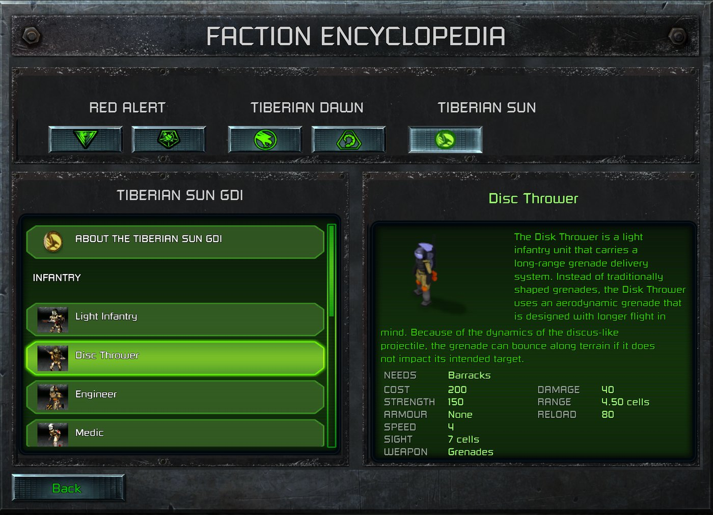

> [!NOTE]
> EA has not endorsed and does not support this product.

# A faction encyclopedia screen

**Holds for:** the client in the box below. EA has stopped patching the game and archived the source in January
2025, so the build should stay put, but check the hash before trusting any address.

**HD mode only.** This page describes the HD renderer. See [HD-only mods](../getting-started/hd-only-mods.md).

## When you need this

When your mod adds enough units and structures that players need a reference: a screen off the main menu that
lists each faction's roster with a picture, a description and its real stats. The same method serves any screen
that shows live game data in the launcher. If a web page or a text file is enough for your players, you don't need
this.

> [!WARNING]
> **Fragile: this calls the launcher's own functions and writes into its textures.**
>
> - **Verified against:** `ClientG.exe` version 1.153 (745903), SHA-256
>   `d405ed389548be51c67740bb6309de10a5f02bdfc86324a10c9ad3b663c08897` (Steam build 21590013).
> - **What it depends on:** the addresses below, the layout of the launcher's list and texture objects, and the
>   offset of the Direct3D texture inside its engine texture.
> - **How it fails if the client changes:** check the opening bytes of every function before you call any of them,
>   and leave the screen out if one differs. A call to a moved function crashes the launcher.
> - The general rules are on [Patching the launcher's code from your DLL](../clientg-ram/patching-the-launchers-code.md).

## The screen

The screen is a new `.BUI` scene opened from a new main-menu button, built as on
[New screens and buttons](new-screens-and-buttons.md): a copy of a stock screen's layout with its class set to
the registered, unused `SplashScreen`, so your DLL binds every widget. A stock screen with a tab row and a list,
such as Mission Select, is a good frame to copy. How to reshape and restyle the copy is on
[BUI screens](bui-screens.md).

## Live stats: load the rules inside the launcher

The launcher, `ClientG.exe`, loads your DLL only for its `CNC_Version` check. The game itself (type heaps, rules,
MIX files) starts in the instance server, and only when a match starts. So at the menu, nothing in the launcher's
copy of your DLL has read the rules.

To show real stats, have the DLL do inside the launcher what a skirmish start does:

1. **Build the type heaps,** as `INIT.CPP` does.
2. **Read your mod's rules from its own `CCDATA` folder:** `rules.ini` through `Rule.Process`, then `aftrmath.ini`
   and `mplayer.ini` as overrides of the sections a skirmish takes from them.
3. **List each faction's entries** from the types it can build: your own faction test, a tech level the skirmish
   allows, and an entry in the sidebar's buildables XML.

Skirmish values then match what players see in a match. Scenario INIs and difficulty aren't applied, so say that the
stats are skirmish values.

## Names, pictures and text

- **Names, cameos and the short description** come from the same buildables XML the sidebar uses:
  `ObjectNameTextID`, `ObjectDescriptionTextID` and `BuildIcon`. Read every `*BUILDABLES.XML` of your mod and of
  each loaded mod folder (asset packs included). The launcher's own text table resolves the keys, so text from
  [`ModText.csv`](../launcher-data/new-text-strings.md) works as it does on the sidebar.
- **A longer description** is one more `ModText.csv` key per entry. Wrap it yourself to fit the box: the text widget
  shows what it's given.

### Pictures: draw into a canvas shipped at start-up

The launcher only loads texture files it found when it started, before it loaded your DLL (observed). A file
written later, or named by a full path, never loads. So:

1. **Ship one blank canvas texture** of the picture's size (a 256 × 192 TGA works), loose with the mod's other
   textures.
2. **Point the screen's picture at the canvas,** with the launcher's own set-texture call.
3. **Find the canvas's Direct3D texture:** look the name up the way the set-texture call does, through the GUI
   manager. The engine texture it returns holds the `ID3D11Texture2D` at `+0x84` (its shader view is at `+0x80`).
4. **Write each picture's pixels** with `UpdateSubresource` on the device's immediate context, on the launcher's UI
   thread.

The picture itself can be composed from the unit's own HD art. Find its frames through the tileset XMLs, read each
from its ZIP or loose DDS, place it by its `.meta` crop (see
[How the launcher draws sprites](../art/how-the-launcher-draws-sprites.md)), and seat turrets and other layers as
the unit's own draw code does. Then apply the faction's house colour the way the game does. The team-colour rules
are in `CNCRATEAMCOLORS.XML` and `CNCTDTEAMCOLORS.XML` (`CONFIG.MEG`), and EA's map editor source shows the maths
(`TextureManager.cs`): in linear light, a green pixel within the house's hue bounds takes the house's hue,
saturation and value shift. Show the cameo for anything the picture can't draw.

## Filling the list

Use the copied screen's own list box, with a sample row from a `.BUI` of its own. Per row, in this client:

| Step | Address |
|---|---|
| Clear the list | `0xF6AF60` |
| Add a row | `0xF6A620` |
| Clone the sample row into the list's column | `0xF73CB0` |
| Make the row's button take no input, so the list gets the click | `0xF80BC0` |
| Show a row as selected | `0xF80920` |
| Select a row after filling | `0xF74EA0` |
| Set a quad's texture | `0xF604C0` |
| Find a texture by name (GUI manager) | `0xF301F0` |

Each of these addresses was read from `ClientG.exe` on disk, and each opens with a normal function prologue. A
click arrives as an event on the row's cell, with the row as its data.

## Traps

- **Process the rules once.** A second `Rule.Process` rebuilds the weapon and warhead heaps underneath the types'
  pointers to them.
- **Let the list take the click.** A cloned row keeps its button. If the button takes input, it eats the click, and
  the list never selects the row.
- **The skirmish's own INI wins.** If a stock `mplayer.ini` override applies in skirmish, your encyclopedia should
  apply it too, or its numbers disagree with the game. See also the INI lookup order on
  [Known engine traps](../troubleshooting/known-engine-traps.md).
- **Hiding stock menu buttons.** To make room on the main menu, shrink a stock button and its badges to nothing
  where they are. The launcher shows them again if you only hide them, and moving them off screen stretches the
  whole menu and misplaces its clicks on ultrawide screens.

## How it was verified

- **The screen and the list calls:** a shipped mod's encyclopedia, opened for every faction on the build before
  release. Every address above was read from `ClientG.exe` on disk and matches the bytes that mod checks before
  calling, except the no-input call (`0xF80BC0`), which it calls without checking. Check it as well.
- **The rules inside the launcher:** the launcher names only `CNC_Version` among the DLL's exports (see
  [Patching the launcher's code from your DLL](../clientg-ram/patching-the-launchers-code.md)), and the mod's code
  builds the heaps and processes its rules as described.
- **House colour:** the two team-colour files in `CONFIG.MEG`, and EA's `TextureManager.cs`, which converts to
  linear light before recolouring.
- **Observed only:** that late-added textures never load.

> [!TIP]
> **In Tiberian Factions**
>
> TF's FACTION ENCYCLOPEDIA sits under the ADD-ONS button, with a tab for each of its five factions. Each tab opens
> with an ABOUT row, then lists infantry, vehicles, aircraft, ships and structures, cheapest first. The selected
> entry shows its in-game picture in its house colour, a description from the original games' manuals, what it
> needs, and its stats (cost, strength, armour, speed or power, sight, weapons, damage, range, reload, seats).
>
> 
>
> The encyclopedia's Tiberian Sun tab with the Disc Thrower selected: its picture, description and live stats.
