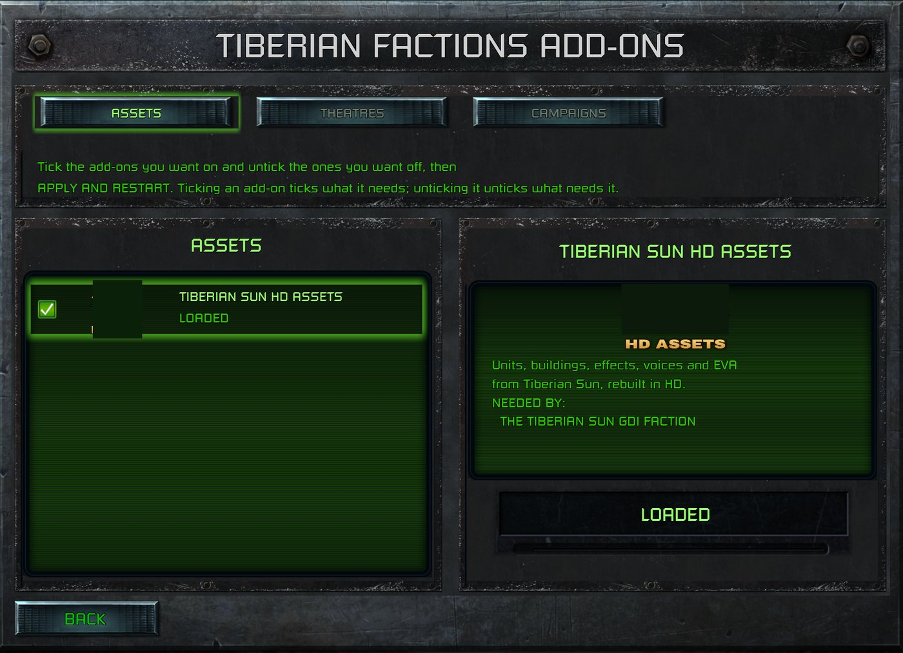

> [!NOTE]
> EA has not endorsed and does not support this product.

# New screens and buttons

## When you need this

When your mod needs a button or a whole screen that the launcher doesn't have, such as a settings page, an add-ons
manager or an encyclopedia, reached from the main menu. Restyling, moving or hiding existing widgets is data only:
see [BUI screens](bui-screens.md). This page is for behaviour the launcher has no code for.

> [!WARNING]
> **Fragile: this patches the launcher's code and calls its internal functions.** Read
> [Patching the launcher's code from your DLL](../clientg-ram/patching-the-launchers-code.md) first. Its rules
> apply to every call and hook here.
>
> - **Verified against:** `ClientG.exe` version 1.153 (745903), 34,797,928 bytes, SHA-256
>   `d405ed389548be51c67740bb6309de10a5f02bdfc86324a10c9ad3b663c08897` (Steam build 21590013).
> - **What it depends on:** the addresses and calling conventions of the launcher functions below, the main
>   menu's event-binding site, and the screen object's layout (`+0x330`, vtable `+0x2CC`).
> - **How it fails if the client changes:** check the opening bytes of every function you'll call, and the hook
>   site's, before installing anything, and install nothing if one differs. The cloned buttons then draw and do
>   nothing, and your screens never open. Calling an internal function at a guessed address crashes the launcher.
> - **Keep it in the front end.** Everything here runs in the launcher's UI, and the simulation never sees it.

**HD mode only.** This page describes the HD renderer. See [HD-only mods](../getting-started/hd-only-mods.md).

**Holds for:** the client in the box above. EA has stopped patching the game and archived the source in January
2025, so the build should stay put, but check the hash before trusting any address.

## Why data alone isn't enough

A `.BUI` can clone a button, and the clone draws. But the launcher wires up behaviour in its own code, by looking
up the widget names it expects, so a clone it has never heard of does nothing when clicked. A new screen is the
same. Each stock screen's `.BUI` names the C++ class that runs it, and that class binds the widgets *it* knows. So
your patch has to do the binding.

## A new main-menu button

1. **Clone a stock button** in a loose copy of `RA_MAIN_MENU.BUI`, as on [BUI screens](bui-screens.md): copy Exit
   Game's widget, rename it (say `MyMod_Settings`), give it a new rect and label, and make room for it by moving
   the rows below.
2. **Hook the moment the menu binds its own buttons.** A register-snapshot hook at the menu's event-binding site
   hands your handler the menu object.
3. **Find your widget and bind its click.** Look the widget up by name through the launcher's own find function,
   cast it to a text button, then call the launcher's event binder with the click event (`0x21`) and your handler.

The main menu lives for the whole session, so anything on it that should change (a notice, a counter) needs its
own refresh, such as a timer on the UI thread.

## A new screen

1. **Write the screen as a `.BUI` of your own**, loose at `Data/ART/GUI/RA/<NAME>.BUI`. The easiest start is a
   copy of a stock screen with its widgets restyled, hidden or cloned.
2. **Run it on a class that binds nothing.** Set the scene's class to `SplashScreen`. `ClientG.exe` registers it,
   but no stock screen uses it, so it brings no handlers of its own. If you kept the stock screen's class, it
   would try to bind the stock widgets it expects.
3. **Open it from your button's handler:** get the GUI manager, create a scene instance named `RA/<Name>` (the same
   form `FACTIONS.XML` uses for screen names), and focus it. The new scene draws over the main menu, and the menu
   carries on underneath.
4. **Bind its widgets.** The scene's behaviour object, at `+0x330`, owns its widgets and events. Find each widget
   and bind it as for the menu button. A handler bound with data `n` receives the behaviour object and `n`, so one
   handler can serve a whole row of buttons or tabs. It's called as a member function: the behaviour object in
   `ecx`, and `n` as its one stack argument, which the handler pops (stock handlers end `ret 4`). In C++, declare
   it `__fastcall` with an unused second parameter for `edx`.
5. **Close it** through the scene's own close (its vtable, `+0x2CC`), then release it.

### Addresses in this client

| What | Address | Opening bytes on disk |
|---|---|---|
| GUI manager (returns it) | `0x5ED5D0` | `A1 B8 3F FA 01 85` |
| Create scene instance | `0xF2CB70` | `55 8B EC 83 EC 1C` |
| Focus a scene | `0xF0E1D0` | `53 56 57 8B F9 E8` |
| Release a scene | `0x55FE10` | `53 8B D9 83 7B 04` |
| Find a widget by name | `0xF0D980` | `55 8B EC 51 83 3D` |
| Cast to text button | `0x5EF8A0` | `55 8B EC 83 EC 64` |
| Cast to button | `0x606990` | `55 8B EC 83 EC 4C` |
| Set a widget's text | `0xF1D270` | `55 8B EC 83 EC 1C` |
| Bind an event | `0x6A9F50` | `55 8B EC 51 53 8B` |
| Main menu's binding site (hook) | `0x6B185B` | `6A 15 68 F0 7E C1 01` |
| Skirmish lobby's Back handler | `0x71C790` | `56 8B F1 E8 B8 FB` |
| Show a message box | `0x1502EA0` | `55 8B EC A1 D8 83` |

**Leaving the skirmish lobby from your code,** say to send the player to a screen of your own, is the lobby's own
Back handler, called on the lobby's behaviour object with data 0. The lobby binds it to its `Back_Button` widget
(kept at `+0x5C` in that object) with the click event, so calling it does just what the button does: the lobby
closes and the main menu underneath shows again. A working mod first checks the button is usable, and leaves the
lobby alone when it isn't, and it calls the handler on the UI tick after the click that asked for it, not from
inside that click.

**A message box of the launcher's own,** say to warn a player that a pack is missing, is `0x1502EA0`. It's
`__cdecl` and takes, in order:
- a callback: a target and an invoker, called as a member function with the clicked button's number;
- the body text, then a key and a text for each of the two buttons (MSVC `std::wstring`s);
- five integers;
- three empty MSVC `std::string`s.

A stock two-button call (at `0x5A97C0`) passes `1, 0, 0, 0, 3`. A working mod passes the same for a box with an
action button and OK, and `1, 1, 0, 2, 3` for OK alone; what each integer does wasn't worked out. Look button
text up as the stock caller does: the text manager at `0x1FE4CE8` with `0x9C1590`, for example `TEXT_OK`. The box
reports its first button as 2 and OK as 3 (observed in a working mod; no stock callback was read to confirm it).

## Switching mods on and off from your screen

An add-ons screen has to know which mods are loaded, which are switched on for the next start, and which are only
downloaded, and it has to switch them. The launcher keeps all of it:

- **Loaded this session:** a vector of the mod root folders at `0x1FE4C28` (MSVC `std::string`s, first and last
  pointers). Look in each for a file only your add-on carries.
- **The Mods screen's list:** the mod manager, returned by `0x5E8CB0`. Its records run from the pointer at `+0x18`
  to the one at `+0x1C`, `0xBC` bytes each: the folder (a `std::string`) at `+0x78`, the mod's ID at `+0xA8`, and
  its "on for the next start" byte at `+0xB9`. A fresh download isn't in it yet (see Traps).
- **Switching a listed mod:** the Mods screen's own toggle, `0x7BB7A0`, called on the mod manager with the ID and
  1 or 0. It finds the record by ID and sets its byte.
- **Switching on a mod the list hasn't seen** (just downloaded): add its ID to the profile's enabled list, a vector
  of IDs at `0x20E0D88`, growing it with the launcher's own allocator. Then save the profile: `0x14D8420` on the
  profile at `0x20E0CB0`, with 1, 0, 1.
- **Restarting** as the Mods screen's RESTART NOW does: post the launcher's restart message (`0x1177810` builds
  it) to the launcher link at `0x1FAD3CC` with `0x11790F0`.

**A mod's ID** is zlib's CRC-32 of its `ccmod.json` `name` followed by `high.low`: `"My Pack"` at version 1.0 hashes
`My Pack1.0`. So **every version bump changes the ID**. The launcher drops enabled IDs that match no installed mod
when it starts, so a player's mod switches off once after each update (observed), and your screen should say so.

**Downloads are Steam's.** Subscribe with `SteamAPI_ISteamUGC_SubscribeItem`, then call `DownloadItem` with high
priority: Steam holds a plain subscription's download while the game runs (observed). A downloaded item sits in
`steamapps/workshop/content/1213210/<item>/`, which every Steam account on the machine shares, but the launcher
lists only the signed-in account's subscriptions. Check `GetItemState` before treating a download as this
player's.

| What | Address | Opening bytes on disk |
|---|---|---|
| Mod manager (returns it) | `0x5E8CB0` | `A1 10 45 FA 01 85 C0` |
| Switch a listed mod | `0x7BB7A0` | `55 8B EC 51 8B C1` |
| Save the profile | `0x14D8420` | `55 8B EC 8B 45 10` |
| Build the restart message | `0x1177810` | `6A 08 E8 89 91 7D` |
| Post it to the launcher | `0x11790F0` | `55 8B EC FF 75 08` |
| The launcher's allocator | `0x9509A0` | `55 8B EC 5D E9 D7` |

## Traps

- **Check everything before installing anything.** One mismatched function means a different client. Install
  none of the screen, not just the part that failed.
- **Hidden widgets should shrink in place.** A widget moved off screen widens the screen's fit, which stretches
  the menu and its clicks on ultrawide displays (observed).
- **A Workshop download doesn't reach the mods list until a restart.** If your screen switches mods on or off, the
  launcher's own list only rescans on a restart or Mods > Refresh (observed).

## How it was verified

- **The class:** `SplashScreen` is in `ClientG.exe`'s strings beside `Create_Scene_Instance`. None of the 207 stock
  `.BUI` files uses it, and a shipped screen that does draws and works.
- **The calls:** every address above was read from `ClientG.exe` on disk, and matched the opening bytes a working
  patch checks before installing.
- **The handlers and the lobby's Back:** the lobby's set-up disassembled for this page finds `Back_Button` by name,
  keeps it at `+0x5C`, and binds `0x71C790` to it with event `0x21` and data 0, through a binder with the same
  opening bytes as the one above; `0x71C790` takes the object in `ecx` and returns with `ret 4`. A working mod's
  handlers are declared that way, and its lobby pop-up leaves the lobby through that handler.
- **Switching mods:** the toggle at `0x7BB7A0` disassembled for this page (it walks `0xBC`-byte records, compares
  the ID at `+0xA8` and writes the byte at `+0xB9`), the opening bytes above read from disk, and `0x1FE4C28` and
  `0x20E0D88` referenced from the launcher's code. A released mod's add-ons screen switched a downloaded pack on
  by the ID worked out as above, restarted, and found the pack loaded. Per-account subscriptions: each account's
  `userdata/<id>/ugc/1213210_subscriptions.vdf` against the one shared `workshop/content/1213210/` folder.
  Observed only: the ID dropped after an update, and Steam holding a download while the game runs.
- **The message box:** the stock call at `0x5A97C0` disassembled for this page: it looks its text up through the
  text manager at `0x1FE4CE8` with `0x9C1590` and pushes `1, 0, 0, 0, 3` before the three empty strings. A released
  mod's lobby pop-up runs its action on button 2, and its OK closes it.
- **In play:** a released mod adds three main-menu buttons and three screens of its own this way (an add-ons
  manager, a faction encyclopedia and a settings page), on Linux under Proton and on the Steam Deck.

> [!TIP]
> **In Tiberian Factions**
>
> TF's main menu has TIBERIAN FACTIONS ADD-ONS, FACTION ENCYCLOPEDIA and TIBERIAN FACTIONS SETTINGS, each a
> clone of Exit Game. The ADD-ONS screen is a restyled copy of TF's campaign page, run on `SplashScreen`. It has
> tabs and rows cloned from stock widgets, checkboxes from the Bonus Gallery, and a download bar, and it subscribes,
> downloads and switches the mod's asset packs on and off.
>
> 
>
> TF's ADD-ONS screen: a screen of the mod's own, on the launcher's unused SplashScreen class. The pack logos are blanked here because they use EA's Tiberian Sun logo.
