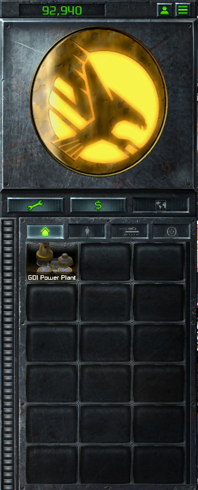

> [!NOTE]
> EA has not endorsed and does not support this product.

# The UI atlas

**Holds for:** C&C Remastered Collection, Steam build 21590013. EA has stopped patching the game and archived the
source in January 2025, so this should hold.

**HD mode only.** This page describes the HD renderer. See [HD-only mods](../getting-started/hd-only-mods.md).

## When you need this

When your mod changes a UI image: the radar crest, the sidebar, lobby emblems and flags, menu buttons, the title
logo. Nearly all of them are regions of one atlas. A standalone screen image, such as the main menu's background,
is its own loose texture instead, and doesn't need this page.

## The atlas and its region table

`Data/TEXTURES_SRGB.MEG` holds 1,358 textures. All but three are DDS: the exceptions are the atlas
`MT_COMMANDBAR_COMMON.TGA` (6871 × 6716, 32-bit BGRA, 184,582,562 bytes) and its two companions, `.MTD` and `.MTM`.
The `.MTD` maps each region name to a box `x, y, w, h` in atlas pixels, measured from the top-left corner.

**The `.MTD` layout.** All values are little-endian. It opens with an `int32` -2 and a `u32` count of regions (1,554
in the stock file). Each region record is:

```
u32     name length, in bytes, NUL padding included
char[]  the name (UI_SIDEBAR_FACTIONLOGO_ALLIES.TGA), padded with 1 to 4 NULs to a multiple of four
int32   x, y, width, height       the box, in atlas pixels from the top-left
int32   0, 0, width, height       the same in every stock record
u8      a flag, 1 or 0
```

That radar crest region is `(5698, 1706, 794, 713)`. **Read the length, don't skip NULs.** Skipping NULs after a
name to find x also skips x's own zero bytes when x is a multiple of 256: two stock regions
(`RA_UI_RED_SEARCH_BTN_NORMAL_MIDDLE`, `UI_PAPERBUTTON_00_LEFT`) then read wrong.

## Shipping a repainted atlas

Repaint regions in a full copy of the atlas, and ship it loose at `Data/ART/TEXTURES/SRGB/MT_COMMANDBAR_COMMON.TGA`.
The launcher draws your copy in the menus and in the match alike. It's a whole-file replacement: everything you
don't repaint must still be there.

- **Either TGA flavour loads.** The stock atlas is bottom-origin with no footer (descriptor `0x00`). A copy written
  by a typical image library, top-origin with a footer (descriptor `0x08`), loads too.
- **Or edit the stock file's bytes in place.** After its 18-byte header, the pixel at `(x, y)` (from the top-left,
  as the `.MTD` measures) is at `18 + (6716 - 1 - y) × 6871 × 4 + x × 4`, stored `B, G, R, A`. The file stays
  format-identical, and only the regions you paint change.
- **Ship it as DXT5 DDS to save video memory.** The atlas is drawn on every screen, and as a TGA it costs 176 MB.
  As a DXT5 DDS with a full mip chain it's 62 MB, and the menus and sidebar look the same. DXT needs sides that are
  multiples of 4, so pad the width from 6871 to 6872 pixels. Name it `MT_COMMANDBAR_COMMON.DDS`, in the same folder.
- **The launcher works out each region's texture coordinates from the size of the atlas it loaded.** Padding to 6872
  is fine. But anything of yours that computes those coordinates, such as a memory patch on the cached region
  records, must use the size you ship. See [Re-pointing launcher UI art in memory](../clientg-ram/repointing-atlas-regions.md).

Sprite and terrain frames can ship as loose DDS too, with their own rules: see
[Sprite memory and DDS](../art/sprite-memory-and-dds.md).

## Geometry is the launcher's

**Region boxes are fixed.** Only the pixels inside them are yours. Art must fit the stock box. A loose `.MTD` with
altered boxes was ignored when tested (observed once), and no Workshop mod surveyed ships one.

**A texture MEG is not a route.** A mod's own `TEXTURES_SRGB.MEG` replaces the base one whole, so it would have to
carry all 1,358 textures. Loose files are the route.

## Pick the right region

Most lost time here is spent repainting the wrong region. Several look alike:

| What you see | Region | Keyed by |
|---|---|---|
| The radar crest, in a match | `UI_SIDEBAR_FACTIONLOGO_ALLIES` / `_SOVIET` (794 × 713) in Red Alert's HUD; `_GDI` (718 × 706, at 1, 1875) / `_NOD` (660 × 660, at 3778, 2221) in TD's | side, and the HUD scene |
| The big side logo in the skirmish lobby | `RA_UI_MULTIPLAYER_ALLIED_LOGO_LARGE_NORMAL` and its `_HOVER` / `_SELECTED` versions | side |
| A country's flag in lobby lists | `RA_UI_FLAG_ICON_<COUNTRY>` (73 × 40) | country |
| The small logo on waypoint and rally markers | `RA_UI_ALLIED_LOGO_SMALL` (25 × 19) / `RA_UI_SOVIET_LOGO_SMALL` (21 × 18) | side |
| A faction's emblem in the lobby picker | `UI_MULTIPLAYER_PLAYERSLOT_FACTION_<nn>` with `_ON` / `_OVER`: `_00` and `_01` (66 × 56) are TD's GDI and Nod, `_03` to `_10` (150 × 80) Red Alert's eight countries, and there is no `_02` | the picker row, via `FACTIONS.XML` |
| A player's badge on the lobby map's start positions and on the loading screen | `UI_MAPSELECT_FACTION_<nn>` (40 × 40), numbered `_01` to `_10`, one above the picker's numbers | the faction |

**Per side or per country decides what you can do with data.** A repainted crest shows for every faction on that
side and HUD scene. A repainted flag shows only for its country, so it's the clean data lever for a faction that
rides one country. A crest per faction on one side needs the memory patch linked above. For the picker emblems,
`FACTIONS.XML`'s `SmallIconName` can point only at the launcher's preloaded player-slot regions (see
[Adding a faction](../engine/adding-a-faction.md)). Repaint those.

## Growing the atlas

When every region is taken, the atlas can grow. An 8192 × 8192 copy, with the stock art at its own coordinates and
the new space filled, loads. The menus, lobby and HUD draw correctly, and a region record pointed into the new space
draws it. The `.MTD` holds only pixel boxes and no atlas size, so nothing else needs changing.

But **the new space has no names**: a loose `.MTD` isn't read, so nothing can ask for a new region by name. The only
way to show it is to re-point a cached region record in memory. Proven in a test, not adopted in a released mod. A
grown TGA is about 268 MB, against 184 MB.

## How it was verified

- **The atlas and table:** `TEXTURES_SRGB.MEG`'s listing (1,355 DDS plus the atlas TGA, `.MTD` and `.MTM`), the
  atlas's TGA header, and the whole stock `.MTD` parsed with the record layout above: 1,554 records, ending exactly
  at the file's 110,654 bytes. The crest boxes, TD's included, match the ones a working mod's crest patch uses and
  that mod's notes.
- **The picker, marker and small-logo regions:** their boxes read from the `.MTD` for this page, and the stock
  `FACTIONS.XML`, whose `SmallIconName`s run `_00`, `_01`, `_03` to `_10`. A shipped mod repaints all of them and
  each shows where the table says; that the map badges also draw on the loading screen is its record (observed).
- **Editing in place:** the formula matches the stock file's size (18 + 6871 × 6716 × 4 = 184,582,562 bytes) and
  the scripts a shipped mod paints its crests and emblems with.
- **Loose TGA:** a shipped mod's repainted copy draws in menus and matches, and another mod's
  ([Reilsss's Command & Conquer in Red Alert](https://steamcommunity.com/sharedfiles/filedetails/?id=2853520457))
  ships one with descriptor `0x08` and a footer that also loads. It's the only loose atlas among the Workshop mods
  surveyed, and no mod surveyed ships an `.MTD`.
- **DDS:** a shipped release carries the atlas as DXT5 with 13 mip levels at 6872 × 6716 (61.5 MB, measured). Its
  crest patch computes texture coordinates from that size, and draws correctly. `ClientG.exe` holds neither 6871
  nor 6716 as a float or a double (searched).
- **Loose DDS tileset frames:** a shipped tileset XML names `.tga` frames that exist only as `.DDS` in the mod.
- **Growing:** a probe build at 8192 × 8192, with region records read back as 8192 wide during a match, and a crest
  drawn from the new space. Observed in one test session.

> [!TIP]
> **In Tiberian Factions**
>
> TF repaints its radar crests, lobby emblems and flags, main menu box, buttons and title, and lobby panels in one
> atlas. Its build converts the atlas to DXT5 DDS, which took 116 MB off video memory on every screen. Tiberian
> Sun GDI's crest is painted over an observer-mode region that Red Alert matches don't draw, because every free region
> was taken.
>
> 
>
> TS GDI's radar crest in a Red Alert match, painted into the atlas over a region Red Alert matches don't draw. The lobby picker's emblems are on the faction page.
