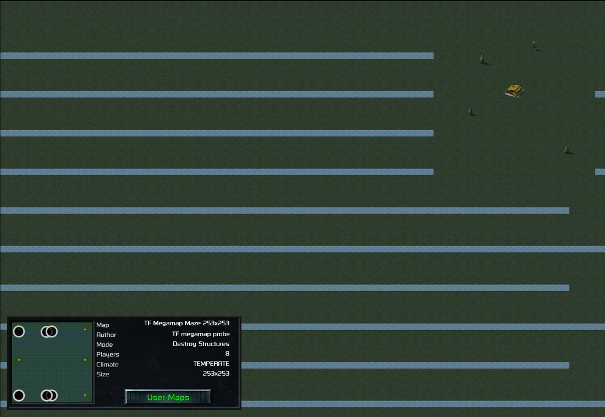

> [!NOTE]
> EA has not endorsed and does not support this product.

# Bigger maps: up to 255×255

**Holds for:** C&C Remastered Collection, Steam build 21590013. EA has stopped patching the game and archived the
source in January 2025, so this should hold.

**Status:** built and played on Linux and the Steam Deck, but not yet in a released mod. LAN with a joiner hasn't
been tested.

**HD mode only.** Classic graphics can't draw a map past 128 cells: the legacy renderer's buffer is 128 cells wide,
and big maps run with it switched off (see the engine side below). A mod with big maps should lock classic mode
out. See [HD-only mods](../getting-started/hd-only-mods.md).

## When you need this

When you want Red Alert maps bigger than 128×128 cells, the size Red Alert has always had. It takes a custom DLL
with deep engine changes and a patch to the instance server's code. A mod whose maps fit 128×128 (126×126
playable) doesn't need this page.

> [!WARNING]
> **Fragile: this patches the instance server's machine code.** The rules on
> [Patching the launcher's code from your DLL](../clientg-ram/patching-the-launchers-code.md) apply here too, in
> the other process.
>
> - **Verified against:** `InstanceServerG.exe` version 1.153 (745903), 16,625,512 bytes, SHA-256
>   `8d66c63b02ca71e6cf52502bd5d7d2be499ca79822f09717c556161e37791e5d` (Steam build 21590013).
> - **What it depends on:** two instructions in the server's export copy, at the addresses below.
> - **How it fails if the server changes:** the patch accepts only the stock bytes, or its own earlier patch, and
>   otherwise leaves the server alone. Without it, a big map's static export is cut to fit and the action list is
>   sent empty, so the map draws only in part and the cursor falls back to the arrow. Nothing overruns.
> - **Restore on unload.** The server process outlives your DLL, so put the stock bytes back on
>   `DLL_PROCESS_DETACH`. Otherwise a later game in the same server reads freed memory.

## Why 128 looked like a wall

`DLLInterface.h` gives two exports fixed arrays of `MAX_EXPORT_CELLS` (128 × 128) entries:
`CNCMapDataStruct::StaticCells` and `CNCPlayerInfoStruct::ActionWithSelected`. That's true in both games' headers,
although Tiberian Dawn's normal map is 64 wide, so the number looks like the launcher's own buffer size. Growing
the arrays breaks the struct layout the other side expects, and a bigger map overruns them.

Neither is the limit it looks like:

- **The launcher has no 128 limit of its own.** It draws, scrolls and shows on the radar whatever size the static
  map export gives it, and clamps the camera to `OriginalMapCellX/Y/Width/Height`.
- **The arrays are copied by the instance server**, the process that calls your DLL and serializes its exports
  for the launcher. Both copies take their length from the export itself (width × height, and
  `ActionWithSelectedCount`), and neither caps at 16,384 entries. Only the source pointer is fixed inside the
  struct.

So the structs keep their size, and the server is patched to copy from bigger arrays of your own.

## Routes that fail

Each of these was tried first, and each one failed. They're the obvious moves, so they're worth knowing before you
make them.

- **Raise `MAX_EXPORT_CELLS`.** `CNCMapDataStruct` grows about four times over, but the buffer the DLL is handed
  doesn't. EA's own guard in `CNC_Get_Game_State` (`buffer_size < sizeof(CNCMapDataStruct)`) then refuses the static
  map export every time, and no terrain draws at all. It fails safe, but it's unplayable. It also shifts every field
  after the array.
- **Raise only the map size.** Leave the arrays at 16,384 entries and make the map bigger. The loop that fills
  `ActionWithSelected` never checks its index against `MAX_EXPORT_CELLS`, so a big map writes far past the end of
  the array every time units are selected, and the server crashes.
- **Change the shape, not the area.** With `X:7, Y:8` bitfields, a 128 × 255 map fits the 16-bit `CELL` exactly:
  the last cell is 32767. It doesn't help, because the export limit is on total cells, and 128 × 255 is still twice
  16,384.
- **Ask the launcher for a bigger buffer.** There's no channel for it. `CNC_Get_Game_State` returns a bare `bool`,
  and the launcher's only other contact with the DLL is the `CNC_Version` check. Bumping the version just fails
  that check.
- **Conclude it's the launcher's wall.** For a long time this was the verdict: the 128 × 128 arrays looked like the
  launcher's own buffer, and growing a struct in `DLLInterface.h` looked like the end of it. The mistake was the
  process. The fixed arrays are copied by the *instance server*, which copies whatever length the export declares.
  The launcher was never the limit, and the fix was one pointer per copy in the server.
- **Leave the legacy render on.** Once maps grew, the server crashed whenever anything was drawn past cell 128: the
  classic renderer still drew every object into its 128-cell buffer, even with nobody looking. Turning it off for
  big maps (see the engine side below) fixed the crash, and saved its draw time as well.

## The server patch

| Export | Instruction in `InstanceServerG.exe` | Patch |
|---|---|---|
| Static map | `lea edi,[ebp-0x90294]` at `0x59235A` (`8D BD 6C FD F6 FF`), the base of the cell copy loop | `mov edi, <your array>` + `nop` |
| Player info | `lea ecx,[edi+0x1ED]` at `0x5982A4` (`8D 8F ED 01 00 00`), the action list handed to the copy | `mov ecx, <your array>` + `nop` |

Apply it from your DLL's `DllMain` when the process is the instance server, after comparing the stock bytes. Both
byte runs above were read from the server file on disk.

## The engine side

Red Alert's cell type is the bigger job. It is a 16-bit `signed short` with 7-bit X and Y bitfields, so 128 × 128 is
built into it.

- **Widen the cell.** `MAP_CELL_W/H` to 256, `CELL` to 32 bits, bitfields to `X:8, Y:8`. Make `CELL` a `long`,
  not an `int`, because `TARGET` is an `int` and the engine overloads functions on the two.
- **Widen what holds cell numbers.** `CellClass::ID` becomes a `CELL`. Zone IDs become 16-bit too, because a big map
  with ponds and rocks passes 255 zones, and aliased zones make unrelated landmasses look connected.
- **Keep offset lists `short`.** `Occupy_List`, `Overlap_List` and the exit lists hold small deltas and end in
  `REFRESH_EOL` (32767). Retyped as `CELL`, the terminator collides with a real cell.
- **Re-encode offsets for the launcher.** The launcher decodes cell offset lists (`OccupyList`, the sidebar's
  `PlacementList`) on a fixed 128-wide grid, whatever the map's size. Send each offset as `dy * 128 + dx`.
- **Convert pixel positions as ints.** `Lepton_To_Pixel`'s `signed short` cast turns 128 cells or more negative.
- **Never run the legacy render on a big map.** Its buffer (`SeenBuff`) is 3072 pixels, 128 cells. Anything drawn
  past cell 128 writes beyond it and crashes the server. Use the path EA uses for multiplayer with two humans,
  where the legacy render is off. Test the map against the buffer's size, not against the internal view's, which
  is sized to the map and is never smaller.
- **Bound whole-grid scans to the map**, and count rows rather than building the next row with `XY_Cell`, which
  wraps row 256 to cell 0 and never ends. Then a map that fits 128×128 does the same work as before.
- **No recursion for flood fills.** EA's `Zone_Span` recurses, and a maze-like 250×250 map exhausts the server's
  stack. Use an explicit stack.
- **Grow the staging buffer** used to pack the map to 256 KB, enough for a 256×256 MapPack.

## Map files

A scenario numbers its cells `y * width + x`: in the MapPack and OverlayPack, and in every cell field
(`[Waypoints]`, `[CellTriggers]`, `[TERRAIN]`, `[SMUDGE]`, `[Overlay]`, the unit, infantry, structure, ship and
aircraft sections, `[Base]`, and team move-to-cell missions).

- **Write a new format.** Use a new `NewINIFormat` (4) for files on the 256-wide grid, packing 65,536 cells.
- **Read old maps at their real position.** A format 3 or older file uses width 128, and a cell number in it is a
  different x and y on the 256 grid. Convert every cell number as you read it, and never rewrite the files.
  Every existing map then loads unchanged, official maps included.
- **Saves change layout.** Saves from a 128-grid build won't load. See [Save versions](../engine/save-versions.md).

## The other limit: no editor makes them yet

A bigger grid is only half the job: someone has to make the maps. Today no map editor can.

- **EA's map editor**, in the released source, caps a Red Alert map at 128 × 128
  (`MaxSize = new Size(128, 128)` in `CnCTDRAMapEditor/RedAlert/Constants.cs`).
- **Nyerguds' Mobius editor**, the community's fork of EA's, keeps the same cap.
- **[cnc-map-editor](https://github.com/gibbo101/cnc-map-editor)**, by this manual's author, is a work in
  progress. It's built on Nyerguds' Mobius editor: Mobius's core (formats, map model, renderer) with a rebuilt
  interface, running natively on Linux. It's mod-aware, learning a mod's types and theatres from a manifest the mod
  ships, and it has a headless command line that scripts and AI assistants can drive. It also stops at 128 × 128
  for now. Because it learns a mod's grid from data, it's the natural place for 256-grid support to land.

Until then, big maps are written by script: a program that writes the format-4 scenario directly, cell numbers
and MapPack included. That's fine for test maps, such as open ground, mazes and ore fields at each start, but not
for maps people want to play.

## Why 255, and what going further would take

Three things cap a side at 256 cells, and none moves without rewriting both sides of the interface:

- **The launcher's cell numbers are bytes.** `CNCDynamicMapEntryStruct::CellX/CellY` and
  `CNCPlayerInfoStruct::HomeCellX/HomeCellY` are `unsigned char`.
- **Coordinates are 8.8 fixed point.** A lepton is 16 bits, a cell byte and a sub-cell byte, and object positions
  reach the launcher as those 16-bit leptons.
- **`TARGET` packs a coordinate in 12 bits per axis:** 255 cells × 16 + 8 = 4088, inside 4095.

A side of exactly 256, across or down, also wraps `Cell_To_Lepton` to 0, so clamp the map and its one-cell border to end by cell
255. That leaves 253 × 253 playable, about four times the old 126 × 126.

### Going past 255: what would have to change

> [!CAUTION]
> **Unproven.** Nobody has built this. The list below is read from EA's source and the interface header, as a map
> for whoever tries. It isn't a recipe.

Going past 255 cells a side is possible in theory. Each limit below sits in a type, and each type would have to
widen, on both sides of the interface:

| Limit | Where it lives | What would change |
|---|---|---|
| A coordinate's cell part is one byte | `LEPTON` is an `unsigned short`, split into a `Cell` byte and a sub-cell `Lepton` byte (`LEPTON_COMPOSITE`). `COORDINATE` is an `unsigned long` holding an X and a Y lepton (`COORD_COMPOSITE`). | Leptons to 32 bits and `COORDINATE` to 64. That touches every function that takes, packs or compares a coordinate, and anything saved or sent with one. |
| Targets pack a coordinate in 12 bits per axis | `TARGET` is a `long`, a type tag plus a 24-bit mantissa (`TARGET_MANTISSA`). A coordinate target packs each axis in 12 bits: 255 × 16 + 8 = 4088, inside 4095. | A new `TARGET` encoding with more bits per axis, or a wider `TARGET`, along with every place that builds or decodes one. |
| Cells are `X:8, Y:8` | The 32-bit `CELL` already has room. Only the bitfields stop at 256. | Wider bitfields. This is the easy part. |
| The launcher's cell fields are bytes | `CNCDynamicMapEntryStruct::CellX/CellY` and `CNCPlayerInfoStruct::HomeCellX/HomeCellY` are `unsigned char` in `DLLInterface.h`. | The structs can't grow, because the launcher reads them at fixed offsets. Every launcher function that reads these fields would need patching to take the cell from somewhere else. |
| The launcher's positions are 16-bit leptons | `CNCObjectStruct::CenterCoordX/CenterCoordY` are `unsigned short`, in leptons. At 256 leptons a cell, cell 256 is 65,536, one past the type. | The same again: patches to every launcher reader of these fields, in code you don't have the source for. |
| Offsets on the launcher's 128-wide grid | Occupy and placement offsets are decoded as `dy * 128 + dx` in a `short`. | Fine while a building's footprint stays small. Unaffected by map size, but worth re-checking. |
| Events carry coordinates | Game events (`EventClass`) carry `COORDINATE` fields, and multiplayer packets are sized from `sizeof` the events. | Bigger events, so packets and recorded games change size. LAN play would need re-testing. |
| Map files | The format-4 MapPack holds 256 × 256 cells. | Another format, carrying its size, and readers for every older one. |

The engine half is large but self-contained. The launcher half is the hard part: the launcher's own code reads
byte cells and 16-bit positions, and every one of those reads would need a patch. That's far more code-patch
surface than anything else in this manual.

**Costs grow with the area as well.** The shroud and occupier exports write an entry per cell, and the selection
export checks every cell. A 512 × 512 map is four times the per-tick export work of 255 × 255.

## Costs

Measured on the Steam Deck, with a 253×253 map, eight players (seven AI) and the server's 59 ticks a second. The
mod measured uses an A* pathfinder (below), not Red Alert's own. A mod on the stock pathfinder will have different
pathfinding costs.

| Per tick | Early game | Late game, 25 minutes in |
|---|---|---|
| Game logic | 1.4–2 ms | about 5 ms, single ticks to 15–25 ms |
| of which pathfinding | under 0.5 ms | about 3 ms |
| Dynamic map export | about 1.2 ms | about 1 ms |
| Shroud export | about 1.2 ms | about 1 ms |

At its worst the server spends about 8 ms of each 17 ms tick, and the match ran 25 minutes without a fault. A
200×200 skirmish plays with no slowdown felt.

- **The pathfinder decides the spikes.** Stock Red Alert has no A*: EA's `Find_Path` (`FINDPATH.CPP`) follows
  edges around obstacles. The mod measured here uses an A* pathfinder ported from CFE Patch Redux, with a budget of
  4,096 node expansions. On a long route A* runs out of budget, and a unit retrying at each looser move type costs
  10–20 ms in one tick: the spikes in the table. The fix there is coarse routing. Route far orders over a graph of
  map sectors first, and send A* to a waypoint along it. How EA's stock pathfinder behaves on a 253×253 map hasn't
  been measured.
- **Per-cell exports grow with the area.** The shroud and occupier exports write an entry per cell. While units are
  selected, the player-info export checks the action for every cell: about 64,000 on a 253×253 map, against at most
  16,384 before.
- **Memory** rises by about 10 MB.

## How it was verified

- **The patch:** both instructions and their stock bytes read from `InstanceServerG.exe` on disk, matching the
  working patch's expected bytes. The fixed arrays, the byte cell fields and the lepton positions are in EA's
  `DLLInterface.h`, and the 12-bit `TARGET` packing is in EA's `TARGET.CPP`.
- **Play:** a 200×200 skirmish against the AI, and a 25-minute eight-player match at 253×253 with timing logs, on
  the Steam Deck. An official Red Alert map and a converted TD map play unchanged on the 256 grid.
- **The router:** checked natively against brute-force shortest paths on 253×253 open, maze and random grids,
  with no wrong unreachable verdict and routes within 11% of the shortest.
- **Not yet:** LAN with a joiner, and how the lobby reads a 256-wide map's start markers.

> [!TIP]
> **In Tiberian Factions**
>
> TF's big-map work runs on a development branch, not yet in a release. It plays maps up to 253×253, about four
> times Red Alert's largest, with every existing official and TD map loading unchanged on the new grid. A 200×200
> test map plays on the Steam Deck without a felt slowdown.
>
> 
>
> TF's 253×253 maze test map on the development branch, at the launcher's farthest zoom: the construction yard, top right, is a speck beside the maze's water channels, and the view covers only a corner of the map. Inset: the lobby reads the map as 253x253, but draws its eight start markers bunched in the left half of the preview (observed once; how the lobby reads them is still open).
