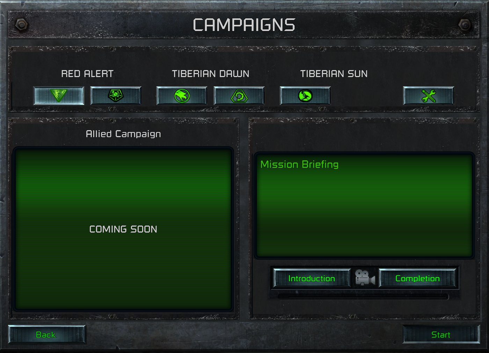

> [!NOTE]
> EA has not endorsed and does not support this product.

# Custom campaigns: replacing the official ones

**Holds for:** C&C Remastered Collection, Steam build 21590013. EA has stopped patching the game and archived the
source in January 2025, so this should hold.

## When you need this

When a Red Alert mod wants its own single-player missions in Mission Select: replacing official missions, adding to
a campaign, or hiding the stock ones. Replacing a stock mission's content is data only, and proven. Adding a
mission under a name the game doesn't know also needs a launch route, the same wall that
[new skirmish maps](new-maps-in-the-skirmish-list.md) hit. A mod that only adds skirmish maps doesn't need this
page.

## Display and launch are separate

Two sets of data drive Mission Select, and they do different jobs:

| To change | Edit | Effect |
|---|---|---|
| Whether a mission **shows** | `INSTANCES.XML`, `<ShowOnMissionSelect>` | `false` hides it, even if the player has completed it |
| Whether it's **unlocked from the start** | `INSTANCES.XML`, `<IsUnlockedAtStart>` | `true` always shows it; otherwise the player's progress decides. All 34 Counterstrike and Aftermath missions set it `true` |
| **Which game's** Mission Select lists it | `INSTANCES.XML`, `<ExternalGameID>` | `RedAlert` or `TiberianDawn`. A TD instance never lists in Red Alert. |
| Its **name and briefing** | `INSTANCES.XML`, `<LocationNameTextID>`, `<MissionBriefingTextID>` | Text IDs, looked up in the game's text |
| Its **movies and map picture** | `INSTANCES.XML`, `<IntroMovieName>`, `<BriefMovieName>`, `<ActionMovieName>`, `<WinMovieName>`, `<MissionSelectMapTexture>` | Movie names, and the texture Mission Select shows for the mission (`UI_NOD01_MapState.tga` and the like) |
| Whether it **launches**, and what comes next | the campaign files (`RA_ALLIES.XML`, `RA_ALLIES_MISSIONS.XML` and the like, in `CONFIG.MEG`'s `DATA\XML\CAMPAIGNS\`) | A mission whose definition is removed still lists, but its Start does nothing. `MapStageUnlock` chains to the next stage. |

So **the roster shown comes from `INSTANCES.XML`**, not from the campaign files. Cutting a campaign file down to two
missions still shows all fourteen. Adding missions to a campaign's `<Stages>` doesn't make them appear.

Both kinds of file ship loose in the mod, as patched copies of the stock ones. See
[Overriding the launcher's data](../launcher-data/overriding-launcher-data.md).

The screens themselves are `.BUI` files in `CONFIG.MEG` (see [BUI screens](../front-end/bui-screens.md)). Red
Alert's campaign select is `DATA\ART\GUI\RA\RA_CAMPAIGN_SELECT.BUI`, its Mission Select `RA_MISSIONSELECT.BUI`
beside it, each row `RA_MISSIONSELECT_LISTENTRY.BUI`; TD's are `DATA\ART\GUI\CNC\CNC_CAMPAIGN_SELECT.BUI`,
`UI_MISSIONSELECT.BUI` and `UI_MISSIONSELECT_LISTENTRY.BUI`.

### How the campaign files fit together

All in `CONFIG.MEG`, under `DATA\XML\`:

- **Two manifests list what loads.** `PROGRESSIVECAMPAIGNFILES.XML` names the campaign files and
  `PROGRESSIVECAMPAIGNMISSIONFILES.XML` the mission files. `CAMPAIGNS.XML` is an empty wrapper. There's no separate
  Counterstrike file (its line is commented out): Counterstrike's missions belong to the Aftermath campaigns.
- **A campaign** is a `ProgressiveCampaignTypeClass` in a campaign file. Its `<CampaignMissions>` lists mission
  definitions by name, in order.
- **A mission definition** is a `ProgressiveCampaignMissionTypeClass` in a `*_MISSIONS.XML` file. It names the
  `<Instance>` to play and, with `MapStageUnlock`, the stage it unlocks. Its name needn't match the instance's:
  `Mobius_Aftermath_Allied_Campaign_9_Map` plays `Mobius_Allied_Aftermath_Campaign_48_Map`.

Each Red Alert tab's missions belong to one campaign:

| Tab | Campaign | Campaign file | Mission file |
|---|---|---|---|
| Allies | `RA_ALLIES_CAMPAIGN` | `RA_ALLIES.XML` | `RA_ALLIES_MISSIONS.XML` |
| Soviets | `RA_USSR_CAMPAIGN` | `RA_USSR.XML` | `RA_USSR_MISSIONS.XML` |
| Allied expansions | `RA_Aftermath_Allied_CAMPAIGN` | `RA_AFTERMATH.XML` | `RA_AFTERMATH_MISSIONS.XML` |
| Soviet expansions | `RA_Aftermath_USSR_CAMPAIGN` | `RA_AFTERMATH.XML` | `RA_AFTERMATH_MISSIONS.XML` |
| Ant | `RA_Ant_CAMPAIGN` | `ANT.XML` | `ANT_MISSIONS.XML` |

The last Allied and Soviet missions (`RA_ALLIES_14`, `RA_USSR_14`) carry `MapStageUnlock` -1; the last expansion
and Ant missions carry no `MapStageUnlock` at all. Tiberian Dawn's campaigns live beside them in `GDI.XML`,
`NOD.XML`, `CONSOLE.XML` and `FUNPARK.XML`, with their mission files `GDI_MISSIONS.XML`, `NOD_MISSIONS.XML`,
`CONSOLE_MISSIONS.XML` and `FUNPARK_MISSIONS.XML`, all listed in the same two manifests.

## Replacing an official mission: shadow its scenario

A stock mission slot plays whatever scenario INI of the right name it finds first, and a file in your mod's
`CCDATA/` folder comes first. So, to replace the mission's content:

1. **Find the slot's file name.** It's built from the instance's `<Mission>` number:
   `SC` + the house's letter + two digits + direction + variant, `.INI`. Aftermath's first Allied mission,
   `Mobius_Allied_Aftermath_Campaign_43_Map` with `<Mission>43</Mission>`, plays `SCG43EA.INI`.
2. **Write your scenario** in Red Alert's format. Starting from the stock file is easiest. The stock scenarios are in
   `general.mix` inside a `MAIN.MIX` under `Data/CNCDATA/RED_ALERT/`: `CD1`'s holds the original Allied and Soviet
   missions and the multiplayer maps `SCM01EA`–`SCM24EA`; `AFTERMATH`'s holds the expansion missions, `SCG43EA.INI`
   among them, and `SCM01EA`–`SCM99EA`.
3. **Remove the `[Digest]` section.** Red Alert checks a scenario's digest at load. A wrong digest aborts the
   load (only multiplayer scenarios numbered below 25 are exempt), but a *missing* digest skips the check. Any edit makes the old
   digest wrong, so delete it. The abort is compiled in only because `DEFINES.H` defines `RELEASE_VERSION`, which
   EA's build and Vanilla Conquer's both do. Maps saved by EA's map editor rely on the missing-digest
   skip too: the editor never writes a `[Digest]`.
4. **Ship it** as `CCDATA/SCG43EA.INI` in the mod. No `CONFIG.MEG` change is needed. The file is read when the mission loads, so a
   changed copy takes effect at the next Start, with no restart of the game (observed on a Steam Deck).

The mission keeps its slot: its tab, its name and briefing (from `INSTANCES.XML` and the game's text), its movies
and its place in the campaign chain. The INI's own `[Briefing]` feeds only the in-game briefing screen. To restyle
the name, briefing or movies, edit the instance too.

## Adding a mission: data shows it, but launching is the hard part

A new `<Instance>` shows on Mission Select once it has the right `Variant`, `<ShowOnMissionSelect>true` and
`<IsUnlockedAtStart>true`. **But it won't start.** The instance server only starts instances it knows from the
base game's data, the same wall as new skirmish maps. There are two ways round:

- **Use stock slots.** Hide the stock missions you don't want, and give the ones you keep your scenarios as above.
  This is proven, and needs no launcher patch. The number of missions is limited to the stock slots.
- **A mission carrier.** Launch your instance under a stock instance's name and hand the DLL your map, as
  [the skirmish carrier](new-maps-in-the-skirmish-list.md) does. **Unproven for general use:** the only working
  version is one mod's development build, wired to one map.

Three data rules for a new instance:

- **Put it after its `Variant`.** The launcher reads `INSTANCES.XML` in one pass, so an instance placed before the
  instance it inherits from inherits nothing, and lists on no tab. The stock file always defines a variant before
  using it: append your instances at the end.
- **The `Variant` picks the tab.** `Mobius_Allied_Campaign_Base` lists on the Allies tab,
  `Mobius_USSR_Campaign_Base` on the Soviets', `Mobius_Aftermath_Allied_Map_Base` and `..._USSR_Map_Base` on the
  expansion tabs, `Mobius_Ant_Map_Base` on the Ant tab. The base also carries what its missions inherit:
  `Mobius_Aftermath_Allied_Map_Base` sets `<House>Greece`, `<DefaultCampaignName>RA_Aftermath_Allied_CAMPAIGN` and
  `<MissionSelectMapTexture>RA_UI_Retaliation_Allies_MapState.tga`, so a mission on it sets only its own fields.
- **Its name needs Red Alert text.** A Tiberian Dawn text ID doesn't resolve in Red Alert's Mission Select, and
  shows a placeholder.

## Tabs and houses

The launcher sorts each Red Alert mission onto a tab by game, expansion and house. Its side tests only know Red
Alert's countries: a mission whose `<House>` is `GDI` or `NOD` lands on no Red Alert tab at all. Putting GDI or Nod
missions in Red Alert's Mission Select therefore takes a launcher code patch on the tab sort. See
[Patching the launcher's code from your DLL](../clientg-ram/patching-the-launchers-code.md) and its fragility rules.

> [!WARNING]
> **Fragile:** these addresses and bytes belong to `ClientG.exe` 1.153 (745903), SHA-256
> `d405ed389548be51c67740bb6309de10a5f02bdfc86324a10c9ad3b663c08897`. Compare the stock bytes before any write,
> and leave the launcher alone if they differ: the missions then simply don't list.

| In `ClientG.exe` 1.153 (745903) | Address | Stock code |
|---|---|---|
| Allied-side test (faction 3 to 6: Spain, Greece, England, France) | `0x118E830` | `8B 81 88 04 00 00 83 C0 FD 83 F8 03 0F 96 C0 C3` |
| Soviet-side test (faction 7 to 8: USSR, Ukraine) | `0x118E840` | `8B 81 88 04 00 00 83 C0 F9 83 F8 01 0F 96 C0 C3` |
| Expansion tabs' calls to them | `0x63382F`, `0x633878` | `E8` to the two tests |

Other Mission Select sites a patch can hook, in the same build:

| Site | Address | What's there |
|---|---|---|
| Row style | `0x632FFA` | Picks a row's crest style from the mission's house: GDI (`0x64E740`) and Nod (`0x64E770`) styles first, then this branch calls the Allied-side test and takes the Allied (`0x64E710`) or Soviet (`0x64E7A0`) style |
| Row select | `0x64E680` | A function: gives a row's buttons their selected look |
| Mission label | `0x118D710` | A function: builds the label a mission's row shows |
| Tab switch | `0x633E60` | A function: switches Mission Select to another tab |

The mission's faction is read from the instance at `+0x488`. GDI is 0 and Nod 1, which is why neither passes. The
calls sit in the tab sort, `0x633520`, which files each mission under a numbered tab: Allies 6, Soviets 7, Allied
expansions 8, Soviet expansions 9, Ant 10 (the `mov [ebp-0Ch], n` after each test).

## The campaign map and branching missions (open)

> [!CAUTION]
> **Unsolved.** Nobody has made a campaign map of their own yet, or a branching campaign that doesn't rejoin. This
> section records what the stock files show, and where the trail goes cold.

Between missions, Red Alert's campaigns show a map of territories, and the player picks the next mission on it.
`RA_CAMPAIGNMAPS.XML` (in `CONFIG.MEG`'s `DATA\XML\CAMPAIGNS\`) defines it for the Allied and Soviet campaigns,
one `CampaignMapSelectMapClass` each, with `GuiLayer` `RA_ALLIES` and `RA_USSR`. `CAMPAIGNMAPS.XML` beside it holds
the other eight: Tiberian Dawn's (`TD_GDI`, `TD_NOD` and others), and Red Alert's expansion and Ant campaigns,
whose layers are named `TD_Aftermath_Allied`, `TD_Aftermath_USSR` and `TD_Funpark`. A `GuiLayer` belongs to the
campaign map; the Mission Select tabs come from the tab sort above.

```xml
<CampaignMapSelectStageClass>
    <TerritorySelectMovie>RA/AlliesMap_03.bk2</TerritorySelectMovie>
    <Maps>
        <Entry>RA_ALLIES_3A</Entry>
        <Entry>RA_ALLIES_3B</Entry>
    </Maps>
</CampaignMapSelectStageClass>
```

- **Each stage's map is a pre-rendered movie,** a Bink file in the base game's `MOVIES_RA.MEG`
  (`DATA\ART\MOVIES\RA\ALLIESMAP_03.BK2`). Stage 1 has no map at all.
- **A stage's entries are its choices.** Stage 3 offers `3A` or `3B`, and stage 5 offers three.
- **The original's branches rejoin.** In `RA_ALLIES_MISSIONS.XML`, both `RA_ALLIES_3A` and `RA_ALLIES_3B` unlock stage
  4 (`MapStageUnlock`). A branch is a choice of which version of a stage to play, and then the story converges.
- **Units can carry over.** `RA_ALLIES_4` has `<RestoreAllUnits>` naming mission 2's instance, which brings that
  mission's surviving units back.

**Where it goes cold:**

- **A map of your own.** The file names the movie and the choices, but nothing in it says where each choice sits on
  the map, or which part the player clicks. That link isn't in any data file read so far, so it's in the movie, in
  another file, or in the launcher's code. Until it's found, a custom campaign can reuse the stock maps (with the
  stock territories) but can't draw its own. **Unproven.**
- **Branches that don't rejoin.** Whether two choices in one stage can unlock *different* stages, so the story
  splits for good, hasn't been tested. The stock campaigns never do it. **Unproven.**

## Traps

- **Progress decides what shows.** A mission not yet unlocked doesn't list, even with `ShowOnMissionSelect`
  true. Only `IsUnlockedAtStart` overrides that. On one player's Ant tab, two of the four missions showed, though all
  four are `ShowOnMissionSelect` true. Where the player's progress is kept wasn't traced. The local settings file
  (`Player_RA_settings_1.bin`, on [Overriding launcher data](../launcher-data/overriding-launcher-data.md)) names
  some campaign instances, `MOBIUS_ALLIED_CAMPAIGN_2_MAP` and `MOBIUS_ANT_CAMPAIGN_1_MAP` among them, so it may be
  there. **Unproven.**
- **TD's campaigns can't be borrowed.** Their instances are `TiberianDawn` instances on TD's tabs, and TD's scenario
  format doesn't run in Red Alert's engine. A GDI or Nod campaign in Red Alert needs new Red Alert scenarios.

## How it was verified

- **Display and launch:** each row of the table was changed in a test build and checked in Mission Select, on a
  Linux desktop and a Steam Deck: hiding completed missions, cutting a campaign file down, adding `<Stages>` that
  didn't appear, a removed definition that wouldn't start, and a new instance that appeared. The flags and values
  are in the stock `INSTANCES.XML` (`ShowOnMissionSelect`, `IsUnlockedAtStart`, `ExternalGameID` with
  `RedAlert` and `TiberianDawn`). The tests: Allied 5A, 5B and 5C set `false` made "Tanya's Tale" vanish though it
  was completed; removing `RA_ALLIES_14`'s definition left its Start doing nothing while mission 1 still launched; and
  a new `Mobius_Allied_Campaign_99_Map` on the Allied variant listed as "Allies 99" on the Allied tab, its
  deliberately Tiberian Dawn name ID showing a placeholder.
- **Unlocks, bases and the stock scenarios:** counted in the stock `INSTANCES.XML` for this page (every one of the
  34 instances on the four expansion bases sets `IsUnlockedAtStart` true; the Aftermath Allied base's three fields);
  both `general.mix` archives listed by name hash for this page. A shipped mod's hijacked `SCG43EA.INI` started from
  the Aftermath copy.
- **The movie and picture fields:** counted in the stock `INSTANCES.XML` (about 395 KB), in `CONFIG.MEG`
  itself, and written by EA's own instance export in `DLLInterfaceEditor.cpp` (TD), which prints
  `<BriefMovieName>`, `<ActionMovieName>` and `<WinMovieName>` from each scenario's movies.
- **The scenario shadow:** `SCG43EA.INI` with every enemy removed and `[Digest]` deleted, shipped in a mod's
  `CCDATA/`, won itself in about 30 seconds from the Aftermath tab, on both machines. The mission is "ITALY: Harbor
  Reclamation"; all 90 enemy entries (USSR and BadGuy, across its units, ships, infantry and structures) were removed
  and the rest renumbered. On the win the DPTHCHRG movie played, the campaign advanced to "In the Nick of Time", and
  the roster showed the completion shield. A stock run can't be won unattended in seconds, so the game read the
  mod's file. EA's source gives the file name (`Set_Scenario_Name`), the digest check (`CCINIClass::Load` skips a
  missing digest, returns 2 for a wrong one) and the abort on 2 inside `#ifdef RELEASE_VERSION` (`SCENARIO.CPP`),
  with `RELEASE_VERSION` defined in `DEFINES.H`; Vanilla Conquer's `scenario.cpp` and `defines.h` have the same.
  EA's map editor source has no digest code at all.
- **Variant order:** observed as instances that listed nowhere until moved after their base. The stock file defines
  every one of its 456 instances' variants before use, and a shipped mod's build appends its instances at the end.
- **The campaign map:** the stock `RA_CAMPAIGNMAPS.XML` and `RA_ALLIES_MISSIONS.XML` read for this page (stages,
  movies, entries, `MapStageUnlock`, `RestoreAllUnits`), every `CampaignMapSelectMapClass` and its `GuiLayer` in
  both campaign map files, found through `CONFIG.MEG`'s index, the movies listed in `MOVIES_RA.MEG`, and a working
  mod that couldn't make a map of its own or a lasting branch.
- **Tab sort:** the two side tests and their calls, and the tab numbers stored after each test in the tab sort,
  were read from `ClientG.exe` on disk. A shipped mod's patch on them lists its GDI and Nod missions, and its notes
  give the same tab numbers. The other sites: the row-style branch and the four style calls round it, and the
  three function starts, read from the exe on disk; a shipped mod hooks all four, and its notes and code name
  them.
- **The campaign files:** the stock manifests, campaign and mission files extracted from `CONFIG.MEG` for this page
  (every `ProgressiveCampaignTypeClass`, every `MapStageUnlock`), checked against a working mod's campaign notes
  and the loose copies its CAMPAIGNS page ships. `PROGRESSIVECAMPAIGNMISSIONFILES.XML` lists TD's four mission
  files beside Red Alert's, each present in `CONFIG.MEG`'s index, and the same index holds the six Mission Select
  screens, which the working mod's notes name; it ships Red Alert's Mission Select and its row as loose, restyled copies. The stock `INSTANCES.XML` has 456 instances: 22 on the Allied base,
  20 Soviet, 8 and 9 on the Allied Counterstrike and Aftermath bases, 4 Ant.
- **No restart:** a working mod copied a changed scenario INI into the mod's `CCDATA/` on a Steam Deck with the game
  running, and the next Start played it.

> [!TIP]
> **In Tiberian Factions**
>
> TF rebuilt Mission Select as a CAMPAIGNS page, with a tab per faction: Red Alert's Allies and Soviets, and TD's
> GDI and Nod on the two expansion tabs, relabelled. Tiberian Sun's GDI uses the Ant tab. The stock missions are
> hidden, and each faction tab reads COMING SOON until its campaign ships. TF's proven route for mission content
> is a stock slot with a shadowed scenario. Its mission carrier is still a development-build experiment.
>
> 
>
> TF's CAMPAIGNS page: a tab per faction, each reading COMING SOON until its campaign ships.
