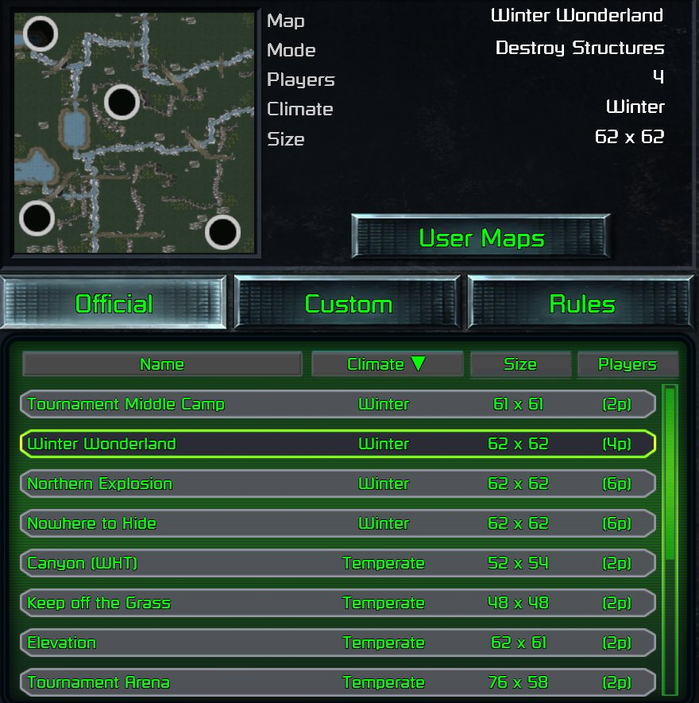

> [!NOTE]
> EA has not endorsed and does not support this product.

# New maps in the skirmish Official list

## When you need this

When a Red Alert mod wants its own maps in the skirmish lobby's **Official** list, beside Red Alert's, such as
Tiberian Dawn's skirmish maps. Listing a map takes only data. *Starting* one also takes a launcher code patch,
because the game's instance server only starts entries it already knows. If your maps can live with the player's
custom maps instead, or your mod only changes existing maps, you don't need this page.

> [!WARNING]
> **Fragile: the launch half of this patches the launcher's code.** Read
> [Patching the launcher's code from your DLL](../clientg-ram/patching-the-launchers-code.md) first. Its rules
> apply to every hook here.
>
> - **Verified against:** `ClientG.exe` version 1.153 (745903), SHA-256
>   `d405ed389548be51c67740bb6309de10a5f02bdfc86324a10c9ad3b663c08897` (Steam build 21590013).
> - **What it depends on:** the launch-send function and every call to it, the two lobby IPC sends, the instance
>   key lookup and the GUI's set-texture call. All of these are addresses in this one build.
> - **How it fails if the client changes:** done as below, the install checks every site first and installs
>   nothing if the core sites don't match. The entries still list, because listing is data, but launching one
>   fails at match start on the server's instance assert.
> - **Keep it LAN-safe:** every client must resolve the carrier entry (see Traps).

**Holds for:** the client in the box above. EA has stopped patching the game and archived the source in January
2025, so the build should stay put, but check the hash before trusting any address.

## Listing a map: data only

The Official list is built from `Data/XML/INSTANCES.XML` in `CONFIG.MEG`. Red Alert lists every entry on its
multiplayer base variant, whatever the entry is called:

```xml
<Instance Name="Mobius_Red_Alert_Multiplayer_902_Map" Variant="Mobius_Red_Alert_Multiplayer_Base">
    <MaxPlayers>4</MaxPlayers>
    <LocationNameTextID> TEXT_NAME_MP_2_SAND_TRAP </LocationNameTextID>
    <LocationDescriptionTextID network="client"> TEXT_NAME_MP_2_SAND_TRAP </LocationDescriptionTextID>
    <Mission>902</Mission>
    <JSONDataText> { "cnc_climate_text_id" : "TEXT_CNC_CLIMATE_DESERT",
                     "cnc_size_value" : 3306, "cnc_size_text_id" : "TEXT_CNC_SIZE_57X58" } </JSONDataText>
    <AmbientSFXEnvironmentName> Ambient_Desert_Day </AmbientSFXEnvironmentName>
    <AmbientMusicEventName> MUS_RA_MULTIPLAYER_MODE </AmbientMusicEventName>
</Instance>
```

- **Name it like Red Alert's own entries** (`Mobius_Red_Alert_Multiplayer_<n>_Map`), on a number Red Alert doesn't
  use. TD's own entries, on TD's variant, never show in Red Alert's list, so each TD map needs a new Red Alert
  entry.
- **Text:** the name and description are text IDs, and TD's own IDs work in Red Alert. Sand Trap above uses TD's
  `TEXT_NAME_MP_2_SAND_TRAP`, so a TD map needs no new strings.
- **Preview data:** each entry needs an `<INIData>` block in `Data/XML/CNCMAPPREVIEWDATA.XML`, under the entry's
  name in upper case. It holds the map's bounds, its theatre and one start waypoint per player. Cells are numbered
  on Red Alert's grid, 128 wide (`cell = y * 128 + x`). TD's grid is 64 wide, so every TD cell must move: TD's
  start at (6, 16) becomes (38, 48) when the map is centred on Red Alert's grid.
- **Thumbnail:** the lobby shows a texture named after the entry in upper case, such as
  `MOBIUS_RED_ALERT_MULTIPLAYER_902_MAP.DDS`, the way the base game names its own. The base game already has a
  thumbnail for all 34 of TD's skirmish maps (`MOBIUS_TIBERIAN_DAWN_MULTIPLAYER_<n>_MAP.DDS`, and
  `..._COMMUNITY_<k>_MAP.DDS`).
- **Ship both XMLs loose**, as whole files: a patched copy of the base game's, with your entries added.

## Why a listed map won't start

The instance server (`InstanceServerG.exe`, which carries its own `\XML\Instances.xml` path) resolves instances
and map files from the base game's data, not your mod's. A launch naming an entry it doesn't know fails at match
start, on the server's `Creating instance %s` assert in `serveripcmessagehandler.cpp`.

You can't get round this by pointing a stock entry at your map, either. An edited `<OverrideMapName>` on an
existing entry changes nothing, because the server still loads the base game's map for it.

## Starting it: launch under an entry the server knows

The way round is a **carrier**: an entry the server knows, which already hands the DLL a map file by name. Red
Alert's Hastings entry, `Mobius_Red_Alert_Multiplayer_D6_Map`, is one. It has `<Mission>0</Mission>` and
`<OverrideMapName>SCMD6EA.INI</OverrideMapName>`, and EA's DLL plays the instance's override map in place of the
mission's map (`override_map_name` in `CNC_Start_Instance_Variation`).

1. **Rename the launch.** Hook every call to the launcher's launch send. When it names one of your entries,
   send it as D6 instead. A launch carries the instance's name and a key: the CRC-32 of the upper-cased name.
2. **Hand over the real map.** Before sending, write your map's file name to a small handoff file. When the DLL
   starts a D6 scenario, it takes the handoff's map instead of `SCMD6EA.INI`. It should take it only if the file
   is fresh (a minute old at most), and delete it after reading, so a stale handoff never hijacks a real Hastings
   game.
3. **Cover the lobbies too.** The skirmish screen launches through the send above, but LAN and Steam matchmaking
   lobbies build their own launch message (`IPCLaunchInstanceMessage`, instance name at `+0x30`) and send it
   straight to the server. Hook those two sends and rename D6 in place.
4. **Make every client read D6 as your entry.** The server tells every client to load D6. Hook the instance key
   lookup so that D6 resolves as whichever of your entries the client last showed or launched. A LAN joiner never
   launched anything, so for them it's the entry their lobby last showed. The loading screen then names the right
   map.
5. **Optional: thumbnails without shipping any.** Hook the GUI's set-texture call and swap in the base game's TD
   thumbnail for your TD entries.

### Addresses in this client

| What | Address | Stock bytes or target |
|---|---|---|
| Launch send (function) | `0x7F1C40` | called from `0x6284B0`, `0x633A5E`, `0x715E8D`, `0x72003B`, `0x723C16`, `0x72D9B8`, `0x72DED9`, `0x7E8A8D` (skirmish, lobby, load, resume and restart starts) |
| IPC send (function) | `0x5860A0` | lobby launches call it from `0x7943EA` (LAN) and `0x5DCE18` (Steam matchmaking) |
| Instance key lookup | `0x14FE820` | `55 8B EC 56 8B F1` |
| GUI set-texture | `0xF604C0` | `55 8B EC 80 3D 68 84 FE 01 00` |
| Launch message | vtable `0x1C055A4` | instance name string at `+0x30` |

Each call site is `E8` + an offset to the function shown. All of these were read from the client file on disk.

## Converting the map

The map file itself has to be in Red Alert's format, every cell moved onto the 128-wide grid. A TD map also has to
play in its own theatre: see [TD theatres in Red Alert](../using-what-the-player-owns/td-theatres-in-red-alert.md).
Ship it in the mod's `CCDATA/` folder under a name of your own.

## The other route: the player's custom maps

A map can also go where the player's own maps live, with no launcher patch. The launcher lists Red Alert custom
maps from `Documents\CnCRemastered\Local_Custom_Maps\Red_Alert\` (EA's map editor saves there). Each map is three
files of the same name:

- `<name>.mpr`: the whole scenario, in Red Alert's INI format;
- `<name>.tga`: its preview picture;
- `<name>.json`: what the lobby lists it by, `MapTileX`, `MapTileY`, `MapTileWidth`, `MapTileHeight`, `Theater` and
  `Waypoints` (the starts).

Starting one, the launcher calls the DLL's `CNC_Start_Custom_Instance` with the folder and the map's name, and the
DLL loads `<folder><name>.mpr` as an INI (`[Basic]` `Name`, `[Digest]`). With its `multiplayer` flag false, EA's
DLL plays it as `GAME_NORMAL`. The map shows under the player's custom maps, not in the Official list.

## Traps

- **D6 must always resolve.** A client told to load D6 that finds no entry for it stalls the whole match. If your
  list hides Hastings (to stop it showing twice), the key lookup must still answer for it. TF lists Hastings again
  as one of its own entries.
- **Hook every launch path.** Skirmish, load, resume and restart each call the launch send from a different place.
  A path you miss launches D6 itself, and Hastings is what gets played.
- **A placeholder entry can't carry.** An entry the server doesn't know is never started, so the carrier has to be
  a stock entry.

## How it was verified

- **The data:** the stock `INSTANCES.XML` and `CNCMAPPREVIEWDATA.XML` from `CONFIG.MEG` (the entries' variant,
  Hastings' override map, TD's text IDs and its 64-wide preview data), both games' map widths in EA's source
  (`MAP_CELL_W`), and the base game's thumbnail names in `TEXTURES_SRGB.MEG`.
- **The DLL side:** EA's `CNC_Start_Instance_Variation` plays `override_map_name` when an instance sets one.
- **The hooks:** every address and stock byte above was read from `ClientG.exe` on disk. A shipped mod lists and
  plays all 34 of TD's skirmish maps this way, from the skirmish screen and in LAN games, under Proton on Linux and
  on the Steam Deck.
- **The server's refusal:** a new instance hitting the server's assert was observed in play, and the assert text
  and its source file are in `InstanceServerG.exe`. The ignored `OverrideMapName` edit was observed once, when a
  hijacked community entry still loaded its stock map.
- **Custom maps:** EA's map editor source (its save folder, `Local_Custom_Maps`, and the `.mpr`, `.tga` and `.json`
  it writes, with the JSON's fields), `CNC_Start_Custom_Instance` in EA's `DLLInterface.cpp`, a Proton prefix's
  `Local_Custom_Maps\Red_Alert\` holding such triplets, and a working mod's notes, which found the same folder on a
  Steam Deck.
- Observed, not re-tested for this page: that an unresolved D6 stalls a match.

> [!TIP]
> **In Tiberian Factions**
>
> TF lists all 34 of TD's skirmish maps in Red Alert's Official list, numbered so they can't collide with Red
> Alert's: TD's multiplayer map *n* is entry 9*nn* (Sand Trap, TD's map 2, is 902), TD's community maps are 980 to
> 986, and Hastings moves to 999. Each map plays in its own TD theatre, and its lobby thumbnail is the base game's
> own, so TF ships no thumbnails.
>
> 
>
> TD's Winter Wonderland in Red Alert's Official list, beside Red Alert's own maps, with the base game's thumbnail. TD's maps show their own climate, Winter.
