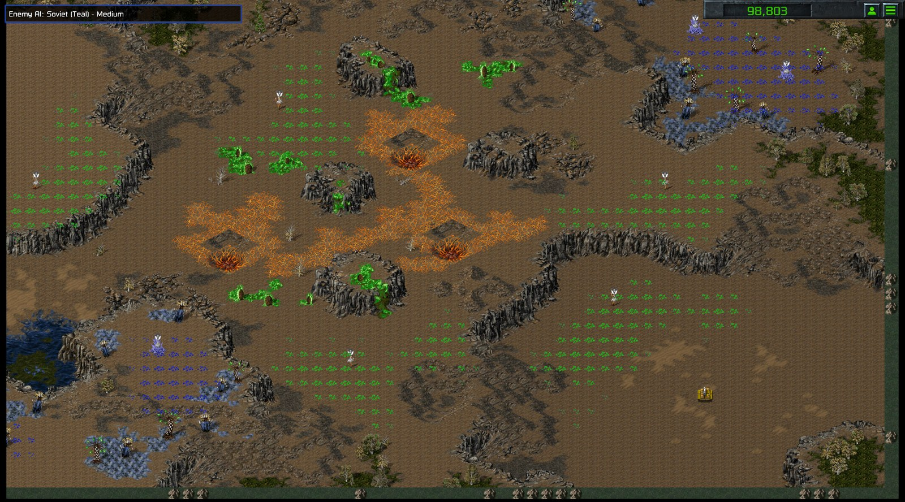

> [!NOTE]
> EA has not endorsed and does not support this product.

# Per-map art with tile patches

**Holds for:** C&C Remastered Collection, Steam build 21590013. EA has stopped patching the game and archived the
source in January 2025, so this should hold.

**HD mode only.** This page describes the HD renderer. See [HD-only mods](../getting-started/hd-only-mods.md).

## When you need this

When a map should look like something no tileset can paint: a picture rendered elsewhere (another game's own view
of the map, a painted map), or hand-fixed art on a few cells. Terrain template names can't do this, as
[Adding a theatre of your own](custom-theatres.md) explains: a new template name with loose art crashes the
launcher. Tile patches are a separate layer, keyed by map, and they take new names. If a stock tileset or a reskin
of one is enough, you don't need them.

## What the base game does with them

EA retouched its own official maps with tile patches: 224 Red Alert maps and 94 Tiberian Dawn maps have a patch file
in `CONFIG.MEG`, which replaces the art of chosen cells with textures of their own. A patch is a block of cells,
each with one texture or an animation of several.

## The files

Three kinds of file, all loose in the mod's `Data` folder:

```
Data/XML/TILEPATCHES/MAPS/RA/<MAP>_MAPPATCHES.XML   where each patch goes
Data/XML/TILEPATCHES/PATCHES/<PATCH>_PATCH.XML      a patch's cells and their textures
Data/ART/TEXTURES/SRGB/PATCHES/<PATCH>/<TEXTURE>-00.DDS
```

The map file places patches at cells counted from one cell up and left of the map bounds' top-left (its `[Map]` `X`
and `Y`), not from the corner of the grid: a patch at `X` 1, `Y` 1 starts on the bounds' first cell.

```xml
<XML>
 <MapPatchingDataClass>
  <PatchPositions>
   <Entry><X>1</X><Y>1</Y><PatchName>RA_MYMAP_0001</PatchName></Entry>
  </PatchPositions>
 </MapPatchingDataClass>
</XML>
```

A patch file lists its cells, each with a texture name, relative to the patch's own top-left:

```xml
<XML>
  <TileOverridePatchClass>
   <PatchName>RA_MYMAP_0001</PatchName>
   <DirectoryPath>PATCHES\RA_MYMAP_0001\</DirectoryPath>
   <FPS>5</FPS>
   <Tiles>
    <Entry><TextureName>pa0001.tem-0_0</TextureName><X>0</X><Y>0</Y></Entry>
   </Tiles>
  </TileOverridePatchClass>
</XML>
```

Each texture is a DDS under the patch's folder, with a frame number: `PA0001.TEM-0_0-00.DDS`. EA's are 128 by 128
pixels, DXT1 (opaque) or DXT5, with mipmaps. A smaller texture is stretched over the cell: 64 by 64 DXT1 draws
cleanly and is a quarter of the size.

## What a mod can do

- **New names load.** A mod's own patch names, and a map file for a map that has no patches in the base game, both
  load from loose files.
- **They must be there when the game starts.** The launcher indexes the mod's loose files at start-up. Files added
  while the game runs are ignored until it restarts.
- **One texture per cell can cover the whole map.** Cut a picture into cell-sized textures and the tiles meet without
  a seam at any zoom: lines crossing tile edges, straight or diagonal, stay unbroken.
- **The ground under it still counts.** Units drive by the cells' templates, which the patch hides. Paint the art you
  want with patches, and give each cell a stock template for its land type: `CLEAR1` for open ground, `W1` for water
  and `B1` for rock are each one cell with one land type.

## Which map a file belongs to

The launcher looks up `<MAP>_MAPPATCHES.XML` by the file name, without extension, of the map that is actually
playing:

- **An official map** uses its file name: Keep off the Grass is `SCM05EA`.
- **A map started through a carrier entry** (see [New maps in the skirmish Official list](new-maps-in-the-skirmish-list.md)),
  where the DLL plays a different file from the entry the server launched, uses the file the DLL played.
- **A map from the Custom list** gets an empty name, so it never finds a patch file. Exporting the file name from the
  DLL's map data doesn't change that. Patched maps belong in the Official list.
- **From an add-on:** patch files in a second mod folder, beside the mod whose map they draw, load the same way.

## Many textures: ship them in archives

A whole map is thousands of textures, and loose files are what the launcher indexes when it starts. On one desktop,
485,000 loose patch files in an add-on took the game's first frame from 26 seconds to 3 minutes 23 seconds. Ship them in
MEG archives instead, and the start is as quick as without them.

- **A mod's own `Data/MEGAFILES.XML` is ignored.** The launcher mounts the archives its install's
  `Data/MEGAFILES.XML` lists, and a mod's copy of that file changes nothing.
- **Your DLL can mount them.** The launcher's archive manager adds an archive with `MegaFileManagerClass::Megafile_Add`,
  which it calls for each archive in that list. A DLL running inside `ClientG.exe` can call it for its own archives:
  the files in them then load as if they were the game's. Patch lookups at a map's start find files in an archive
  added after start-up.
- **Mount once the mod list is known.** When the launcher first loads your DLL, its list of mod folders doesn't yet
  hold the other mods. Find the archives by the folder that holds them later, the first time they are needed: before a
  patched map's lobby entry is shown, or launched.
- **A MEG names at most 65,535 files.** Its file table indexes names with 16 bits. One archive per map is a natural
  split.

> [!WARNING]
> **Fragile: mounting from the DLL calls the launcher's code.** Read
> [Patching the launcher's code from your DLL](../clientg-ram/patching-the-launchers-code.md) first.
>
> - **Verified against:** `ClientG.exe` version 1.153 (745903), SHA-256
>   `d405ed389548be51c67740bb6309de10a5f02bdfc86324a10c9ad3b663c08897` (Steam build 21590013).
> - **What it depends on:** `Megafile_Add` at `0x9F4E60` (opening bytes `55 8B EC 83 EC 28 A1 68 80 F8`), a `thiscall`
>   on the manager taking a `const std::string&` path and three 0s, returning the archive's index or `0xFFFFFFFF`; the
>   manager's pointer at `0x1FE8AF0`. The start-up list is read at `0x9F49B0`.
> - **How it fails if the client changes:** check the opening bytes and mount nothing if they differ. The maps then
>   draw their stock ground under the right land, and still play.

## Video memory and loading

A map's patch textures are read during its own loading screen, and no other map's are. On one desktop, 3,010
textures read in 2.6 seconds and 9,216 in 7 seconds. Terrain loads the same way: see
[Adding a theatre of your own](custom-theatres.md#video-memory-per-tile-used).

## How it was verified

- **The layout:** EA's patch files in `CONFIG.MEG` and their textures in `TEXTURES_PATCHES_SRGB.MEG`. The launcher's
  file names (`_mappatches.XML`, `_patch.XML`, `TILEPATCHES\MAPS`, `TILEPATCHES\PATCHES`) are strings in
  `ClientG.exe`, which builds the map's file name from a game folder (`RA` or `TD`) and the playing map's name.
- **New names and new files:** a labelled test pattern of 2,304 cells over Keep off the Grass, under new patch names,
  and 9,216 cells over Waterloo Revisited, which has no patches of its own, both drew in a skirmish. Patches added
  while the game ran didn't draw until a restart.
- **Seams:** the test pattern's diagonal lines crossed every tile edge unbroken, at the default zoom and zoomed in.
- **Loading:** the textures' file read times: each map's were read in its loading screen; an unplayed map's never were.
- **Keying:** logging the name the launcher passes to its patch loader: an official map's file name, a carrier map's
  played file, and an empty name for a Custom-list map.
- **Positions:** a whole-map picture placed from position 0 drew one cell up and left of its land: the camera's
  top-left corner showed the picture's second cell, stock ground showed along the right and bottom edges, and the
  move cursor refused open ground beside painted walls. Placed from position 1, the corner showed the first cell and
  the cursor matched the picture.
- **Land under the art:** a whole map drawn with patches over `CLEAR1`, `W1` and `B1` cells; units drove where the
  templates allowed and never through the cells marked rock. The land types are read from the stock iconsets' control
  maps.
- **Archives:** the start-up times with the add-on's tiles loose, then in 39 archives; a copy of `MEGAFILES.XML`
  naming them in the add-on's `Data`, which left the maps without their art; the same archives mounted with
  `Megafile_Add` from the DLL, which drew them (its result: 39 of 39 mounted). `Megafile_Add`, its manager and the
  start-up list are read from `ClientG.exe` on disk, where the list's loader names the function in an error string.
  The 16-bit name index is in the MEG format: see [MEG and MIX archives](../formats/meg-and-mix-archives.md).

> [!TIP]
> **In Tiberian Factions**
>
> Tiberian Sun's 39 multiplayer maps play in Red Alert, drawn as TS draws them. A converter renders each map in TS's
> own camera, with its heights, cliffs, lighting, trees and bridges, and cuts the picture into one 64 pixel patch
> texture per cell. The cells underneath carry the land type the picture shows. The maps ship in an add-on, one MEG
> per map that TF's DLL mounts, and are listed in the Official list through TF's carrier.
>
> 
>
> Tiers of Sorrow, Tiberian Sun's own map, playing in Red Alert from its patches.
