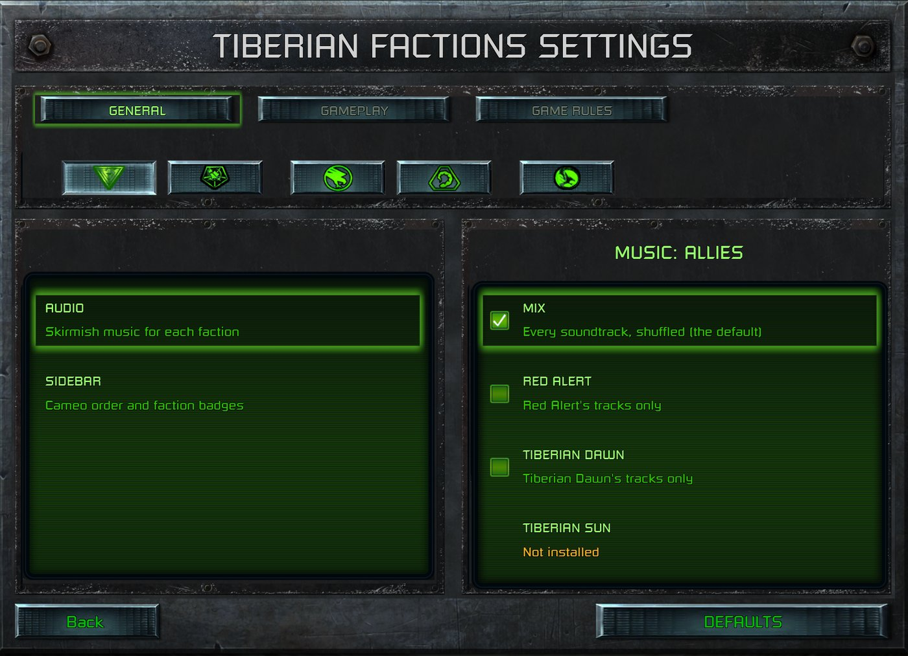

> [!NOTE]
> EA has not endorsed and does not support this product.

# Music by faction, and the jukebox

## When you need this

When each faction should hear its own music in skirmish: Red Alert's tracks for the Allies and Tiberian Dawn's
for GDI, say. Or when your mod adds tracks to the jukebox, especially tracks that are only sometimes installed.
Changing the skirmish playlist for everyone is data alone, and doesn't need the patch on this page.

> [!WARNING]
> **Fragile: the faction part patches the launcher's code.** Read
> [Patching the launcher's code from your DLL](../clientg-ram/patching-the-launchers-code.md) first. Its rules
> apply here.
>
> - **Verified against:** `ClientG.exe` version 1.153 (745903), SHA-256
>   `d405ed389548be51c67740bb6309de10a5f02bdfc86324a10c9ad3b663c08897` (Steam build 21590013).
> - **What it depends on:** two call sites and their targets, and two data addresses (the lobby's faction pick and
>   the jukebox's track list), all in this one build.
> - **How it fails if the client changes:** each call site is checked for its stock target before it's
>   redirected. On any other client nothing is installed, and every faction hears the stock skirmish music.

**Holds for:** the client in the box above. EA has stopped patching the game and archived the source in January
2025, so the build should stay put, but check the hash before trusting any address.

## How the launcher picks skirmish music

- **Music events are data.** `Data/XML/AUDIO/MUSICEVENTS.XML` (in `CONFIG.MEG`) defines each event as a playlist
  of WAV files. A skirmish instance names its music `MUS_RA_MULTIPLAYER_MODE` in `INSTANCES.XML`, and the
  launcher adds the player's audio-setting prefix (`RAR_`, `RAC_` or `RAB_`, for Remastered, Classic or Bonus)
  before looking it up. All three events exist in the stock file.
- **Changing the playlist for everyone is data.** Ship a loose `MUSICEVENTS.XML` with your tracks in those events
  (see [Overriding the launcher's data](../launcher-data/overriding-launcher-data.md)).
- **Nothing in the data picks by faction.** `AUDIO_FACTIONS.XML` has a `<MusicMap>` per faction, but EA's own
  comment there says they're "not using these for C&C TD / RA", and they stay empty.
- **The DLL can't play music.** Its theme player is compiled against a null sound backend in the remaster build,
  and EA's DLL has its theme queueing commented out.

## The patch: redirect one lookup

The launcher looks up the skirmish music event through its music manager's find function, at match start and
again whenever a track ends and the gap has run out. Redirect that one call:

1. At ClientG's start-up load of your DLL, check the call site still calls the stock find, then point it at your
   function (see the code-patch page).
2. In your function, when the event is a skirmish one, read the local player's lobby pick and ask for that
   faction's event instead, such as `RAR_MYMOD_MUS_TD`, defined in your `MUSICEVENTS.XML`.
3. If that event doesn't exist, call the stock find with the original name. Your mod then never plays silence.

Each player's launcher runs its own lookup, so in a LAN game each player hears their own faction's music.

### Addresses in this client

| What | Address | Stock target |
|---|---|---|
| The skirmish music lookup (call site) | `0x169D018` | `call 0xE92A90`, the music manager's find |
| The jukebox manager's setup (call site) | `0x15CF40E` | `call 0xEA3530` |
| The lobby faction pick | `0x20E0CF8` | the picker row plus 2 |
| The jukebox track list, begin and end | `0x2038734`, `0x2038738` | a vector of 0x5C-byte entries |

Both call sites were read from `ClientG.exe` on disk and match.

## The jukebox

The jukebox list is data: `<MusicJukeboxTracksList>` in `AUDIO_SYSTEM_CONSTANTS.XML`. Each entry gives a
`<FileName>`, a `<TextID>` for its title, a `<TrackType>` (such as `Remaster`) and a `<Game>`. Add your tracks
there in a loose copy of the file, with their titles in your mod's text.

**Removing an entry has to happen before the jukebox manager's setup.** The launcher parses the list into a
vector, then the jukebox manager builds its own records from it, and its screen refuses to build unless the two
are the same length. So for tracks that are only sometimes installed, redirect the call to the manager's setup:
drop the missing tracks' entries from the parsed vector, then call the stock setup. Removing records afterwards
breaks the screen.

## Traps

- **One copy of each list wins.** When two enabled mods ship `MUSICEVENTS.XML` or `AUDIO_SYSTEM_CONSTANTS.XML`,
  only one copy is read, so an add-on can't carry its own lists beside its parent mod's. The parent owns the lists,
  and the add-on ships only its WAVs.
- **`RandomizePlayList` shuffles the first track too.** The stock skirmish events set it `True`, so a fixed opening
  track followed by a shuffled rest isn't possible. (Observed.)
- **The jukebox filters by `<Game>` and `<TrackType>`.** An entry shows when those match the player's filter
  checkboxes, not their audio setting. An unknown `<Game>` value is never shown. (Observed.)
- **A playing jukebox playlist overrides the skirmish music**, faction choice included. (Observed.)

## How it was verified

- **The data:** the stock `MUSICEVENTS.XML` (the three prefixed skirmish events, and `RandomizePlayList` on them),
  `INSTANCES.XML` (the event name, with EA's comment that the prefixes are added in code), `AUDIO_FACTIONS.XML`
  (the unused maps and EA's comment) and `AUDIO_SYSTEM_CONSTANTS.XML` (the jukebox entry fields), all from
  `CONFIG.MEG`.
- **The DLL can't play music:** the remaster build compiles `soundio_null.cpp`, and EA's `DLLInterface.cpp` has its
  theme queueing commented out.
- **The patch:** both call sites and their stock targets read from `ClientG.exe` on disk. In a shipped mod,
  each faction's choice plays in skirmish, including in LAN. The jukebox lists optional tracks only while they're
  installed. Tested under Proton on Linux and on the Steam Deck.
- **Two sources only:** the lobby pick and track-list addresses (TF's notes and code). They're data, not code, so
  there are no stock bytes to check, though both fall inside ClientG's `.data` section (`0x1F45000` to
  `0x21101A8`). The observed traps also rest on two.

> [!TIP]
> **In Tiberian Factions**
>
> Each TF faction plays its own choice of Mix, Red Alert, Tiberian Dawn or Tiberian Sun, set on TF's own settings
> page and saved to a small INI file that the hook reads at every track. Tiberian Sun's tracks are built from the
> player's own copy (see [Content built from the player's own games](../using-what-the-player-owns/content-from-the-players-own-games.md)),
> so the hook falls back to the Mix rotation, and the jukebox hides them, whenever they're missing.
>
> 
>
> TF's settings page: music chosen per faction. Tiberian Sun's music reads "Not installed" until the player builds it from their own copy.
