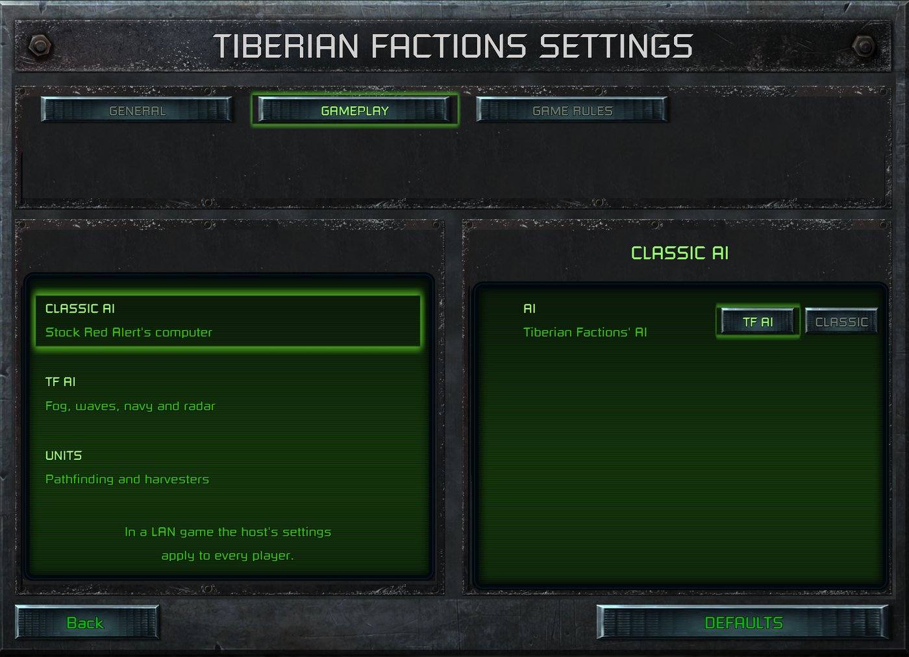

> [!NOTE]
> EA has not endorsed and does not support this product.

# A player settings page

**Holds for:** C&C Remastered Collection, Steam build 21590013. EA has stopped patching the game and archived the
source in January 2025, so this should hold.

## When you need this

When your mod changes how Red Alert *plays* (pathfinding, the AI, controls, the sidebar), and some players will
want the old behaviour back. A switch per change lets them keep the rest of your mod. A mod that only adds content
or changes balance doesn't need one.

## The rule: off means exactly vanilla

A switch is only honest if turning it off gives Red Alert's own behaviour, not a near copy. So:

- **Keep vanilla's code path intact behind each switch.** Branch where your change begins, and let the off branch
  run EA's original code unchanged.
- **When your change replaced a system outright,** such as an AI's build order, a pile of per-feature switches
  can't get back to vanilla. Keep a copy of vanilla's function as a "classic" mode instead, changed only as far
  as your new content needs: for example, mapping Red Alert's buildings to a new faction's own.
- **Not everything is a switch.** Bug fixes stay on, as balance does. So does content: new factions, their
  sounds, their EVA. A switch is for a change in behaviour a player might reasonably prefer without.
- **On by default.** A player who never opens the page plays the mod as you ship it.

## The settings file

Keep the settings in a small INI file in the player's `Documents/CnCRemastered/` folder, beside the game's own
files, not in the mod folder. A Workshop update replaces the mod folder, but never touches `Documents`.

- **Store only what the player changed.** A missing key means on. Read each key with `GetPrivateProfileIntA`,
  with 1 as its default.
- **Read the file once, when a match starts.** Pathfinding, the AI and the sidebar export run every tick, and
  must never touch the disk. Load every switch into memory at match start and have each site ask that.
- **A change applies from the next match.** Say so on the page.
- **Switches change behaviour, not saved state.** Then a loaded save simply runs under the switches as they are
  now, and saves never need to carry them.

## In LAN games: whose settings?

Only the host runs the simulation (see [LAN games](../engine/lan-games.md)), so only the host's DLL reads a
settings file during a match.

- **Simulation switches** (the AI, units, controls) follow the host's file for every player. Say so on the page,
  and tell the players at match start.
- **A per-player switch** that only changes what one player sees, such as their own sidebar's order, has to travel
  from that player's launcher to the host. The launcher's [mod hotkey commands](../launcher-data/mod-hotkey-commands.md)
  are a channel that reaches the host's DLL. A command sent by code with a marker value can carry a few bits.
- **What the launcher does on each machine** (its art, its music) stays each player's own, set by that player's
  own launcher patches.

## How it was verified

- **The design and the file:** a shipped mod's settings page (released in its 5.7.0), its settings code
  (`GetPrivateProfileIntA` with a default of 1, keys written only when switched off, read once when a match
  starts), and its documentation.
- **LAN:** a LAN game with a Steam Deck joining a PC host, set differently. Each player saw their own sidebar,
  and the host's simulation switches applied to both.
- **"Classic" mode:** played against a Soviet, a Nod and a TS GDI computer house with the mod's classic AI. Each
  built vanilla's order, using its own faction's buildings.

> [!TIP]
> **In Tiberian Factions**
>
> TF's settings page has GENERAL and GAMEPLAY pages. GENERAL holds music per faction and the sidebar's sorting and
> badges. GAMEPLAY holds a CLASSIC AI master switch, the TF AI's fair fog, attack waves, naval and radar, and the
> units' A* pathfinding, give way and smart harvesters. TF's A* is adapted from CFE Patch Redux. Switched off,
> units use stock Red Alert's own pathfinder. Each per-player sidebar choice reaches the host as a mod
> command when a LAN match starts. The page itself is a new front-end screen.
>
> 
>
> The TIBERIAN FACTIONS SETTINGS page, GAMEPLAY tab: each switch's off state is stock Red Alert.
