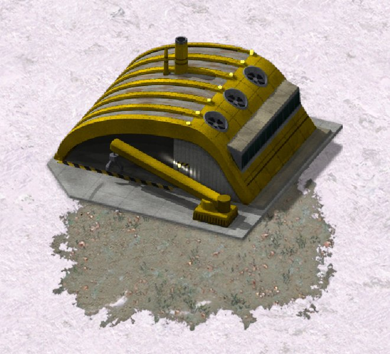

> [!NOTE]
> EA has not endorsed and does not support this product.

# Tiberian Dawn art from the base game

**Holds for:** C&C Remastered Collection, Steam build 21590013. EA has stopped patching the game and archived the
source in January 2025, so this should hold.

**HD mode only.** This page describes the HD renderer. See [HD-only mods](../getting-started/hd-only-mods.md).

## When you need this

When a Red Alert mod uses Tiberian Dawn units, buildings or effects with their art unchanged. Shipping copies of
that art works, but a full set of TD units and buildings adds well over 100 MB to the download. Reading it from the base game ships nothing. A mod
that uses no TD art, or only TD art it has repainted, has no use for this page: repainted art still has to ship.

## The idea

A Red Alert mod can draw Tiberian Dawn's HD unit, building and effect art without shipping any of it. Every player
already owns that art in the base game's `Data/TEXTURES_TD_SRGB.MEG`. The trick is a tileset entry that makes the
launcher open the base game's ZIP for you.

## How the launcher finds a tile's art

- `Data/MEGAFILES.XML` mounts every texture MEG at start-up, `TEXTURES_TD_SRGB.MEG` included, whichever game is
  being played. The files are reachable from Red Alert.
- TD's *tilesets* are not. With Red Alert running, the launcher builds its tile maps from a fixed list: `RA_Units`,
  `RA_Structures`, `RA_VFX`, `RA_RadarMap`, `RA_Terrain_Shroud`, `Common_VFX`, `Common_UI` and `Common_Misc`.
  `TD_Units` and the other TD tilesets never load in Red Alert.
- An object's tile is looked up by name in every world tileset, so the tileset it lives in doesn't matter. A unit's
  tiles placed in `RA_Structures` draw normally.
- A tile opens `<RootTexturePath>\<tile name>.zip`. A tile name may contain a path (`SUB\TDAPC` opens
  `UNITS\SUB\TDAPC.ZIP`), and a frame named `<folder>\<file>.tga` reads from the ZIP that was opened as `<folder>`.

## The mechanism: an opener tile

Give one world tileset, such as `RA_VFX`, an empty `RootTexturePath`. Its tile names are then resolved from the
texture root, which holds both games' trees. Then add two kinds of tile:

```xml
<TilesetTypeClass name="RA_VFX">
    <RootTexturePath></RootTexturePath>
    <Tiles>
        <!-- Opener: its name makes the launcher open the base game's MTNK.ZIP. Never drawn. -->
        <Tile><Key><Name>Tiberian_Dawn\Units\MTNK</Name><Shape>0</Shape></Key>
              <Value><Frames><Frame>Tiberian_Dawn\Units\mtnk\mtnk-0000.tga</Frame></Frames></Value></Tile>
        <!-- The tile your DLL asks for, reading frames out of the opened ZIP. -->
        <Tile><Key><Name>TDMTNK</Name><Shape>0</Shape></Key>
              <Value><Frames><Frame>Tiberian_Dawn\Units\mtnk\mtnk-0000.tga</Frame></Frames></Value></Tile>
        ...
```

- **The opener** names the base game's ZIP by its path under the texture root. Its only job is to get that ZIP
  opened. Nothing asks for it by name, so it is never drawn.
- **The real tile** keeps the name your DLL exports (`TDMTNK` here). Its frames point into the opened ZIP using the
  base game's own frame names (`mtnk-0000.tga`), not whatever name your copy used.
- **The tileset's existing art moves with it.** Emptying the root breaks every frame the tileset already had. Prefix
  each one with the old root (`Red_Alert\VFX\120mm\...`), and add an opener for each ZIP folder it names
  (`Red_Alert\VFX\120MM`). A loose frame folder, with no ZIP, needs no opener.
- House colours, shading and turrets draw exactly as they would from a copy of the ZIP in your mod.

The tileset file itself ships in the mod as `Data/XML/TILESETS/RA_VFX.XML`. It has to be the whole tileset in the
full `<Tilesets><TilesetTypeClass>` envelope, a patched copy of the one in `CONFIG.MEG`. A file holding only the
added `<Tiles>` is not loaded.

## Traps

- **Paths are never normalised.** A frame or tile name containing `..\` finds nothing. Name the file from the
  texture root instead.
- **Not every tileset is a world tileset.** `Common_UI` and `RA_RadarMap` are drawn differently: a unit tile placed in
  either draws as a white square, whatever ZIP it reads.
- **Terrain tilesets don't use openers.** A terrain tileset never opens a ZIP through an opener tile, so a mod's own
  terrain art stays a ZIP under its usual root.
- **Match frames exactly.** A tile can only come from the base game if every frame it uses is in a base ZIP. Before
  pointing a tile at the base game, compare each frame (and its `.meta`) by size and CRC with the base ZIP's.
  Anything you repainted still has to ship.

## How it was verified

Every TD unit, building and effect tile whose frames match the base game byte for byte was moved to openers in a
shipped mod, and its copies were deleted from the mod. Medium Tank and MCV house colours and turrets, construction
yard and power plant build-ups, and missile effects were checked by eye under Proton on Linux and on the Steam
Deck, in skirmish and over LAN. Red Alert's own effects in the re-rooted tileset still drew.

**Not measured yet:** whether load time or memory changes when art is read this way instead of shipped.

**Credit:** DontCryJustDie's [TD-Assets](https://steamcommunity.com/sharedfiles/filedetails/?id=3003163891) first
showed TD's HD art drawing in Red Alert, from `TD`-prefixed copies. This page reads the same art from the base game
instead.

> [!TIP]
> **In Tiberian Factions**
>
> TF's GDI and Nod draw TD's own art. A build step compares every TD frame the mod would ship with
> `TEXTURES_TD_SRGB.MEG`, and moves every tile that matches into `RA_VFX` as openers. That removed 78 ZIPs (126 MB)
> from the download. Art TF repainted, such as the flame effects and the cameos with their owner badge, still
> ships.
>
> 
>
> GDI's construction yard in a Red Alert match, drawn from the base game's own TD art.
